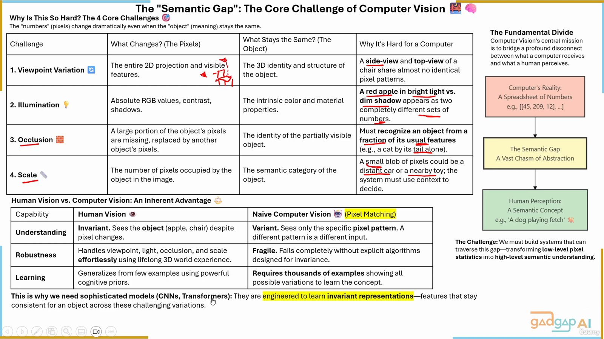

# 第 1 章 计算机视觉：语义鸿沟、技术演进与通用流程

计算机视觉研究的是如何由图像或视频获得可用的语义：场景中有哪些对象、对象位于何处、各像素属于什么类别，以及能否据此生成新的视觉内容。机器接收的并不是人类眼中的“画面”，而是按空间位置排列的数值。理解这些数值如何被转换为边缘、形状、对象和场景，是贯穿本书的主线。本章从语义鸿沟出发，梳理手工特征、深度学习与生成式视觉三种范式，并用经典分类实验串起数据、特征、模型和评估组成的通用流程。

## 像数值表示与语义鸿沟

数字图像被离散为像素。以常见的 8 位灰度图为例，每个像素有 $2^8=256$ 种取值，范围为 $0\sim255$：0 表示黑，255 表示白，中间值表示不同灰度。彩色图像则用多个通道表示，例如 RGB 图像的每个像素包含红、绿、蓝三个数。无论后续算法多么复杂，其输入本质上都是具有高度、宽度和通道维度的数值数组。

视觉处理通常包含三个抽象层次。低层处理寻找边缘、角点和斑块；中层处理将局部结构组织为形状及特征描述；高层处理进一步识别对象、场景和活动，并输出类别、边界框、分割掩码、三维重建结果或生成图像。因此，“看见”并非直接读取某个像素，而是建立从局部统计到整体语义的映射。

这一映射难以构造，核心原因在于**语义鸿沟**：相同的语义可以对应截然不同的像素组合，而相似的像素组合也未必具有相同语义。课程归纳了四类典型变化。

| 变化 | 像素层面的表现 | 对模型的要求 |
|---|---|---|
| 视点变化 | 同一物体从侧面、正面或俯视观察，空间结构不同 | 学习不完全依赖单一视角的表示 |
| 光照变化 | 阴影、强光会改变亮度和颜色数值 | 区分固有属性与照明影响 |
| 遮挡 | 只能观察到对象的一部分 | 利用不完整证据及上下文推断整体 |
| 尺度变化 | 远处真车与近处玩具车都可能只占很小的像素区域 | 结合尺度、形状和场景信息判别 |

人类能够借助三维世界经验，以少量示例形成较稳健的概念；机器则通常需要大量样本与计算，才能学习对这些变化不敏感的特征。卷积神经网络、Transformer 等模型的重要意义，正在于以分层表示逐步跨越这一鸿沟。

{ .diagram }

图 1-1：计算机视觉的语义鸿沟及主要输入变化。课程第 5 课时抽帧。

## 视觉任务与通用处理链路

一个视觉系统可概括为“输入—处理—输出”：传感器获取现实场景，图像形成具有高度、宽度和通道的像素网格，算法从中提取模式，最后给出面向任务的结果。分类为整幅图像赋予类别；检测同时确定对象类别和位置；分割在像素层面划分对象或语义区域；生成模型则合成新的图像或视频。

这一抽象链路适用于不同技术路线，也适用于多种行业。医学影像可通过检测和分割辅助发现异常；自动驾驶需要检测、分割和深度估计共同描述道路环境；工业系统可检查裂纹、装配错误和污染；零售场景可进行货架监测与无收银结算；安防系统可完成异常检测、人脸识别和活体检测。任务不同，输出和评估标准也随之不同，不能仅以“图像看起来清晰”判断系统是否有效。

在需要学习的任务中，可将完整流程进一步展开为：

1. 明确类别、位置、掩码或生成内容等目标，并准备对应数据。
2. 进行必要的清洗、尺寸统一和颜色空间处理。
3. 获取表示：手工方法显式计算描述子，深度方法由网络学习特征。
4. 用训练数据拟合分类器或网络，在独立测试数据上预测。
5. 用准确率等任务指标评估，而不是只检查训练集表现。

## 手工特征：从边缘到描述子

早期视觉系统依赖专家把视觉知识写成固定规则。程序在图像各位置计算预定义响应，再组合这些响应并交给分类器。其主要结构是“低层边缘检测—中层特征描述—高层分类”。

### Sobel 与 Canny 边缘检测

Sobel 算子衡量灰度在水平、垂直方向的变化。两个 $3\times3$ 卷积核分别得到梯度 $G_x$ 和 $G_y$，常用梯度幅值为

$$
G=\sqrt{G_x^2+G_y^2}.
$$

亮度变化剧烈的位置形成较大的响应，因此边缘在暗背景上表现为亮脊。卷积核在图像上逐位置滑动并计算局部乘积和，这一操作后来也成为卷积神经网络的基础。

Canny 是多阶段边缘检测方法：先用高斯平滑抑制噪声，再计算梯度，随后沿梯度方向执行非极大值抑制（NMS），保留局部最强响应以细化边缘，最后经阈值处理得到较清晰的二值边缘。Sobel 往往保留较粗、较多的响应，Canny 则着重得到单像素化的清晰轮廓。这里的 NMS 是沿梯度方向筛选局部极大值，不应误解为简单制造模糊或对整幅图只保留一个值。

OpenCV 实验可用 `cv2.rectangle`、`cv2.circle` 构造合成图，用 `cv2.Sobel` 分别求两方向梯度并合成幅值，同时调用 `cv2.Canny`，最后比较原图、Sobel、Canny 及两者差异。差异图用于观察 Sobel 中额外保留的边缘响应，而不是证明一种方法在所有图像上都优于另一种。

### HOG 与 SIFT 特征描述

| 方法 | 表示方式 | 主要特点与用途 |
|---|---|---|
| HOG，方向梯度直方图 | 统计局部梯度方向和幅值，划分方向区间并进行归一化 | 描述局部边缘结构，可用于行人、车辆、手势和字符识别，常接 SVM |
| SIFT，尺度不变特征变换 | 检测稳定关键点，并在关键点邻域构造描述子 | 强调尺度、旋转不变性，对视角和光照变化更具稳健性，可用于匹配、拼接、三维重建和 SLAM |

HOG 关注梯度方向的空间分布：圆周边缘的方向连续变化，矩形则集中于少数主方向。这里使用的是**灰度梯度**的方向，而非把边缘切线直接当作梯度。SIFT 则把匹配建立在关键点上，使同一对象在不同拍摄条件下仍能建立局部对应。综合练习还引入 Prewitt、Laplacian 和 ORB 作为扩展算子，用于比较其他边缘与局部特征表示。

## 描述子上的分类：SVM 与 KNN

手工特征本身不直接给出语义类别，还需要分类器完成最后一步。支持向量机（SVM）寻找区分类别的超平面，并尽量扩大类别间隔。靠近边界、决定间隔的位置称为支持向量；新样本依据其位于超平面哪一侧被分类。线性核适合线性边界，RBF 核可表达非线性关系。若 45 个测试样本中 42 个分类正确，则准确率为 $42/45\approx93.3\%$。

K 近邻（KNN）不显式学习分隔超平面，而是比较测试样本与训练样本的特征距离。常用欧氏距离为

$$
d(\mathbf f,\mathbf g)=\sqrt{\sum_i(f_i-g_i)^2}.
$$

选取最近的 $K$ 个样本，以多数类别作为预测。例如 $K=3$ 时，最近邻中两个属于猫、一个属于狗，测试样本便判为猫。$K$ 控制参与投票的邻域大小，而不是聚类数量；KNN 也不应仅因使用邻域就称为聚类算法。

课程的合成数据实验把上述环节连成完整闭环：每类生成 50 个圆、正方形和三角形，共 150 幅图像；`np.random.seed(42)` 固定随机数据以便复现；逐图提取 HOG 向量，每个向量含 1764 个特征；按 70%/30% 划分训练集和测试集，因此测试样本为 45 个；分别训练 SVM 与 $K=5$ 的 KNN，再输出预测与准确率。该简单实验中两者均达到 100%，这一结果只反映类别边界清晰的合成任务，不能外推到猫狗等复杂对象。扩展练习又加入十字形和星形，并比较线性/RBF SVM、$K=3$ 与 $K=7$ 的 KNN，以及 25% 的测试集划分。其实验环境由 NumPy、OpenCV、Matplotlib 和 scikit-learn 构成；可选的大语言模型 API 用于生成文字解释，不替代视觉特征计算与分类器。

## 从学习特征到生成视觉

深度学习带来的根本变化，是把“专家规定看什么”转为“模型从数据中学什么”。网络利用大量带标注图像学习层级参数，低层到高层的表示不再逐项人工设计，并能随数据与目标调整。

| 维度 | 手工特征范式 | 深度学习范式 |
|---|---|---|
| 特征来源 | 人设计 Sobel、HOG、SIFT 等规则 | 网络从数据学习层级特征 |
| 决策方式 | 描述子外接 SVM、KNN 等分类器 | 特征与预测在网络中联合优化 |
| 数据与适应 | 规则换场景后常需重新设计 | 依赖大规模数据，可通过训练适应新分布 |
| 主要局限 | 对视角、光照、尺度和遮挡较敏感 | 数据、计算和训练成本较高 |

判别式模型回答“图中是什么、在哪里”，输出标签或边界框；生成式模型则学习数据分布，回答“某个新概念可能长什么样”。GAN、扩散模型等可以依据图像或文本提示合成现实中未曾存在的画面，例如生成穿宇航服的猫。其目标由描述已有世界扩展到创造新的视觉内容，但两者仍共享数值表示、数据建模和任务评估这些基础。

因此，无论采用手工规则、卷积网络、视觉 Transformer 还是生成模型，都应先明确输入、处理和输出，再决定表示方法与评估方式。技术演进改变的是特征获得方式及可完成任务的范围，而不是视觉系统必须连接像素与语义这一根本要求。

## 本章小结

- 计算机视觉的核心是把像素统计转换为类别、位置、掩码及场景理解，视点、光照、遮挡和尺度变化构成语义鸿沟的主要来源。
- 手工视觉链路以 Sobel/Canny 提取边缘，以 HOG/SIFT 组织描述，再由 SVM 或 KNN 完成分类。
- 可复现实验必须区分训练与测试数据，并用任务指标评估；简单合成数据上的高准确率不代表复杂场景中的泛化能力。
- 深度学习从数据中学习层级特征，生成式视觉进一步学习数据分布并合成新内容；不同范式仍遵循输入、处理、输出与评估的共同框架。
<!-- course-lectures: 1-21 -->

<!-- ebook-navigation -->

---

[返回完整目录](../index.md) · [下一章 →](ch02.md)
