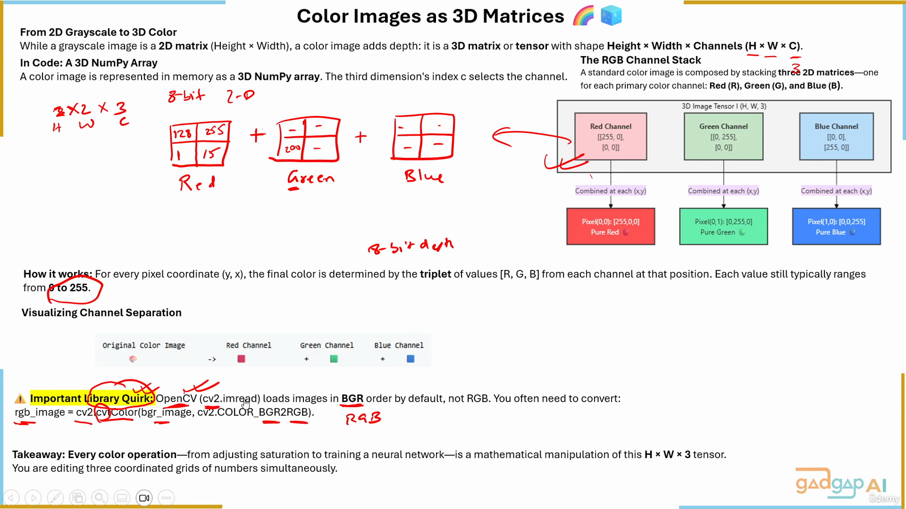

# 第 2 章 数字图像：像素、矩阵、色彩空间与位深

视觉模型的输入质量首先取决于对数字图像的正确理解。图像既是可以观察的画面，也是具有确定形状、坐标顺序、数据类型和取值范围的数组。像素决定空间采样，通道组织颜色或其他特征，位深约束每个采样值的表达能力；三者共同影响内存、速度和后续算法。本章建立这套数组视角，并通过 OpenCV 的读写、色彩转换与颜色掩码操作，把图像表示落实到可执行的预处理步骤。

## 像素、通道与矩阵结构

一幅数字图像通常写为

$$
H\times W\times C,
$$

其中 $H$ 是高度，$W$ 是宽度，$C$ 是通道数。空间像素总数为 $H\times W$。例如宽 1920、高 1080 的图像包含 $1920\times1080=2\,073\,600$ 个像素，约 207 万像素。数组形状的书写顺序是高度在前、宽度在后，不能按日常“宽乘高”的说法颠倒。

灰度图只有一个强度通道，可写成 $H\times W\times1$，通常省略最后的 1，因而表现为二维矩阵。8 位灰度图中，0 为黑、255 为白、128 位于强度中点。RGB 彩色图需要三个同尺寸矩阵，分别保存红、绿、蓝分量，因此是 $H\times W\times3$ 的三维数组。通道本质上是矩阵的组织维度，并不永远等于颜色数；后续卷积网络可以把中间特征扩展到几十个甚至更多通道。

{ .diagram }
<p class="figure-caption">图 2-1：彩色图像的三维矩阵与 RGB 通道。课程第 26 课时抽帧。</p>

### 图像坐标与数组索引

计算机视觉通常以图像左上角为原点，$x$ 向右增大，$y$ 向下增大，与数学中纵轴向上的坐标系不同。NumPy 索引又按“行、列”排列，所以访问位置时常写成 `image[y, x]`：第一个索引选择行，第二个索引选择列。

若高度为 $H$、宽度为 $W$，零基索引的有效范围是

$$
0\le y\le H-1,\qquad 0\le x\le W-1.
$$

因此宽高为 1920×1080 的图像，最大横、纵索引分别是 1919 和 1079，而不是 1920 和 1080。在一个 3×3 网格中，索引 `(2, 1)` 表示第三行第二列。数组索引采用 `(y, x)`，而部分绘图或几何 API 使用点坐标 `(x, y)`，混用两者是图像处理中常见的错位来源。

课程的数组实验用 `np.random.randint` 分别构造 100×100 灰度图和 100×100×3 彩色图，整数采样上界设为 256，因此实际值落在 0～255。随后通过 `.shape` 检查形状，并读取局部像素和各通道值。彩色数组在 OpenCV 语境下若某点依次为 `[54, 88, 155]`，则按 BGR 顺序应解释为蓝 54、绿 88、红 155，而不能直接把首值当红色。

## 色彩空间的选择

色彩空间规定通道数值的含义。RGB、HSV 和灰度并不是三种互斥的“图片质量”，而是面向显示、颜色规则与计算效率的不同表示。

### RGB：加色表示及其限制

RGB 以红、绿、蓝三个分量的加色组合表达颜色，是显示器、手机和电视等设备的原生表示，也接近许多图像传感器的初始数据形式。其局限在于亮度与颜色耦合在三个通道中：同一红苹果在阳光下可能为 `(220, 50, 40)`，进入阴影后三个分量都会变化。若算法仅根据固定 RGB 数值识别对象，光照变化便会被误当成对象变化。

RGB 仍适合显示、存储和初始加载，不应因光照敏感就笼统地认为它不适合神经网络。真正需要判断的是任务是否依赖颜色、输入光照是否稳定，以及是否需要把颜色与亮度拆成更便于制定规则的通道。

### HSV：分离色调、饱和度与明度

HSV 将颜色描述分解为：

| 分量 | 含义 | OpenCV 8 位图像中的常见范围 |
|---|---|---|
| H，Hue | 色调，即在色环上的颜色类别 | 0～179 |
| S，Saturation | 饱和度，即颜色的纯度或鲜艳程度 | 0～255 |
| V，Value | 明度，即明暗程度 | 0～255 |

OpenCV 用 0～179 编码 8 位图像的 H，而不是直接使用 0～360 的角度。红色位于色环端点附近，因此常需两个区间共同覆盖，例如课程示例使用 H=0～10 与 H=160～180 两段阈值。HSV 的优势是把颜色类别与明度分通道表达：光照改变时，变化往往更集中于 V，基于 H、S 的颜色检测通常比直接阈值化 RGB 更方便。但 H、S 并非在所有阴影、低明度或高亮条件下都绝对不变，实际阈值仍需用目标场景验证。

课程示例为不同颜色设定 H 区间，再经 `cv2.inRange` 生成二值掩码：目标颜色区域为白，其余区域为黑。红色使用两个区间并合并掩码，练习中还演示了黄色 H=20～30、绿色 H=40～80、蓝色 H=100～130 的分割范围。这些数值只对应演示图像，不是所有相机和光照条件下的通用参数。RGB 与 HSV 都是三通道数组，转换色彩空间本身不会减少通道数。

### 灰度：用信息约简换取效率

灰度转换把三个颜色通道压缩为一个强度通道。常用加权关系为

$$
Y=0.299R+0.587G+0.114B,
$$

权重体现人眼对不同颜色分量的感知敏感性，而不是简单地对 R、G、B 求平均。例如 `(R,G,B)=(45,120,200)` 时，应按上式逐项加权得到灰度值。

在尺寸和位深相同的前提下，三通道变为一通道，原始数组元素数降为三分之一，减少约 $2/3$，即约 67%。相应地，存储、内存带宽和部分计算也会下降，这对实时系统尤其有价值。边缘、形状和纹理任务往往可以从灰度图开始；交通灯状态、果实成熟度等以颜色为关键证据的任务则应保留颜色。灰度化是不可逆的信息约简，不能把它当作所有任务的默认最优选择。

## 位深、数据类型与资源开销

位深表示每个通道采样值使用多少位。对 $b$ 位无符号整数，理论上有 $2^b$ 个离散级别，取值范围为 $0\sim2^b-1$。位深提高的是强度或颜色的量化精细程度，并不增加图像的空间像素数。

| 表示 | 课程涉及的取值方式 | 特点与适用情形 |
|---|---|---|
| 1 位 | 0 或 1 | 二值图 |
| 2 位、4 位 | 分别为 4、16 个级别 | 用于观察低位深量化与资源差异 |
| 8 位整数 | 0～255 | 常见于 JPEG、PNG 和一般视觉处理，紧凑且兼容性好 |
| 16 位整数 | 0～65535 | 保留更细微的强度变化，适合医学影像、RAW 摄影和后期编辑 |
| 32 位浮点示例 | 课程将强度归一化到 0.0～1.0 | 便于连续数值处理；该范围是示例约定，并非所有 32 位图像的固定范围 |

8 位量化级别有限，平滑渐变可能出现条带，微弱强度差异也可能被合并。16 位每通道级别更多，对细微病变、发丝状骨折等弱对比信息更有表达能力，也更耐受多次编辑；代价是同尺寸、同通道下原始数据量通常约为 8 位的两倍，处理与显示要求也更高。8 位 RGB 每通道有 256 级，三个通道的组合数为 $256^3$；16 位相应为 $65536^3$，但这并不表示实际图像一定包含所有颜色。

比较不同图像的数组内存时，应同时检查 `shape`、数据类型和每元素字节数，而不能只看宽和高。课程练习将 2、4、8、16、32 位表示并列比较，目的正是区分离散级别、NumPy 数据类型与视觉呈现，避免把“更精细”误解为“空间分辨率更高”。

连续数组的理论内存可写为 $M=H\times W\times C\times s$，其中 $s$ 是每个数组元素实际占用的字节数，$M$ 不包含容器元数据等额外开销。只有在 $H$、$W$、$s$ 均不变时，通道数由 3 降为 1，内存才严格降为三分之一。标称 2 位或 4 位量化也不等于 NumPy 会按 2 位或 4 位紧密存储，应以实际 `dtype` 和 `nbytes` 核对。JPEG、PNG 编码后的文件大小，则不同于图像解码为数组后的内存占用。

## OpenCV 图像处理基础

OpenCV 在 Python 中以 `cv2` 使用，默认按 **BGR** 顺序读取彩色图，而 Matplotlib 等工具通常按 RGB 解释数组。直接用 Matplotlib 显示 `imread` 的结果会使红蓝通道错位，因此显示前应转换。

```python
image = cv2.imread(path)
print(image.shape)

rgb = cv2.cvtColor(image, cv2.COLOR_BGR2RGB)
hsv = cv2.cvtColor(image, cv2.COLOR_BGR2HSV)
gray = cv2.cvtColor(image, cv2.COLOR_BGR2GRAY)
cv2.imwrite("gray.png", gray)
```

读取与显示还涉及一组明确分工的 API：`cv2.imshow` 打开窗口，`cv2.waitKey` 等待按键，`cv2.destroyAllWindows` 清理窗口；`cv2.imwrite` 按指定文件名和格式保存图像。加载后先检查 `.shape` 与数据类型，再转换到任务所需的色彩空间，可以减少后续显示和模型输入错误。

综合实验用矩形、圆形和文字构造图像，分别保存为 JPG、PNG 后重新读取；又构造互补变化的红绿渐变、固定蓝通道的彩色图，分解观察 H、S、V 和灰度结果。这样的合成实验把通道变化与视觉结果一一对应，比只观察最终彩色图更容易定位问题。实验还比较大尺寸下灰度与 RGB 的内存占用，结果与通道数关系一致：灰度数组约为三通道数组的三分之一。

这些数值处理流程可以附加大语言模型，用于依据图像元数据生成色彩空间比较或流程摘要，但这属于外围的文字分析能力。图像转换、掩码生成和内存统计仍由 NumPy 与 OpenCV 完成；清晰地区分工具计算与语言解释，是构建多模态视觉程序的基本原则。

## 本章小结

- 数字图像按 $H\times W\times C$ 组织；灰度通常是二维数组，RGB/HSV 是三通道数组，索引需注意 `(y,x)` 与几何点 `(x,y)` 的区别。
- RGB 适合设备显示和原始表示，HSV 便于按色调、饱和度和明度制定颜色规则，灰度则以减少约三分之二的通道数据换取效率。
- 位深决定每通道的量化能力；8 位紧凑通用，16 位保留更多细微强度信息，浮点表示还需明确数值范围。
- OpenCV 默认使用 BGR，跨库显示前通常应转为 RGB；读写、色彩转换和 HSV 掩码构成基础图像处理链路。
<!-- course-lectures: 22-36 -->

<!-- ebook-navigation -->

---

[← 上一章](ch01.md) · [返回完整目录](../index.md) · [下一章 →](ch03.md)
