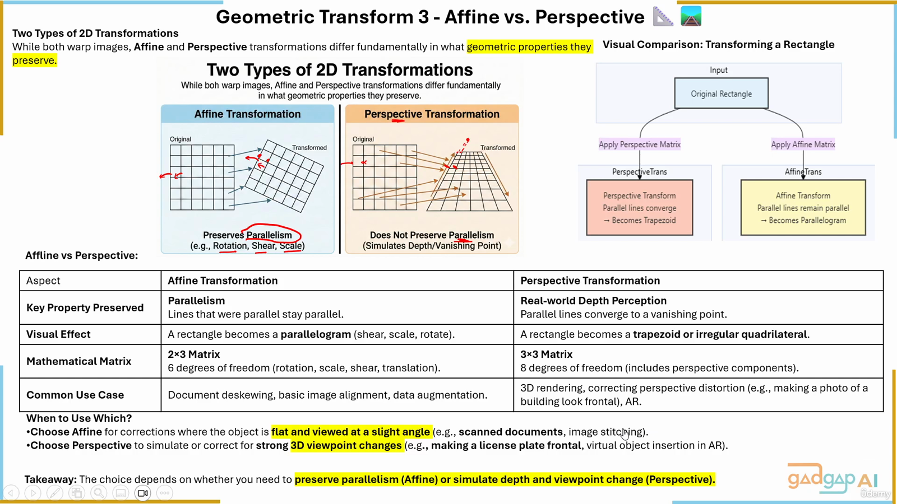

# 第 3 章 图像预处理：几何变换与光度调整

真实图像常带有噪声、曝光异常、尺寸不一、倾斜和无关背景，不能直接视为整齐一致的训练样本。预处理的任务，是在保留有效证据的前提下，把输入整理为适合模型的形式；数据增强则进一步通过受控变化扩充样本，使模型接触不同视角、位置和光照。本章围绕几何与光度两类变换展开：前者重排像素坐标，后者改写像素强度。二者与下一章的卷积滤波共同构成基础图像变换体系。

## 预处理目标与变换分类

一条基础预处理链路通常包括去噪、感兴趣区域（ROI）裁剪、尺寸调整和归一化。去噪抑制随机颗粒与采集伪影；ROI 裁剪保留车牌等任务相关区域，减少无关背景；缩放把不同来源的图像统一到模型要求的尺寸；归一化则规范强度范围。过暗、模糊或旋转的图像还需有针对性地进行光度或几何校正。

这些操作服务于两个相互关联但不完全相同的目标：一是提高数据一致性和有效性，二是通过数据增强增加训练样本的变化。只有正面犬图像的分类器可能难以识别背面视角，训练时对方向、位置、尺度等进行合理扩充，能够提供这种变化。增强并不是无约束地制造图片，变换后仍应保留类别语义，并与具体任务相容。

| 变换类别 | 主要改变 | 典型操作 |
|---|---|---|
| 几何变换 | 像素的位置及图像空间结构 | 平移、旋转、缩放、剪切、翻转、仿射与透视变换 |
| 光度变换 | 像素的亮度、对比度或颜色数值 | 亮度/对比度调整、Gamma 校正、直方图均衡化 |
| 滤波变换 | 由邻域计算得到的新像素值 | 模糊、锐化、去噪与边缘检测 |

实际流程可以组合多类操作，但顺序会改变结果。课程实验先在白色画布上绘制彩色矩形、圆和文字，再对同一输入分别施加变换，以便区分坐标变化、强度变化和邻域滤波的作用。

## 缩放、插值与基本几何操作

### 坐标移动与像素重采样

平移为所有坐标添加固定偏移：$x'=x+t_x$，$y'=y+t_y$。旋转改变方向，缩放改变宽和高，剪切使矩形倾斜为平行四边形，翻转则沿水平、垂直或两个方向反转像素排列。它们可用于文档校正、对象对齐、全景拼接和训练增强。

几何映射通常先给出新坐标，再由插值确定新位置的像素值。尤其是从 3×3 放大到 5×5 时，新网格并不恰好落在旧像素中心，不能仅复制原矩阵。插值就是依据原图中邻近的已知采样值估计未知位置。

| OpenCV 插值方法 | 邻域依据 | 选择原则 |
|---|---|---|
| `INTER_NEAREST` | 最近的原像素 | 速度最快；分类掩码和标签图应优先使用，避免制造不存在的类别值 |
| `INTER_LINEAR` | 邻近 4 个像素的线性插值 | 一般缩放中兼顾速度与质量 |
| `INTER_CUBIC` | 邻近 16 个像素的加权插值 | 计算更多，适合较重视质量的放大 |
| `INTER_AREA` | 源像素区域的贡献 | 更适合缩小图像 |

插值并非越复杂越好。掩码若使用线性或三次插值，可能产生中间灰度并破坏离散标签；高质量放大与实时缩小则应采用不同取舍。

### 旋转和平移的矩阵表示

绕原点旋转角度 $\theta$ 时，坐标关系为

$$
\begin{bmatrix}x'\\y'\end{bmatrix}
=
\begin{bmatrix}
\cos\theta&-\sin\theta\\
\sin\theta&\cos\theta
\end{bmatrix}
\begin{bmatrix}x\\y\end{bmatrix}.
$$

旋转中心会显著影响结果：绕左上角原点旋转与绕图像中心旋转并不等价。为把线性变换与平移合并，引入齐次坐标：

$$
\begin{bmatrix}x'\\y'\\1\end{bmatrix}
=
\begin{bmatrix}
m_{11}&m_{12}&t_x\\
m_{21}&m_{22}&t_y\\
0&0&1
\end{bmatrix}
\begin{bmatrix}x\\y\\1\end{bmatrix}.
$$

其中左上 2×2 子矩阵承载旋转、缩放或剪切，最后一列承载平移。旋转时四个系数由正弦和余弦构成；缩放时可取 $m_{11}=s_x$、$m_{22}=s_y$，其余线性系数为 0。齐次表示使多个操作能够组合，减少逐项执行的开销，但矩阵组合顺序仍不可随意交换。

OpenCV 中，`cv2.resize` 完成缩放，`cv2.getRotationMatrix2D` 按中心、角度和缩放因子构造旋转矩阵，`cv2.warpAffine` 执行仿射映射。平移则可用 NumPy 构造 $2\times3$ 矩阵后交给同一函数。课程示例将原图放大 1.5 倍，也把 400×600 的数组缩小为 200×300；随后绕中心旋转 30°、保持尺度因子为 1，并平移 $t_x=50$、$t_y=30$ 像素。旋转或平移后，输出画布没有源像素对应的区域会形成边界填充，必须同时考虑输出尺寸和边框，而不能只计算坐标。

### 组合操作与空间一致性

缩放的 $s_x$ 与 $s_y$ 可以不同，分别控制宽、高；二者不等时会改变长宽比。旋转与平移组合时，既要指定旋转中心，也要确认对象是否被输出边界截断。课程示例按先缩放、后旋转组织，这是一条清晰的演示顺序，而不是所有任务唯一可行的顺序；更换顺序后应重新计算矩阵和输出范围。

若图像附带边界框、关键点或掩码，空间标注必须与图像采用同一套坐标映射。只变换图像而保留旧标注，会造成对象与标签错位。几何校正也只能重排已有采样信息，不能补回被遮挡的对象内容，或凭插值恢复采集时不存在的细节。

## 仿射变换与透视变换

仿射和透视变换都能扭曲平面图像，区别在于保持哪些几何关系。仿射变换使用 2×3 矩阵，保持直线和原有平行关系；透视变换使用 3×3 矩阵，能够表达深度和视点变化，但不再保证平行线仍然平行。

| 对比项 | 仿射变换 | 透视变换 |
|---|---|---|
| 平行性 | 保持 | 可能消失，延长后可相交 |
| 矩形常见形态 | 平行四边形 | 梯形或一般四边形 |
| 矩阵 | 2×3 | 3×3 |
| 典型任务 | 旋转、缩放、剪切、文档去斜、图像对齐和增强 | 视角校正、平面正视化、三维视觉效果 |

课程用三对源点与目标点调用 `cv2.getAffineTransform` 求仿射矩阵，再以 `warpAffine` 作用于整幅图，观察矩形边线仍保持平行。扫描文档的轻微倾斜、旋转和缩放可用仿射方法校正；交通场景中的斜拍车牌若需恢复正视效果，则更适合透视变换。练习中的水平、垂直及双向翻转，以及透视结果，进一步说明几何校正不应只看图像尺寸，还要检查直线与平行关系是否按任务需要保留。

{ .diagram }

图 3-1：仿射变换与透视变换的几何差异。课程第 46 课时（06:19）抽帧。

## 光度调整：亮度、对比度与直方图

光度调整不移动像素位置，而是对原强度 $I$ 建立新映射。亮度与对比度可以统一写为

$$
I'=\alpha I+\beta.
$$

$\beta>0$ 提高整体亮度，$\beta<0$ 降低亮度；$\alpha>1$ 增大对比度，使亮暗差异扩大，$0<\alpha<1$ 则压缩差异，使画面更趋于灰平。曝光不足或过曝可首先调整 $\beta$，灰暗图像可增强对比度，强烈明暗反差导致细节损失时则可尝试降低对比度。OpenCV 示例用 `cv2.convertScaleAbs` 实现这种缩放与偏移：亮度演示加入 $\beta=50$，对比度演示令 $\beta=0$ 并调节 $\alpha$。Gamma 校正则使用指数形式的非线性映射调整强度，不等同于简单加法或乘法。

调整后的数值还必须符合输出数据类型。以 8 位图像为例，超过 0～255 的结果需要适当处理，否则可能丢失高光、暗部或出现不希望的数值环绕。`convertScaleAbs` 还包含绝对值与类型转换行为，适合课程中的显示变换，但若后续计算需要保留带符号的中间强度，就应明确区分数学公式与这一具体 API 的输出规则。

### 直方图均衡化

直方图统计各强度值的像素频数。若低对比度图像的绝大多数像素集中在 0～50 的窄区间，简单线性拉伸未必能充分利用局部分布。直方图均衡化依据原强度分布进行非线性重映射，使像素强度在 0～255 上分布得更充分，从而提升可见对比度。医学胸片中，这有助于显现原本挤在狭窄中间灰度区的纹理，但增强可见性不等于提高诊断结论的可靠性。

课程代码先以 `COLOR_BGR2GRAY` 转为灰度，再执行直方图均衡化。CLAHE 是“限制对比度自适应直方图均衡化”，强调局部区域处理并限制过度增强，可与全局均衡化比较；它并非只适用于彩色图像。综合练习还在 HSV 中提高饱和度，并比较 Lab、YCbCr 等颜色空间中的通道均衡化结果。无论选择哪种方法，都应围绕任务所需细节判断，而不是以画面更亮、更艳作为唯一标准。

## 本章小结

- 预处理通过去噪、ROI 裁剪、缩放和归一化统一输入，数据增强则利用合理变化扩充训练分布，两者都需服务于具体任务。
- 几何变换改写坐标并依赖插值重采样；最近邻适合标签掩码，线性适合一般用途，三次偏重放大质量，区域插值适合缩小。
- 齐次矩阵把旋转、缩放和平移纳入统一计算；仿射保持平行性，透视可表达视点与深度变化。
- 亮度和对比度遵循 $I'=\alpha I+\beta$，Gamma 与直方图方法采用非线性映射；CLAHE 提供局部、限制对比度的均衡化选择。
<!-- course-lectures: 37-51 -->

<!-- ebook-navigation -->

---

[← 上一章](ch02.md) · [返回完整目录](../index.md) · [下一章 →](ch04.md)
