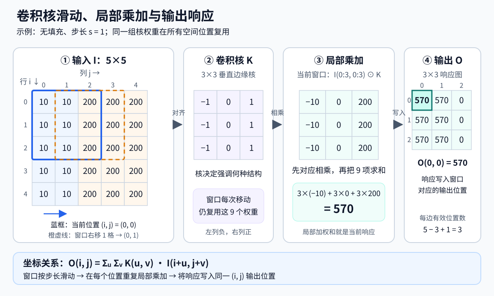

# 第 4 章 卷积滤波与人脸识别预处理

滤波通过邻域运算改变图像：模糊可抑制部分随机变化，锐化强调局部差异，梯度算子则把强度突变转换为边缘响应。这些操作共享同一个计算骨架——用小型卷积核在图像上滑动并求局部加权和。它既解释了许多经典图像处理算法，也连接了后续卷积神经网络中的可学习滤波器。本章先明确卷积计算和典型核的差异，再把去噪、光度校正、尺寸统一等步骤组织成人脸识别预处理及批处理流程。

## 卷积：局部加权求和

设图像为 $I$，卷积核为 $K$。对每个输出位置，取以该位置为中心的图像邻域，将邻域元素与核中对应权重逐项相乘，再把结果求和：

$$
O(i,j)=\sum_u\sum_v K(u,v)\,I(i+u,j+v).
$$

所得数值写回对应的输出位置，随后窗口按步长移动，直至覆盖预定区域。核的大小决定一次看到的邻域范围，核的数值决定强调何种局部结构。同一幅图使用不同核，可以保持不变、变得平滑、更加锐利或突出边缘；改变的不是像素坐标，而是像素与邻域共同计算出的强度。

以 3×3 垂直边缘检测核为例，左右列权重符号相反，中间列为零。计算时左上对左上、中心对中心，依次完成九组乘法后求和，响应放在窗口中心。均匀区域中的正负贡献容易抵消，而左右强度差异较大的区域会产生明显响应。这一过程与 Sobel 的两方向梯度计算一致，也解释了为什么边缘检测可以写成矩阵邻域运算。

{ .diagram }
<p class="figure-caption">图 4-1：卷积核滑动、局部乘加与输出响应。根据课程内容整理。</p>

窗口靠近图像边界时，部分邻域会落到原图之外，需要明确采用边界填充，还是只保留邻域完全有效的输出区域。核越大，受边界规则影响的区域越宽。比较不同滤波结果时，应同时核对输出形状和边界处理，避免把填充造成的响应误认为真实边缘。

卷积神经网络的突破不在于抛弃这一骨架，而在于不再完全由人指定核值。网络把核参数视为可学习变量，经前向传播得到预测，根据损失计算梯度，再通过反向传播更新参数。不同任务由此可以学到不同的局部特征提取器；经典滤波器则提供理解这些学习结果的直观起点。

## 典型卷积核与滤波操作

### 平滑、锐化与边缘核

| 核或操作 | 计算特点 | 主要作用 |
|---|---|---|
| 恒等核 | 保留中心像素，其他权重不产生贡献 | 输出与原图不变 |
| 均值核 | 邻域权重相同，并除以权重总数 | 用邻域平均实现平滑 |
| 高斯核 | 中心权重大，周围权重按高斯形态衰减 | 加权平滑与去噪 |
| 锐化核 | 强调中心与周围的局部差异 | 提高局部对比，使边缘更突出 |
| Sobel | 分别计算水平、垂直方向梯度 | 提取方向性边缘响应 |
| Laplacian | 利用二阶变化刻画局部突变 | 提取不局限于单一方向的边缘结构 |

两个明确的 3×3 平滑核为

$$
K_{\text{mean}}=\frac{1}{9}
\begin{bmatrix}
1&1&1\\1&1&1\\1&1&1
\end{bmatrix},
\qquad
K_{\text{Gaussian}}=\frac{1}{16}
\begin{bmatrix}
1&2&1\\2&4&2\\1&2&1
\end{bmatrix}.
$$

均值核对九个位置一视同仁，高斯核的中心及近邻权重更大，二者都通过归一化避免无意义地整体放大强度。高斯核原始权重之和为 16，因此除以 16，使归一化后的全部权重之和为 1。

课程实现先构造彩色样例，分别施加均值模糊、5×5 高斯模糊和锐化核；再用 `cv2.cvtColor` 从 BGR 转为灰度，调用 `cv2.Sobel` 与 `cv2.Laplacian` 观察边缘。这个结果对比的重点是邻域权重与任务的关系，而非笼统判断哪种输出“最好看”。平滑会削弱部分细粒度信息，锐化会强调局部差异，边缘核则把内容转成强度变化图。

扩展练习还比较了双边滤波、中值滤波、非局部均值去噪、Canny、反锐化掩模等方法。它们可作为去噪、边缘提取和清晰度调整的备选工具，但不应把所有方法无差别堆入流程。若已经通过滤波削弱噪声，后续还要锐化，就应检查两者是否相互抵消；若任务只需要位置明显的边缘，也不必保留全部颜色处理。

## 面向人脸识别的预处理链路

人脸识别的现实输入可能来自暗光监控，兼有噪声、尺寸变化和照明差异。课程给出的 YUV 链路把亮度与颜色分开，只在亮度通道上做直方图均衡化，再恢复为 OpenCV 后续步骤所需的 BGR 表示。

1. **读取图像**：使用 `cv2.imread` 从 JPEG、PNG 等文件加载，得到 BGR 数组，并先检查输入是否有效。
2. **统一尺寸**：按模型输入要求调用 `cv2.resize`。课程以 ResNet、VGG 等架构常见的 224×224 输入为例，而不是把这一尺寸视为所有人脸模型的固定标准。
3. **高斯去噪**：对缩放后的图像执行高斯模糊，抑制随机噪声；核参数应随图像与任务确定。
4. **转换到 YUV**：用 `cv2.cvtColor` 将 BGR 转为 YUV。Y 表示亮度，U、V 表示色度，使光度校正能够集中作用于 Y。
5. **均衡亮度通道**：分离 Y、U、V，仅对 Y 做直方图均衡化，再合并三个通道，避免直接独立均衡所有颜色分量。
6. **恢复输出格式**：将处理后的 YUV 转回 BGR，得到可继续用于人脸检测、识别或保存的图像。

整个逻辑可压缩为以下伪代码，具体目标尺寸与滤波参数由实际模型决定：

```text
bgr = imread(path)
resized = resize(bgr, model_input_size)
denoised = gaussian_denoise(resized)
yuv = BGR2YUV(denoised)
Y = histogram_equalize(Y_of(yuv))
yuv = merge(Y, U_of(yuv), V_of(yuv))
output = YUV2BGR(yuv)
```

这一链路是可选模板，而非固定标准。若只是定位人脸，灰度化通常能减少数据量并提高处理速度，复杂的颜色校正未必必要；若要在不同光照下确认身份，亮度和局部对比的一致性可能更重要，可考虑 Y 通道均衡或 CLAHE。人脸检测回答“哪里有人脸”，人脸识别进一步判断“这是谁”，两者对预处理的需求不能混为一谈。

练习中的另一种链路使用 Lab 色彩空间，对亮度相关通道实施 CLAHE，合并通道后进行双边去噪、锐化和强度归一化。这说明颜色空间与操作顺序应由输入质量和下游模型共同决定，不能仅凭某个通用配方替换验证。

## 函数化、批处理与条件化处理

手工逐图执行上述命令难以复现，也不适合批量训练数据。课程的函数化示例把流程组织为五步：输入检查并保留原图、缩放、高斯去噪、亮度与对比度调整、锐化，同时返回中间结果以便检查。封装的价值在于统一顺序、复用代码和定位异常，而不是保证每一步都必然提升图像质量。

批处理在函数外增加循环：收集图像，逐张调用同一预处理函数，保存或展示原图与处理结果，直到批次结束。它还便于并排检查中间阶段，及时发现去噪过度、亮度异常或边缘被削弱等问题。数据增强批处理则可从同一图像产生多个变体；课程练习包括旋转 15°、增加或降低亮度、提高饱和度、水平翻转、添加噪声和高斯模糊。这些变体用于扩充训练变化，不应与面向推理输入的标准化预处理混为同一目标。

课程还比较了单图手动执行与函数管线执行的计时。单图实验中，函数管线反而稍慢，合理解释是函数调用和流程组织带来额外开销；因此不能仅凭“管线”名称推断延迟更低。批处理的主要收益是可复用、一致和易维护，实际速度仍应通过目标规模下的测量判断。

固定流程之外，还可以按图像质量设置条件分支。练习先计算清晰度，再与目标阈值比较：低于阈值才执行锐化，达到要求则跳过。其余去噪、对比度增强等步骤仍可保留。由此，预处理从静态操作列表变为“测量—判断—执行”的可控流程，减少已经清晰的图像被重复锐化的风险。

### 可选的语言解释模块

课程练习还可选接入大语言模型，让它解释卷积、CLAHE 或预处理结果。系统提示用于设定“计算机视觉专家”等角色，用户提示提交具体分析请求；最大输出 token 数限制回答长度，温度调节生成的随机性。示例把 0.7 作为表达变化与稳定性的折中，接近 0 时输出更保守，升高后变化增多，但这并不等于事实准确性随之提高。

这一模块只负责文字解释，图像读取、滤波、质量测量和条件分支仍由视觉代码完成。没有可用的语言模型 API 时，可以移除该外围调用，而不改变核心图像处理流程。

## 本章小结

- 卷积滤波通过滑动窗口计算局部加权和，核尺寸决定邻域范围，核权重决定平滑、锐化或边缘响应。
- 均值与高斯核采用不同权重；Sobel、Laplacian 强调强度变化，CNN 则把同一局部计算骨架中的核参数变成可学习变量。
- 人脸识别示例依次完成读取、缩放、高斯去噪、YUV 转换、Y 通道均衡和 BGR 恢复，具体步骤应随检测或识别目标调整。
- 函数化与批处理提升一致性和可维护性，但不自动保证更低延迟；基于清晰度等质量指标的条件分支可避免不必要的处理。
<!-- course-lectures: 52-57 -->

<!-- ebook-navigation -->

---

[← 上一章](ch03.md) · [返回完整目录](../index.md) · [下一章 →](ch05.md)
