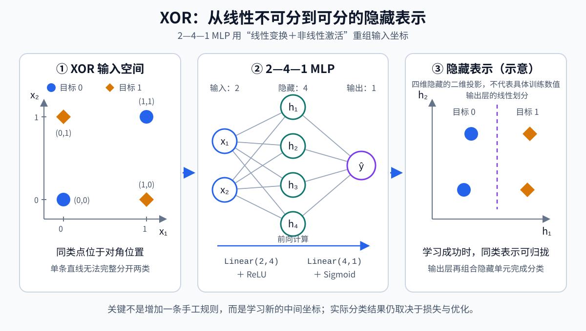

# 第 5 章 从感知机到深度神经网络

深度神经网络并不是神秘的整体，而是由大量结构相同、职责清晰的计算单元组合而成。每个神经元先完成加权求和，再经激活函数产生输出；多个神经元构成层，多层网络则把前一层表示转换为后一层输入。理解这一递推关系，就能从感知机自然过渡到多层感知机（MLP），也就能读懂全连接网络的参数规模、层级表示和 PyTorch 实现。本章先以 XOR 说明单层线性模型的边界，再建立前向计算的统一数学形式，最后用一个 2—4—1 网络把结构、参数量与代码对应起来。

## 从感知机到分层表示

1956 年达特茅斯会议提出“人工智能”这一术语时，研究焦点之一便是单神经元模型。感知机接收输入 \(x_1,\ldots,x_n\)，为每个输入配置权重 \(w_i\)，再加入偏置 \(b\)：

\[
z=\sum_{i=1}^{n}w_ix_i+b,\qquad a=f(z)
\]

其中，\(z\) 是仿射变换结果，\(f\) 是激活函数，\(a\) 是神经元输出。偏置使决策边界不必被迫穿过原点，权重和偏置共同构成需要学习的参数。

XOR（异或）揭示了单个线性神经元的表达能力边界。输入 \((0,0)\) 与 \((1,1)\) 的目标输出均为 0，\((0,1)\) 与 \((1,0)\) 的目标输出均为 1。在平面上，前两点位于一条对角线，后两点位于另一条对角线；无论画水平线、垂直线还是斜线，都无法把两类点完全分开。单神经元只能用一个超平面划分输入空间，因而不能单独表示这种线性不可分关系。解决思路不是逐条添加规则，而是让多个神经元先形成中间表示，再由后续神经元组合这些表示。

神经网络的发展还依赖算法与计算条件。反向传播使多层参数能够依据损失共同更新；ReLU 等激活函数、RMSProp 与 Adam 等优化方法改善了深层训练；2012 年 AlexNet 使用 GPU 训练 CNN，凸显了并行计算的价值。此后，RNN 的变体、生成对抗网络以及 2017 年提出的 Transformer 继续扩展了深度学习的任务范围。早期研究的两次降温也说明，乐观预期必须受能力边界约束。单神经元无法处理 XOR 暴露了模型表达能力的限制，反向传播与多层感知机随后提供了新的解决路径；到 20 世纪 80 年代后期，计算能力又成为训练更大模型的瓶颈。现代深度学习并非某一项发明的单独结果，而是表示方法、优化技术和硬件共同进步的结果。

历史脉络说明，网络结构、训练算法、数据和算力必须协同，单有“增加神经元”并不足以构成功能可用的学习系统。

## 深度、宽度与层次特征

把多个感知机按层连接，就得到多层感知机。输入层接收数据，隐藏层执行特征变换，输出层产生分类或回归结果。相邻两层若每个前一层的单元都连接到后一层的全部单元，该连接称为全连接层，也常记作 FC 或 `Linear`。

“宽度”指一层中的神经元数量，“深度”指隐藏层的层数。相同输入与输出条件下，可以把较多神经元放在一层，也可以把它们分配到多层。后者并非简单复制同一种变换，而是形成表示的递进：较浅隐藏层学习简单模式，中间层组合这些模式，更深层形成较复杂的特征，最终由输出层作出决策。

深度带来的关键优势是层次化组合和潜在的参数效率，而不是“层数越多越好”的无条件保证。过宽的单层网络可能用大量参数记忆样本；增加深度则会增加非线性复合次数，也带来优化、梯度和计算成本方面的要求。合理的深度应结合数据复杂度、训练曲线和验证表现确定。

以一个含 4 个输入、3 个隐藏层且每层 5 个神经元的网络为例，输入到第一隐藏层有 \(4\times5=20\) 条权重连接，相邻隐藏层各有 \(5\times5=25\) 条。若最终输出 3 类，最后隐藏层到输出层有 \(5\times3=15\) 条。每个目标神经元还可以有一个偏置，因此“连接数”并不等于“全部参数量”，统计参数时必须把偏置计入。

## 全连接网络的前向计算

前向传播可以用一组矩阵递推式统一表达。设第 \(l-1\) 层输出为 \(\mathbf a^{(l-1)}\)，第 \(l\) 层权重矩阵为 \(W^{(l)}\)，偏置向量为 \(\mathbf b^{(l)}\)，则

\[
\mathbf z^{(l)}=W^{(l)}\mathbf a^{(l-1)}+\mathbf b^{(l)},\qquad
\mathbf a^{(l)}=f_l(\mathbf z^{(l)})
\]

输入层通常记为 \(\mathbf a^{(0)}=\mathbf x\)。第一隐藏层直接处理原始输入，后续隐藏层处理的是上一层激活值；计算形式完全相同，变化的是输入所代表的语义层次。

批量计算时，可以把每个样本放在矩阵的一行。若批量大小为 \(B\)，输入矩阵形状为 \(B\times4\)，第一层可产生 \(B\times5\) 的激活矩阵；第二、三隐藏层仍保持每行 5 个特征，最后则变成每行 3 个输出。权重矩阵的行列顺序必须与框架约定一致，偏置则作用于同一层的各个目标神经元。用“批量维、输入特征维、输出特征维”检查矩阵形状，比只数网络图中的连线更适合定位实现错误。

这也解释了为什么隐藏层的输出既是一次计算的结果，又是下一层的输入。第一层并不直接给出最终类别，而是把原始测量值转换为更有用的中间坐标；后续层继续转换，直到输出层才把这些内部特征解释为类别概率或连续数值。

对第一隐藏层中的某个神经元，计算可展开为

\[
z_j^{(1)}=\sum_{i=1}^{4}w_{ji}^{(1)}x_i+b_j^{(1)},\qquad
 a_j^{(1)}=\operatorname{ReLU}(z_j^{(1)})
\]

若采用 ReLU，则 \(\operatorname{ReLU}(z)=\max(0,z)\)。到了第二隐藏层，只需把 \(x_i\) 换成 \(a_i^{(1)}\)。字幕中的数值示例最终得到 \(z=0.426\)，因此 ReLU 输出仍为 0.426；若加权和为负，输出才会被截为 0。训练所要寻找的，正是使这些中间表示有助于完成目标的权重与偏置。

输出层的激活方式由任务决定。二分类可用一个 sigmoid 单元输出正类概率；多分类通常用多个单元配合 softmax；回归若需要不受 0 到 1 限制的连续值，可直接输出线性结果 \(z\)。对 \(K\) 个 logits，softmax 为

\[
\hat y_k=\frac{e^{z_k}}{\sum_{j=1}^{K}e^{z_j}}
\]

所有输出位于 0 到 1 之间且总和为 1。分母对各类别相同，分子随当前类别变化，因此 softmax 表达的是类别之间的相对竞争，而不是彼此独立的概率估计。

## 激活函数与层职责

没有激活函数时，多层仿射变换仍可合并成一次仿射变换，增加层数并不能获得非线性表达能力。激活函数正是打破这种线性折叠的关键。常用函数的差异可归纳如下。

| 函数 | 数学形式与输出范围 | 主要特点 | 常见位置 |
|---|---|---|---|
| Sigmoid | \(1/(1+e^{-z})\)，\((0,1)\) | 平滑、可解释为概率；两端饱和时梯度很小 | 二分类输出 |
| Tanh | \((e^z-e^{-z})/(e^z+e^{-z})\)，\((-1,1)\) | 以 0 为中心，但仍会饱和 | 隐藏层 |
| ReLU | \(\max(0,z)\)，\([0,\infty)\) | 计算简单，正区间不饱和，负区间输出为 0 | 隐藏层 |
| Leaky ReLU | \(z>0\) 时为 \(z\)，否则为 \(\alpha z\) | 负区间保留小斜率，示例中 \(\alpha=0.01\) | 隐藏层 |
| Softmax | 各类指数占指数总和的比例 | 输出多类概率分布 | 多分类输出 |

输入层不“学习特征”，它负责保持数据形状并把样本送入网络；隐藏层通过“线性变换＋非线性激活”逐步重组表示；输出层把最后一种内部表示映射为任务目标。层的职责与激活函数的选择应一起考虑，而不能把 sigmoid、softmax 等仅当作网络末尾的固定装饰。

## 用 PyTorch 实现小型 MLP

PyTorch 的激活函数可直接作用于张量，例如 `torch.sigmoid(x)`、`torch.tanh(x)`、`torch.relu(x)`，以及带负区间斜率的 `F.leaky_relu(x, negative_slope=0.01)`。用 `torch.linspace` 生成一组输入后，即可比较这些函数的输出曲线。网络本身通常通过继承 `nn.Module` 定义，在初始化方法中建立层，在 `forward` 中规定数据流向。

课程中的 2—4—1 MLP 可整理为以下骨架：

```python
import torch
from torch import nn

class SimpleMLP(nn.Module):
    def __init__(self, input_size=2, hidden_size=4, output_size=1):
        super().__init__()
        self.fc1 = nn.Linear(input_size, hidden_size)
        self.fc2 = nn.Linear(hidden_size, output_size)

    def forward(self, x):
        x = torch.relu(self.fc1(x))
        return torch.sigmoid(self.fc2(x))
```

其可训练参数可以逐项核对：第一层有 \(2\times4=8\) 个权重和 4 个偏置；第二层有 \(4\times1=4\) 个权重和 1 个偏置，总计 \(8+4+4+1=17\) 个。这个检查比单纯打印模型更重要，因为它把代码对象与数学结构一一对应。实现后还可以遍历 `model.parameters()`，用各参数张量的元素数之和复核 17，并用形状为 \([B,2]\) 的输入检查输出是否为 \([B,1]\)。其中 \(B\) 是样本数，不能误当成第三个输入特征。输出层的概率形状也必须与标签编码方式一致。

课程以四个 XOR 样本训练该网络，使用 MSE 损失和 SGD 优化器，单次演示最终只正确预测三个样本，准确率为 75%。这一结果应理解为该结构与训练配置下的一次实验现象，而不是“一个隐藏层在理论上不能表示 XOR”的证明。它同时提醒我们：具有表达能力的网络仍需合适的损失、优化与训练轮数，增加层数也只是可对照验证的一种调整手段。

{ .diagram }
<p class="figure-caption">图 5-1：多层感知机通过隐藏表示处理 XOR 非线性关系。左侧同类样本位于对角位置，单条直线无法完整分类；中间为 2—4—1 网络；右侧为学习成功时隐藏表示的二维示意，不对应具体训练数值。根据课程内容整理。</p>

## 本章小结

- 神经元的基本计算是加权求和、加入偏置并施加激活；单个线性决策边界无法解决 XOR。
- MLP 用统一递推式连接各层，深度使特征能够逐级组合，但合理容量必须经实验判断。
- 隐藏层激活负责引入非线性，输出层激活由二分类、多分类或回归任务决定。
- PyTorch 中用 `nn.Module`、`nn.Linear` 和 `forward` 定义网络，并应同步核对各层形状与参数量。
<!-- course-lectures: 58-68 -->

<!-- ebook-navigation -->

---

[← 上一章](ch04.md) · [返回完整目录](../index.md) · [下一章 →](ch06.md)
