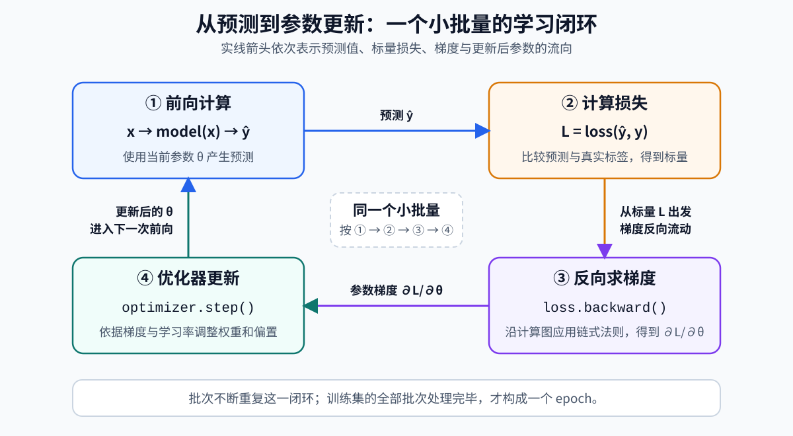

# 第 6 章 损失函数、反向传播与优化器

神经网络的前向传播只能回答“当前参数会作出什么预测”，训练还必须回答“预测错到什么程度、每个参数应怎样改变”。损失函数把预测与标签之间的差异变成标量，反向传播利用链式法则计算损失对各层参数的梯度，优化器再依据梯度和学习率执行更新。三者构成可反复迭代的学习闭环。本章以分类交叉熵为重点，把二分类、多分类、梯度计算和参数更新连成一条数学链路，并通过受控实验说明网络深度、激活函数和优化器的选择不能脱离训练配置单独评价。

## 前向、损失与反向更新

一次前向传播从输入 \(\mathbf x\) 开始，逐层计算

\[
\mathbf z^{(l)}=W^{(l)}\mathbf a^{(l-1)}+\mathbf b^{(l)},\qquad
\mathbf a^{(l)}=f_l(\mathbf z^{(l)})
\]

直至得到预测 \(\hat{\mathbf y}\)。随后，损失函数比较 \(\hat{\mathbf y}\) 与真实标签 \(\mathbf y\)，得到标量 \(L\)。反向传播从 \(L\) 出发，计算所有相关权重和偏置的梯度，优化器据此调整参数。邮件垃圾分类中，网络输出 0.92 可以表示“垃圾邮件”的预测置信度；若真实标签为 1，损失会衡量 0.92 与理想概率 1 之间的距离，而不是直接把 0.92 当作误差。

需要区分“参数更新步”“批次”和“训练轮次”。小批量训练中，一个批次会经历前向、损失计算、反向和更新；训练集的全部批次处理完毕才构成一个 epoch。若把整个训练集一次性送入，一次完整更新才可能对应一轮数据遍历，不能笼统地把任意一次前向加反向都称为 epoch。

{ .diagram }

图 6-1：前向计算、损失、反向梯度与参数更新闭环。外圈箭头按①至④依次表示预测、损失、梯度和更新后参数的流向；全部训练批次完成后才构成一个 epoch。根据课程内容整理。

训练的目标是让损失下降并趋于稳定，但较低的训练损失并不自动等于较好的泛化。课程的非线性“双月”数据实验把数据划分为训练集和测试集，训练后调用模型的评估模式，在未见样本上检查决策边界。这一步骤把“优化成功”与“模型可用”区分开来。

## 分类交叉熵

### 二分类：惩罚错误且自信的预测

设真实标签 \(y\in\{0,1\}\)，模型经 sigmoid 得到正类概率 \(\hat y\in(0,1)\)。二元交叉熵为

\[
L=-\left[y\ln\hat y+(1-y)\ln(1-\hat y)\right]
\]

当 \(y=1\) 时，第二项消失，只需考察 \(-\ln\hat y\)；当 \(y=0\) 时，只需考察 \(-\ln(1-\hat y)\)。因此，交叉熵直接惩罚模型分配给真实类别概率不足的行为。以 \(y=1\) 为例：

| 正类预测概率 \(\hat y\) | 损失 \(-\ln\hat y\) | 含义 |
|---:|---:|---|
| 0.99 | 约 0.010 | 正确且很有把握 |
| 0.95 | 约 0.051 | 正确且较有把握 |
| 0.60 | 约 0.511 | 方向正确，但置信度有限 |
| 0.10 | 约 2.303 | 明显偏向错误类别 |
| 0.01 | 约 4.605 | 极度自信地预测错误 |

自然对数使预测概率越接近 0，损失增长越剧烈。这里的“好”与“坏”是相对于真实标签而言，不能仅根据输出是否大于 0.5 判断损失大小。

### 多分类：只累计真实类别项

多分类标签可写成 one-hot 向量。若类别 0、1、2 分别表示猫、狗、鸟，则“狗”为 \([0,1,0]\)，“鸟”为 \([0,0,1]\)。softmax 输出各类概率 \(\hat y_k\)，交叉熵为

\[
L=-\sum_{k=1}^{K}y_k\ln\hat y_k
\]

由于 one-hot 标签只有真实类别为 1，其余项均为 0，单个样本的损失实际上就是 \(-\ln\hat y_{\text{true}}\)。若真实类别是狗，模型给狗的概率分别为 0.8、0.2、0.05，损失约分别为 0.223、1.609、2.996。其他类别的概率已经通过 softmax 的归一化间接影响真实类别概率，无须再分别写进最终求值式。

对于 0—9 数字分类，one-hot 向量有 10 个位置；若真实数字是 7，只有索引 7 对应项为 1。正确类别概率为 0.75 时，损失为 \(-\ln0.75\approx0.288\)。比较这些数值还可以看到，若真实类别是狗，正确类概率从 0.05 提升到 0.8，损失就会从约 2.996 降至约 0.223；优化所推动的正是真实类别概率的这种变化。

损失函数必须与输出形式和任务目标配套。二分类通常用 sigmoid 概率配合二元交叉熵，多分类用各类 logits 经 softmax 后计算多类交叉熵，回归则常使用均方误差（MSE）衡量连续预测与目标之间的平方差。分类交叉熵关注真实类别获得的概率，MSE 关注数值偏差的大小，二者不能只凭损失数值横向比较。

对一个批次计算时，通常先把各样本损失聚合成均值，再对这个标量执行反向传播。这样，梯度反映的是当前批次的平均误差方向；批次组成变化会使小批量梯度带有一定波动，但每个样本仍通过同一套网络参数参与更新。实现对数运算时还要确保概率由适当的输出层或损失 API 产生，避免把任意实数 logits 直接当作概率取对数。

## 反向传播与梯度下降

损失是各层函数复合后的结果，因此某一层参数对损失的影响必须沿后续计算路径逐层传回。若 \(y=y(x)\)、\(x=x(l)\)、\(l=l(m)\)，链式法则为

\[
\frac{\partial y}{\partial m}
=\frac{\partial y}{\partial x}
 \frac{\partial x}{\partial l}
 \frac{\partial l}{\partial m}
\]

对含三个隐藏层和一个输出层的网络，第一层某权重 \(w_1\) 的梯度可示意写成

\[
\frac{\partial L}{\partial w_1}
=\frac{\partial L}{\partial\hat y}
 \frac{\partial\hat y}{\partial z^{(4)}}
 \frac{\partial z^{(4)}}{\partial a^{(3)}}
 \frac{\partial a^{(3)}}{\partial z^{(3)}}
 \cdots
 \frac{\partial z^{(1)}}{\partial w_1}
\]

实际实现会复用各层中间量，避免从头重复计算；PyTorch 的自动微分负责执行这一过程，但理解链式传递有助于诊断梯度消失与爆炸。多个小于 1 的因子连乘可能使前层梯度趋近 0，多个大因子连乘则可能使其异常增大。

梯度可以直观理解为损失曲面在当前参数处的局部变化率。以单一权重为例，\(\partial L/\partial w\) 是损失对权重曲线的切线斜率：斜率为负时，沿权重增大方向可降低损失；斜率为正时则相反。参数统一按负梯度方向更新：

\[
\theta_{\text{new}}=\theta_{\text{old}}-\eta\frac{\partial L}{\partial\theta},
\qquad \theta\in\{W,b\}
\]

学习率 \(\eta\) 控制步幅。过小会使收敛缓慢，过大可能跨过较低损失区域并引起振荡甚至发散。梯度为 0 是局部平稳点的特征，并不单独保证找到全局最优；深度训练实际追求的是可持续降低损失并在验证数据上表现良好的参数区域。

## 优化器与学习率策略

“每批使用多少样本”和“拿到梯度后怎样更新”是两个不同维度。批量梯度下降使用整个训练集，随机梯度下降使用单个样本，小批量梯度下降折中二者；Momentum、RMSProp 和 Adam 则进一步改变更新规则。

| 方法 | 更新思路 | 使用时的关注点 |
|---|---|---|
| SGD | 直接沿当前负梯度更新 | 简单，但收敛可能较慢，对学习率敏感 |
| SGD＋Momentum | 累积带方向性的速度项 | 减少无效振荡，延续一致方向的更新 |
| RMSProp | 依据近期梯度尺度自适应调整步长 | 适合处理不同参数梯度尺度差异 |
| Adam | 结合一阶动量与二阶尺度估计 | 通常易于起步，是课程采用的默认选择 |

课程在同一学习率 0.01、200 个 epoch 的条件下比较 SGD、Adam 和 RMSProp，示例中 RMSProp 的损失下降更快，Adam 也迅速收敛。这个结果只说明该数据和配置下的表现，不能推出 RMSProp 永远优于 Adam。优化器对比必须保持模型、数据、学习率和轮次一致，并同时记录最终性能与计算开销。

除优化器外，训练稳定性还取决于初始化、归一化和学习率调度。He 与 Xavier 初始化用于给参数提供合理初始尺度；批量归一化控制中间激活的数值范围；学习率调度则随训练进展调整步长，例如从 0.001 起步，在若干轮后降低学习率，使早期快速探索、后期细致收敛。

## 用受控实验理解训练

课程代码把抽象机制转化为几组对照。`make_moons` 生成 1000 个带噪声的双月样本，噪声参数为 0.2，测试集占 20%；一个含 16 个隐藏层、每层 8 个神经元的网络训练 500 个 epoch，学习率为 0.01。观察训练损失、测试表现和决策边界，比只看最后一个损失数字更完整。

| 对照变量 | 实验设置 | 可得出的限定性认识 |
|---|---|---|
| 单层与多层 | 单感知机测试 AND、OR、NAND、XOR；MLP 用二元交叉熵训练 XOR 2000 轮 | 前三类线性任务可由单感知机完成；多层网络在该实验中将 XOR 四个样本全部正确分类 |
| 激活函数 | 800 个同心圆样本，对比 ReLU、sigmoid、tanh | 三者结果接近，ReLU 略高；小差距不足以支持普遍排名 |
| 网络深度 | 双月数据上比较 2 层与 4 层网络，均用 ReLU、Adam、学习率 0.01 训练 400 轮 | 示例准确率由 86.7% 提升到 92.9%，参数量也由 42 增至 778，收益与成本应同时记录 |
| 优化器 | 相同多分类网络比较 SGD、带动量 SGD、Adam、RMSProp | 自适应方法在该示例中下降更快，但结论仍受学习率和任务影响 |

把实验结果表交给大语言模型生成文字解释，可以辅助整理现象，却不能替代上述控制变量和数值证据。可靠的实验闭环是：提出单一变量、保持其他配置一致、记录训练与测试指标，再解释差异及其适用范围。

## 本章小结

- 前向传播产生预测，交叉熵量化分类误差，反向传播计算梯度，优化器更新权重和偏置。
- 二元与多元交叉熵都可归结为对真实类别概率取负对数，错误且自信的预测会受到更大惩罚。
- 链式法则连接各层梯度，学习率决定更新步幅；过小收敛慢，过大可能振荡或发散。
- 优化器、初始化和学习率调度需协同选择，任何实验排名都只对相应数据与配置成立。
- 训练与测试分离、控制变量以及曲线监测，是判断深度、激活和优化策略是否真正有效的基础。
<!-- course-lectures: 69-78 -->

<!-- ebook-navigation -->

---

[← 上一章](ch05.md) · [返回完整目录](../index.md) · [下一章 →](ch07.md)
