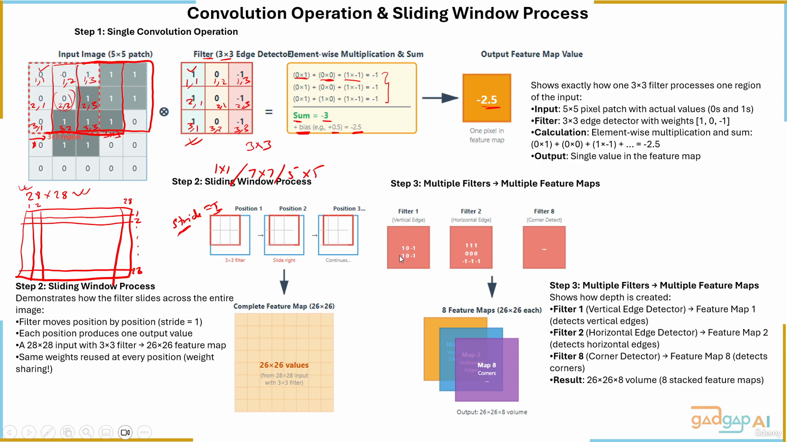

# 第 7 章 卷积神经网络：从全连接到局部特征学习

图像不是一串彼此独立的数字，而是具有局部相关性、位置变化和层次结构的二维信号。把图像直接展平后送入全连接网络，虽然仍能进行函数拟合，却没有充分利用这些空间规律，还会在大尺寸输入上迅速积累参数。卷积神经网络（CNN）用局部连接和权重共享重新组织计算：一个小型卷积核在图像上滑动，同一组权重在不同位置检测同类模式，多个卷积核形成多通道特征图。本章从全连接网络的结构失配出发，推导卷积、步幅和填充的输出尺寸，并区分手工滤波器与网络自动学习的卷积核。

## 全连接网络与图像空间归纳偏差

全连接网络处理图像的典型做法，是按行取出像素并拼接成一个长向量。对于 \(224\times224\) 的 RGB 图像，输入维度为

\[
224\times224\times3=150{,}528
\]

若第一隐藏层含 10,000 个神经元，仅这一层的权重就约有 \(150{,}528\times10{,}000\)，即 15 亿个，还未计入偏置和后续层。巨大的参数量增加显存、计算和优化压力，但问题并不止于规模：展平后的网络没有内建机制保证相邻像素被作为局部结构共同处理。

图像至少包含三种对模型设计有用的空间规律。

| 空间规律 | 含义 | 直接展平并全连接的不足 |
|---|---|---|
| 局部相关性 | 邻近像素共同形成边缘、眼睛、轮胎等局部结构 | 上下相邻行在向量中可能相距很远，局部关系未被显式保留 |
| 平移鲁棒性 | 同一对象从左上移到右下，类别不应改变 | 不同位置对应不同输入维度，网络缺少共享检测器的约束 |
| 层次结构 | 边缘组成纹理和形状，部件再组成对象 | 网络需自行从大量参数中学到组合方式，样本与优化效率较低 |

因此，“DNN 不能处理图像”更准确的表述是：不具备图像归纳偏差的朴素全连接结构通常效率较低，而不是它在数学上完全无法拟合视觉数据。课程的 MNIST 全连接示例把 \(28\times28=784\) 个像素依次映射到 128、64 和 10 个单元，参数量为

\[
(784\times128+128)+(128\times64+64)+(64\times10+10)=109{,}386
\]

该网络在小图像上完全可训练，但其输入组织仍没有利用二维局部性。CNN 的价值正是把上述规律写入结构，而非简单追求更大的网络。

## 卷积块的组成与数据流

一个基础 CNN 可看作若干卷积块加分类头。卷积块通常按“卷积—ReLU—池化”的顺序执行，分类头则在末端展平特征并接全连接层。

| 组件 | 对数据的主要作用 | 需要关注的量 |
|---|---|---|
| 卷积层 | 检测边缘、角点、纹理等局部特征 | 卷积核大小、数量、步幅、填充 |
| ReLU | 引入非线性，保留正响应并置零负响应 | 不改变特征图形状 |
| 池化层 | 聚合邻域并降低空间分辨率 | 池化类型、窗口和步幅 |
| 展平与全连接头 | 把最终特征体映射到任务输出 | 展平维度、类别数或其他输出形式 |

以两层 CNN 为例，可以重复两个“卷积＋ReLU＋最大池化”块，再把最后一个三维特征体转换为一维向量。若任务是 MNIST 十分类，分类头最终输出 10 个数，每个对应一个数字类别。若是其他视觉任务，头部也可能同时包含分类与回归输出，不能把 CNN 固定理解为只有单标签分类一种形式。

这里“8 个特征图”与“8 个卷积核”相对应：每个卷积核在全部空间位置生成一张响应图。输入 RGB 图像的通道数由颜色表示决定，卷积输出通道数则由该层卷积核数量决定；经过第一层后，通道不再必然表示红、绿、蓝，而表示不同的学习特征。

## 滑动窗口与可学习卷积核

### 一次局部卷积计算

设输入局部窗口为 \(X\)，卷积核为 \(K\)，二者大小均为 \(k\times k\)。一个输出位置的计算为

\[
y_{i,j}=b+\sum_{u=1}^{k}\sum_{v=1}^{k}X_{i+u-1,j+v-1}K_{u,v}
\]

也就是对应位置元素相乘，再把全部乘积与偏置相加。深度学习框架中的这一操作通常称为卷积，严格说多数实现采用的是未翻转卷积核的互相关形式；无论术语如何，核心是局部加权和与滑动复用。

课程示例中，一个 \(3\times3\) 卷积核作用于同大小窗口，九项乘积之和为 \(-3\)，加偏置 0.5 后得到 \(-2.5\)。这个标量占据输出特征图的一个位置，而不是用 \(3\times3\) 矩阵替换原窗口。随后窗口按固定步长向右、向下移动，直至覆盖所有允许的位置。

卷积核常见尺寸包括 \(1\times1\)、\(3\times3\)、\(5\times5\) 和 \(7\times7\)，其中 \(3\times3\) 很常用。卷积核越大，单次观察的感受野越大，但计算量也随之增加。对无填充、步幅 1 的 \(28\times28\) 输入，\(3\times3\) 卷积得到 \(26\times26\) 输出；若使用 8 个不同卷积核，最终形状为 \(26\times26\times8\)。

{ .diagram }
<p class="figure-caption">图 7-1：卷积核的滑动窗口计算与特征图生成。一个局部窗口产生一个输出值，窗口按步幅遍历输入；8 个卷积核分别生成 8 张特征图，并堆叠为输出特征体。课程第 83 课时 07:57 抽帧。</p>

多通道输入还要在通道维求和。设输入有 \(C_{\text{in}}\) 个通道，第 \(q\) 个输出通道对应一组覆盖全部输入通道的卷积核，则

\[
y_{i,j,q}=b_q+\sum_{c=1}^{C_{\text{in}}}\sum_{u=1}^{k}\sum_{v=1}^{k}
X_{i+u-1,j+v-1,c}K_{u,v,c,q}
\]

因此，该层权重总数为 \(C_{\text{in}}\times C_{\text{out}}\times k\times k\)，若每个输出通道有一个偏置，再加 \(C_{\text{out}}\)。例如 RGB 输入接 32 个 \(3\times3\) 卷积核时，每个输出通道并不是只处理某一个颜色通道，而是综合三个颜色通道的局部响应。通道维求和与空间位置滑动共同构成完整的卷积计算。

### 从手工滤波到任务驱动学习

传统图像处理已经给出了许多固定滤波器：Sobel 核检测水平或垂直边缘，盒式模糊对邻域取平均，高斯模糊按距离分配权重，锐化核增强中心像素相对邻域的差异。它们有助于理解卷积响应，但 CNN 并不需要在训练前手工指定每类检测器的全部数值。

CNN 把卷积核元素视为可训练参数，通过反向传播和梯度下降，依据任务损失调整这些数值。靠近输入的层往往响应边缘、斑点等低级模式；后续层组合已有响应，形成纹理、形状和部件等更复杂的表示。这里的关键不是网络“预先知道什么是眼睛”，而是局部连接、权重共享和多层组合使其能从数据中学到对目标有用的特征。

## 步幅、填充与输出尺寸

步幅（stride）是窗口每次移动的像素数。步幅 1 保留较密集的采样位置，输出更大、计算更多；步幅 2 每隔一个位置计算一次，输出缩小、细节采样变稀疏。增大步幅是在空间细节与计算成本之间权衡，而不是单纯的性能改进。

填充（padding）是在输入边缘外侧补入若干行和列，常见做法是补 0。没有填充时，边缘和角点参与卷积的次数少于中心像素，输出也会缩小；填充可以增加边缘像素的参与机会，并用于控制输出尺寸。“valid”通常表示不使用填充，“same”表示配置填充以在步幅为 1 的常见设置下保持输入空间尺寸；二者不能颠倒理解。

设单个空间维度的输入大小为 \(I\)，卷积核大小为 \(F\)，两侧填充总量体现为 \(2P\)，步幅为 \(S\)，则输出大小为

\[
O=\left\lfloor\frac{I-F+2P}{S}\right\rfloor+1
\]

向下取整对应只保留能够完整放置卷积核的位置。二维输入的高度和宽度分别使用同一公式，输出通道数独立地由卷积核数量决定。

| 输入与卷积配置 | 代入关系 | 输出空间尺寸 |
|---|---|---:|
| \(I=28,F=3,P=0,S=1\) | \(\lfloor(28-3)/1\rfloor+1\) | 26 |
| \(I=28,F=3,P=1,S=1\) | \(\lfloor(28-3+2)/1\rfloor+1\) | 28 |
| \(I=28,F=3,P=1,S=2\) | \(\lfloor(28-3+2)/2\rfloor+1\) | 14 |
| \(I=5,F=3,P=0,S=2\) | \(\lfloor(5-3)/2\rfloor+1\) | 2 |

此外，膨胀卷积通过在卷积核元素之间插入间隔扩大感受野，而不必同比例增加卷积核参数。它属于另一项结构选择，不应与普通步幅混为一谈。

## PyTorch 卷积示例与设计检查

课程用 MNIST 中数字 5 的灰度图像演示单卷积层：输入 1 个通道，输出 6 个通道，卷积核为 \(5\times5\)，步幅 1、无填充。关键 API 可直接写成：

```python
from torch import nn

conv = nn.Conv2d(
    in_channels=1,
    out_channels=6,
    kernel_size=5,
    stride=1,
    padding=0,
)
```

设输入张量形状为 \([N,1,28,28]\)，其中 \(N\) 为批量大小，则输出为 \([N,6,24,24]\)。空间尺寸由 \((28-5)/1+1=24\) 得出，6 则由卷积核数量得出。逐个查看这 6 张特征图，可以比较不同卷积核响应了哪些边缘或局部模式；在可训练网络中，这些响应会随参数更新而变化。

设计卷积层时，应依次检查四件事：输入与输出通道是否衔接；卷积核尺寸是否符合所需感受野；步幅和填充是否得到预期空间尺寸；通道增加是否带来可接受的计算成本。课程建议早期层可从较少卷积核开始，深层再增加通道，以便在空间分辨率下降时组合更多特征。最终仍应以逐层形状推导和实际张量输出相互核验，避免仅凭层名猜测尺寸。

## 本章小结

- 朴素全连接网络没有内建图像局部性、平移鲁棒性和层次结构，在大图上还会产生巨额参数。
- 卷积通过局部乘加和滑动窗口提取特征，每个卷积核生成一个输出通道，其数值由训练学习。
- 步幅控制采样密度，填充影响边缘参与和输出尺寸；输出大小必须按公式并向下取整计算。
- PyTorch 的 `Conv2d` 将输入通道、输出通道、卷积核、步幅和填充集中配置，逐层核对形状是设计 CNN 的基本功。
<!-- course-lectures: 79-86 -->

<!-- ebook-navigation -->

---

[← 上一章](ch06.md) · [返回完整目录](../index.md) · [下一章 →](ch08.md)
