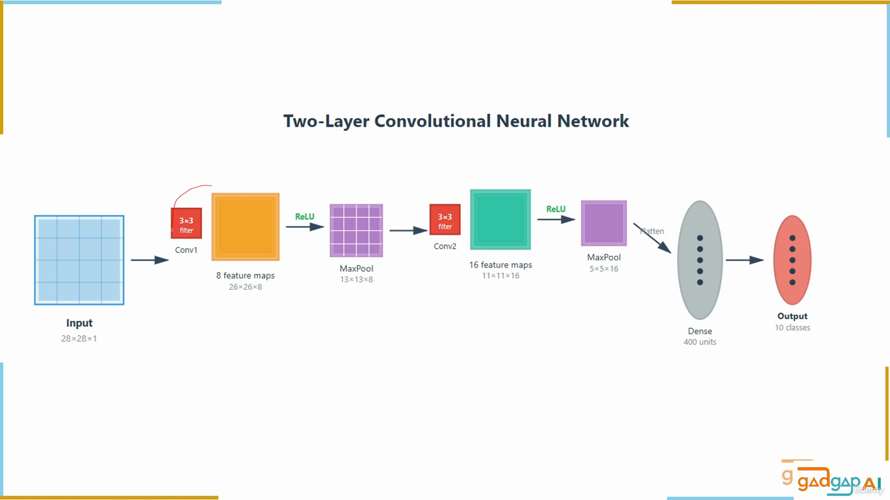

# 第 8 章 ReLU、池化与完整 CNN 架构

卷积层负责从局部邻域提取响应，但单靠卷积的堆叠仍不足以形成高效、稳定的视觉网络。ReLU 在卷积之后引入非线性，池化在空间邻域内聚合响应并降低分辨率，最后的全连接分类头再把特征体映射为类别。把这些组件按明确的数据形状连接起来，才能得到完整 CNN。本章沿一张 \(28\times28\) 灰度图的传播过程，推导两个卷积块及分类头的尺寸和参数量，并解释局部连接、权重共享、平移鲁棒性和层次特征为何共同发挥作用。

## ReLU：非线性、稀疏激活与梯度传递

ReLU 的数学形式为

\[
\operatorname{ReLU}(x)=\max(0,x)=
\begin{cases}
x,&x>0\\
0,&x\leq0
\end{cases}
\]

它逐元素作用于卷积输出的原始特征图：正值原样保留，负值变为 0，特征图的高度、宽度和通道数均不改变。若 8 个卷积核产生 8 张特征图，ReLU 后仍是 8 张，只是其中许多位置可能变为 0，由此形成稀疏激活。负响应被抑制并不等价于它们必然是噪声；ReLU 的实际作用由后续层和训练目标共同决定。

非线性是更根本的作用。若各层只有仿射变换，两层计算可写为

\[
z^{(2)}=W_2(W_1x+b_1)+b_2=W_2W_1x+(W_2b_1+b_2)
\]

其整体仍是一次仿射变换，继续堆层也不会改变这一性质。插入 ReLU 后，各层在不同输入区间采用不同映射，深层网络才能表示分段、复杂的决策关系，而不是把“层数增加”误解为变量次数自然升高。

从反向传播看，sigmoid 导数最大仅为 0.25，多层链式连乘容易使前层梯度缩小；tanh 导数不超过 1，也会在饱和区趋近 0。ReLU 在正区间的导数为 1，计算也只需阈值判断，因此有利于较深层网络的梯度传递。不过其负区间导数为 0，若某单元长期落在负区间，就可能持续不更新。Leaky ReLU 用

\[
f(x)=\max(x,\alpha x)
\]

在负区间保留小斜率，课程示例中的 \(\alpha=0.01\)，为这类单元保留梯度通道。

## 池化：空间聚合与分辨率控制

池化在局部窗口内把多个响应压缩为一个响应。最常见的最大池化与平均池化分别为

\[
y_{i,j}=\max_{(u,v)\in\mathcal R_{i,j}}x_{u,v},
\qquad
y_{i,j}=\frac{1}{|\mathcal R_{i,j}|}\sum_{(u,v)\in\mathcal R_{i,j}}x_{u,v}
\]

其中 \(\mathcal R_{i,j}\) 是当前池化窗口。若窗口为 \(2\times2\)、步幅为 2，四个相邻位置产生一个输出，不重叠地遍历后，高度和宽度各减半，通道数不变。例如 \(26\times26\times8\) 经最大池化后成为 \(13\times13\times8\)，并非把所有通道压成一个通道。

| 池化方式 | 保留的信息 | 配置特点与直观效果 |
|---|---|---|
| 最大池化 | 窗口内最强响应 | 强调显著特征，响应通常更有对比度 |
| 平均池化 | 窗口内平均响应 | 保留整体平均水平，结果相对平滑 |
| 自适应池化 | 按目标尺寸自动组织聚合 | 指定输出尺寸而非固定窗口；课程示例指定 \(7\times7\) |

PyTorch 中可用 `nn.MaxPool2d(kernel_size=2, stride=2)` 和 `nn.AvgPool2d(kernel_size=2, stride=2)` 实现前两者。课程把数字 5 的 \(24\times24\) 特征图分别送入两种池化，空间尺寸都降为 \(12\times12\)，差异在于保留最大值还是平均值。自适应平均池化则直接约定输出形状，适用于希望后续层接收固定空间尺寸的情况。

池化带来三方面收益：减少后续计算和展平维度；扩大后续单元相对原图的感知范围；对小幅位置变化形成一定鲁棒性。最大池化只保留局部最强响应，因此边缘在窗口内稍作移动仍可能得到相同输出。但这并不构成对任意平移的严格不变性，步幅过大同样会丢失细节。

## 两层 CNN 的逐层尺寸与参数量

把前述组件连成课程中的两层示例。输入为 \(28\times28\times1\) 灰度图，两个卷积层均使用 \(3\times3\) 卷积核、步幅 1、无填充，第一、二层分别使用 8 和 16 个卷积核，每个卷积块后接 \(2\times2\)、步幅 2 的最大池化。

| 阶段 | 计算依据 | 输出尺寸（高×宽×通道） |
|---|---|---:|
| 输入 | 灰度图 | \(28\times28\times1\) |
| 卷积块 1 | \(28-3+1=26\)，8 个卷积核 | \(26\times26\times8\) |
| 最大池化 1 | \(26/2\) | \(13\times13\times8\) |
| 卷积块 2 | \(13-3+1=11\)，16 个卷积核 | \(11\times11\times16\) |
| 最大池化 2 | \(\lfloor11/2\rfloor\) | \(5\times5\times16\) |
| 展平 | \(5\times5\times16\) | 400 |
| 全连接层 | 400 个输入映射到 400 个神经元 | 400 |
| 输出层 | 400 个输入映射到 10 类 | 10 |

展平将各通道中的空间元素依次拼接为长向量，400 个值随后进入全连接层。第一个全连接层的参数量为 \(400\times400+400=160{,}400\)，输出层为 \(400\times10+10=4{,}010\)。若真实类别是数字 3，softmax 后该类概率为 0.87，则单样本交叉熵为 \(-\ln0.87\approx0.139\)。

{ .diagram }
<p class="figure-caption">图 8-1：两层 CNN 的卷积、池化与分类头数据流。输入依次形成 \(26\times26\times8\)、\(13\times13\times8\)、\(11\times11\times16\) 和 \(5\times5\times16\) 的特征体，展平后进入 400 单元全连接层与 10 类输出。课程第 91 课时 00:14 抽帧。</p>

相同结构可用 PyTorch 清晰表达：

```python
import torch
from torch import nn

class TwoBlockCNN(nn.Module):
    def __init__(self):
        super().__init__()
        self.conv1 = nn.Conv2d(1, 8, kernel_size=3)
        self.conv2 = nn.Conv2d(8, 16, kernel_size=3)
        self.pool = nn.MaxPool2d(kernel_size=2, stride=2)
        self.fc1 = nn.Linear(16 * 5 * 5, 400)
        self.fc2 = nn.Linear(400, 10)

    def forward(self, x):
        x = self.pool(torch.relu(self.conv1(x)))
        x = self.pool(torch.relu(self.conv2(x)))
        x = torch.flatten(x, 1)  # 保留批量维
        x = torch.relu(self.fc1(x))
        return self.fc2(x)       # 返回 10 类 logits
```

代码采用 NCHW 顺序，因此输入形状是 \([N,1,28,28]\)，第二个池化后的形状是 \([N,16,5,5]\)。`flatten(x, 1)` 只展平后三维，不能误把批量维也合并。模型返回 logits；需要概率时再施加 softmax，使用 PyTorch 交叉熵训练时则不需要在 `forward` 末尾重复添加 softmax。

卷积骨干与分类头之间的接口是最容易发生形状错误的位置。卷积和池化保留批量维与通道维，而 `Linear` 期待每个样本对应一个特征向量，所以展平必须发生在第一次全连接计算之前。反过来，若在网络入口就把整幅图像展平，后续 `Conv2d` 将无法恢复已经丢失的二维邻接关系。修改卷积核、步幅、填充或池化次数后，也应重新计算 `fc1` 的输入维度，不能继续沿用 400。

参数量核对同样应分层进行。卷积核参数由输入通道、输出通道和核尺寸决定，池化与 ReLU 本身没有可训练权重，全连接层则由输入特征数和输出神经元数决定。把这些检查写在建模阶段，可以避免把形状不匹配、参数爆炸或误加激活等问题留到训练循环中才发现。

## CNN 有效的四项结构机制

**局部连接**使每个输出单元只观察一个局部区域，与边缘、纹理等图像模式的形成方式一致。两层卷积的权重数分别为 \(1\times8\times3\times3=72\) 和 \(8\times16\times3\times3=1152\)，不随特征图空间位置数量线性增加。

**权重共享**让同一卷积核在所有滑动位置复用。边缘无论出现在左上还是右下，都使用同一组检测权重，而无须为每个像素位置单独学习一套检测器。这与在每个位置独立连接输入的全连接层有本质区别。

**平移等变与池化鲁棒性**共同应对位置变化。严格说，输入平移会使卷积响应的位置相应移动，这是等变；池化再聚合局部响应，使后续表示对小幅移动不那么敏感。因此，CNN 的优势不是完全忽略位置，而是以更少参数复用位置无关的特征检测规则。

**层次特征构建**通过堆叠卷积块逐级扩大语义范围：早期块响应边缘、角点和简单纹理，中间块组合形状，后续块进一步形成部件与对象级表示。卷积核并非每层都直接从原始像素重新学习，而是在前层表示上继续组合。

需要注意，局部连接和权重共享降低的是卷积特征的参数成本，并不保证整个 CNN 的参数一定少于某个全连接网络。上述示例中，400→400 的分类头已有 160,400 个参数，明显多于卷积核权重。设计时应同时检查卷积骨干和分类头，不能只凭“CNN”名称推断总参数规模。

## 结构变体与对照实验

课程练习进一步把组件作为可替换变量，而不是固定答案。多卷积核结构受 Inception 思路启发，让同一输入并行经过 \(3\times3\) 和 \(5\times5\) 卷积，两支各产生 16 个通道，在通道维拼接为 32 个通道，再进入 64 通道的后续卷积。不同感受野可以并行提取尺度不同的局部特征，但拼接后通道数必须作为下一层输入通道数。

在 10,000 张 MNIST 训练图像和 2,000 张测试图像的子集上，该多卷积核网络训练 3 个 epoch，示例测试准确率达到 97.7%，训练过程中损失下降、准确率上升。随后分别替换最大、平均和自适应池化，三者在该浅层实验中的结果接近，自适应方案略低；加入批量归一化或替换 ReLU、Leaky ReLU、CELU 等激活函数，差异也未形成可普遍推广的排名。

这些结果强调两条实践原则。其一，批量归一化按 \((x-\mu)/\sigma\) 调整激活尺度，主要用于稳定训练，深层网络中往往更值得重点观察；浅层小实验没有明显提升并不否定其作用。其二，Dropout 通过训练时随机关闭部分神经元降低共适应和过拟合风险，但组件是否有益必须在相同数据与训练预算下比较，不能根据单次微小差异宣布某池化或激活函数普遍最优。

## 本章小结

- ReLU 在不改变特征图形状的前提下引入非线性和稀疏激活，并改善正区间的梯度传递。
- 最大池化、平均池化和自适应池化采用不同聚合规则；固定窗口池化可减半空间尺寸而不改变通道数。
- 完整 CNN 必须逐层核对卷积、池化、展平和全连接层的尺寸，批量维应始终保留。
- 局部连接、权重共享、平移鲁棒性与层次组合共同构成 CNN 优势，但全连接分类头仍可能占据多数参数。
- 多卷积核、归一化、Dropout 和激活替换都应通过受控实验评价，浅层单次结果不能直接推广为普遍结论。
<!-- course-lectures: 87-96 -->

<!-- ebook-navigation -->

---

[← 上一章](ch07.md) · [返回完整目录](../index.md) · [下一章 →](ch09.md)
