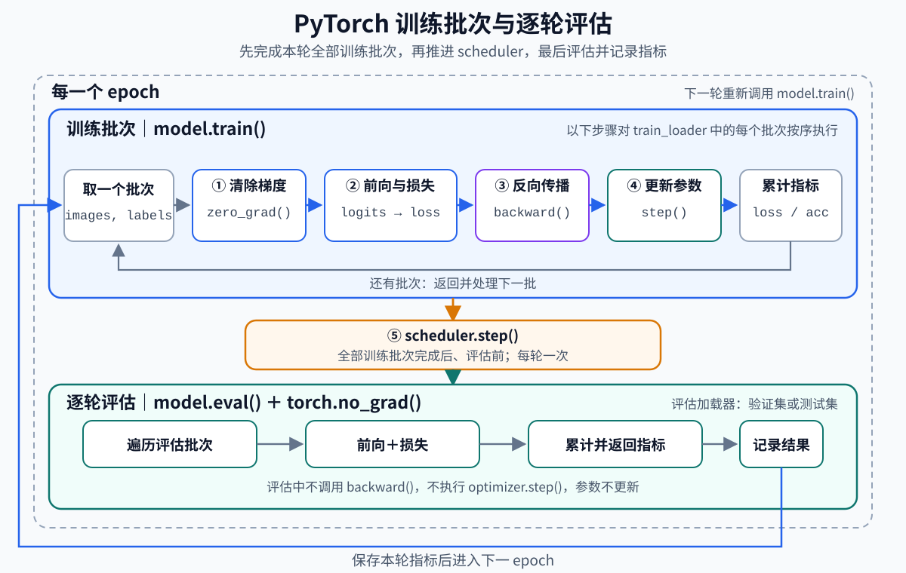

# 第 9 章 PyTorch 实战：数据、模型、训练与评估

一个能够训练的 CNN 不等于一条完整的机器学习流程。真正可复现的实战需要把数据下载与变换、批量加载、设备迁移、模型定义、损失与优化器、训练循环、未见数据评估和错误诊断逐一连接，并保证各阶段的张量形状和运行状态一致。本章以 CIFAR-10 十分类为主线，搭建三个卷积块和全连接分类头，给出训练与评估循环的关键代码，再用 Fashion-MNIST 对照实验说明优化器、学习率调度和数据增强应如何迭代，而不是把某组超参数当作固定答案。

## 任务、张量与运行环境

CIFAR-10 含 60,000 张 \(32\times32\) 的 RGB 图像，分为 50,000 张训练图像和 10,000 张测试图像。10 个类别为飞机、汽车、鸟、猫、鹿、狗、青蛙、马、船和卡车。与单通道 MNIST 相比，它包含更丰富的自然物体和颜色信息；与 ImageNet 相比，它又更适合在消费级 GPU 或 Colab 环境中完成入门实验。十分类任务随机猜测类别的期望准确率约为 10%，这是理解模型结果的基线，而不是训练目标。

张量是数据在框架中的统一载体：标量是零维张量，向量是一维张量，矩阵是二维张量，一张 RGB 图像可组织为三维张量。PyTorch 图像批次通常采用 NCHW 顺序，本例一个标准批次为

\[
[N,C,H,W]=[64,3,32,32]
\]

经过网络后，分类 logits 的典型形状为 \([64,10]\)。最后一个不足 64 张的批次可以更小，因此代码不能处处把批量大小写死。

CPU 适合通用串行控制，GPU 则通过大量较简单的核心并行执行矩阵乘加。卷积网络中的大量同类运算、SIMD 执行方式以及面向张量计算的硬件，使 GPU 成为训练的重要加速器。代码应保留 CPU 回退，并把模型和每批数据放到同一设备：

```python
import torch

device = torch.device("cuda" if torch.cuda.is_available() else "cpu")
```

PyTorch 的动态计算图、Python 调试体验和 `torchvision` 等生态便于研究与调试；TorchScript、TorchServe 则支持进一步的部署需求。常用模块各有职责：`torch` 负责张量运算，`torch.nn` 提供层与损失，`torch.optim` 提供优化器，`torchvision.datasets` 和 `torchvision.transforms` 组织视觉数据与变换，`torch.utils.data.DataLoader` 负责批量迭代。

## 数据管道：变换、加载与批量化

数据质量遵循 GIGO（garbage in, garbage out）原则：模型无法仅靠加深结构弥补错误标签或失真的输入分布。本例训练管道包含随机水平翻转、随机裁剪、张量转换和归一化；测试管道只保留确定性的张量转换与相同归一化，不能加入随机增强。

```python
from torch.utils.data import DataLoader
from torchvision import datasets, transforms

# mean、std 按 RGB 三个通道使用课程给定的统计量
train_tf = transforms.Compose([
    transforms.RandomHorizontalFlip(),
    transforms.RandomCrop(32),
    transforms.ToTensor(),
    transforms.Normalize(mean, std),
])
test_tf = transforms.Compose([
    transforms.ToTensor(),
    transforms.Normalize(mean, std),
])

train_set = datasets.CIFAR10(
    root="./data", train=True, transform=train_tf, download=True
)
test_set = datasets.CIFAR10(
    root="./data", train=False, transform=test_tf, download=True
)
train_loader = DataLoader(train_set, batch_size=64, shuffle=True)
test_loader = DataLoader(test_set, batch_size=64, shuffle=False)
```

归一化对每个通道执行

\[
x'=\frac{x-\mu}{\sigma}
\]

其目的是控制输入数值尺度、改善数值稳定性和优化条件。这里的输入归一化不同于网络中的 `BatchNorm2d`：前者在数据管道中处理像素，后者在网络内部按批量统计调整激活，不能因名称相近而互相替代。

训练集打乱后按 64 张组成批次，50,000 张图像产生 \(\lceil50000/64\rceil=782\) 个批次，最后一批为 16 张。处理完全部 782 个批次才完成一个 epoch。批量化降低一次性载入的内存压力，并使训练曲线能够按轮次持续记录；随机打乱减少固定样本顺序带来的偏差。测试集不需要随机增强，也不依赖随机打乱来估计整体指标。

## 模型构建：三个卷积块与分类头

模型每个卷积块采用“卷积—批量归一化—ReLU—最大池化”。三个卷积层都使用 \(3\times3\) 卷积核、步幅 1、填充 1，因此卷积前后空间尺寸不变；每个 \(2\times2\) 最大池化再把高、宽减半。通道数则按 32、64、128 递增。

| 阶段 | 输出形状（不含批量维） | 形状依据 |
|---|---:|---|
| 输入 | \(3\times32\times32\) | CIFAR-10 RGB 图像 |
| 卷积块 1 | \(32\times16\times16\) | 32 个卷积核，池化后 32→16 |
| 卷积块 2 | \(64\times8\times8\) | 64 个卷积核，池化后 16→8 |
| 卷积块 3 | \(128\times4\times4\) | 128 个卷积核，池化后 8→4 |
| 展平 | 2048 | \(128\times4\times4\) |
| 全连接层 | 256，再降为 128 | 中间使用 ReLU 与 Dropout |
| 输出层 | 10 | 每个类别一个 logit |

```python
from torch import nn

class FirstCNN(nn.Module):
    def __init__(self):
        super().__init__()
        self.features = nn.Sequential(
            nn.Conv2d(3, 32, kernel_size=3, padding=1),
            nn.BatchNorm2d(32), nn.ReLU(), nn.MaxPool2d(2),
            nn.Conv2d(32, 64, kernel_size=3, padding=1),
            nn.BatchNorm2d(64), nn.ReLU(), nn.MaxPool2d(2),
            nn.Conv2d(64, 128, kernel_size=3, padding=1),
            nn.BatchNorm2d(128), nn.ReLU(), nn.MaxPool2d(2),
        )
        self.classifier = nn.Sequential(
            nn.Flatten(),
            nn.Linear(128 * 4 * 4, 256),
            nn.ReLU(), nn.Dropout(0.5),
            nn.Linear(256, 128),
            nn.ReLU(), nn.Dropout(0.5),
            nn.Linear(128, 10),
        )

    def forward(self, x):
        return self.classifier(self.features(x))

model = FirstCNN().to(device)
```

第一个全连接层仅权重就有 \(2048\times256=524{,}288\) 个，说明参数可能主要集中在分类头而非卷积骨干。Dropout=0.5 表示训练时随机置零约一半相应激活，降低神经元共适应；调用评估模式后应停止这种随机丢弃。`forward` 最后返回 10 类 logits，不额外施加 softmax，因为下面的 `CrossEntropyLoss` 已在内部完成所需的对数 softmax 计算。

## 训练配置与完整训练循环

训练三要素分别是损失函数、优化器和评估指标：交叉熵回答“当前错多少”，Adam 决定“参数怎样更新”，准确率、精确率、召回率或 F1 回答“性能是否在改善”。课程主示例还使用 L2 权重衰减和步进式学习率调度，训练 20 个 epoch，并在第 10 轮附近体现学习率变化。

```python
from torch import optim

criterion = nn.CrossEntropyLoss()
optimizer = optim.Adam(
    model.parameters(), lr=0.001, weight_decay=1e-4
)
scheduler = optim.lr_scheduler.StepLR(optimizer, step_size=10)

for epoch in range(20):
    model.train()
    loss_sum, correct, total = 0.0, 0, 0

    for images, labels in train_loader:
        images = images.to(device)
        labels = labels.to(device)

        optimizer.zero_grad()       # 清除上一批梯度
        logits = model(images)      # 前向传播
        loss = criterion(logits, labels)
        loss.backward()             # 自动微分
        optimizer.step()            # 更新权重和偏置

        batch_n = labels.size(0)
        loss_sum += loss.item() * batch_n
        correct += (logits.argmax(dim=1) == labels).sum().item()
        total += batch_n

    train_loss = loss_sum / total
    train_acc = correct / total
    scheduler.step()                # 每个 epoch 后推进调度器
    test_loss, test_acc = evaluate(model, test_loader, criterion, device)
```

`zero_grad`、`backward` 和 `step` 的顺序不可混淆：梯度默认会累积，若不清零，上一批梯度会混入当前更新；若不调用 `step`，即使已经计算梯度也不会改变参数。平均损失按批次样本数加权，准确率按正确样本总数计算，不能直接对各批百分比做不加权平均。准确率为

\[
\mathrm{Accuracy}=\frac{\text{正确预测数}}{\text{总预测数}}
\]

例如 32 张中预测正确 28 张，准确率是 \(28/32=87.5\%\)。

训练监测至少包含训练与测试损失、训练与测试准确率、学习率以及二者差距。健康趋势通常是损失下降后趋稳、准确率上升后趋稳，训练与泛化表现不出现持续扩大的裂口。具体数值随任务而变，不能把其他示例中“若干轮达到 98%”的描述当作 CIFAR-10 的必然轨迹。

课程示例逐轮记录测试指标以展示训练动态。更严格的实验协议应从训练数据中另划验证集，用验证指标监测训练、选择超参数和决定停止时机，保留测试集到模型与配置完全确定后再做最终评估，避免测试信息反向参与模型选择。下面的评估函数同时适用于验证加载器和测试加载器，关键是明确调用它的目的与时机。

## 未见数据评估与错误定位

评估函数与训练循环共享前向和损失计算，但有三个关键区别：切换 `model.eval()`，不计算梯度，不执行参数更新。组织完整脚本时，先定义该函数再进入训练循环，训练代码即可在每轮末尾调用它并记录测试指标。

```python
def evaluate(model, loader, criterion, device):
    model.eval()
    loss_sum, correct, total = 0.0, 0, 0

    with torch.no_grad():
        for images, labels in loader:
            images, labels = images.to(device), labels.to(device)
            logits = model(images)
            loss = criterion(logits, labels)

            batch_n = labels.size(0)
            loss_sum += loss.item() * batch_n
            correct += (logits.argmax(dim=1) == labels).sum().item()
            total += batch_n

    return loss_sum / total, correct / total
```

`eval()` 会改变 Dropout 和批量归一化等层的运行行为，`no_grad()` 则减少评估时不必要的计算图开销；两者作用不同，不能相互替代。若要展示单样本置信度，可在评估阶段使用 `prob = torch.softmax(logits, dim=1)`，再取最大概率及其类别索引。训练时不必先手工执行这一步。

{ .diagram }
<p class="figure-caption">图 9-1：训练批次与逐轮评估的完整流程。每批依次执行清梯度、前向与损失、反向传播和参数更新；全部训练批次完成后先调用 <code>scheduler.step()</code>，再切换 <code>eval()</code> 与 <code>no_grad()</code> 逐批评估，记录结果后进入下一轮。根据课程内容整理。</p>

课程主示例训练 20 轮后报告准确率 79.87%，整体约为 80%。总体数字之外，还应保存全部预测与标签，生成混淆矩阵及各类别的精确率、召回率和 F1。示例中猫的表现最弱，狗也相对困难，汽车和船较好；可视化正确与错误样本时，还观察到鸟和飞机之间的混淆。由此可以优先检查相似类别样本，而不是盲目增加所有数据。

错误定位还包括难例与置信度校准。运动模糊、复杂背景和目标遮挡若反复出现在错误样本中，就应补充相应训练情形或调整增强；高置信度预测应对应较高准确率，否则即使总体准确率尚可，概率也不能被当作可靠风险度量。改进后可分别尝试增加卷积块、调整池化、扩充数据或进行超参数搜索，每次只改变有限变量并重新评估。部署前再保存模型权重、记录配置与数据变换，并按需要评估混合精度等优化手段。

## 常见问题与迭代验证

| 现象 | 判断依据 | 可采取的调整 |
|---|---|---|
| 过拟合 | 训练表现明显好于验证或测试表现，差距持续扩大 | 增加数据或增强、使用 Dropout/权重衰减、减小模型容量 |
| 欠拟合 | 训练与验证表现都较低 | 增加训练轮数或模型容量，检查学习率，适当减弱 Dropout |
| 梯度消失 | 前层梯度接近 0，早期层几乎不学习 | 检查激活与初始化，采用 ReLU、He/Xavier 初始化及适当归一化 |
| 梯度爆炸 | 梯度或损失异常增大甚至发散 | 梯度裁剪、降低学习率、检查输入与激活尺度 |
| 收敛过慢 | 损失长期下降很小 | 在受控范围内调整学习率，检查数据、设备和批量配置 |
| 训练与评估行为不一致 | 指标异常波动或同一样本结果不可复现 | 检查 `train()`/`eval()`、测试变换、设备迁移和展平形状 |

学习率 0.001、批量大小 64、Dropout 0.5，以及逐步增加的 32/64/128 通道，是本例的起始配置而非普遍最优值。Fashion-MNIST 练习进一步说明了这一点：使用相同的三卷积块思路训练 5 轮，示例测试准确率约为 82%；随后用两卷积层的简化网络分别训练 4 轮，比较 SGD、RMSProp、Adam 和 AdamW，SGD 学习率为 0.01，其余为 0.001，结果 Adam 的测试表现最好，而 RMSProp 的训练表现最好，二者不能混为一谈。

学习率对照包括固定学习率、`StepLR`、指数衰减和平台期下降策略（`ReduceLROnPlateau`）。该组实验中步进式调度取得 84.03% 的最高结果，但仍只适用于对应设置。数据增强从无增强逐步增加到旋转，旋转加仿射，再加入水平翻转；较强增强反而使该小网络表现下降，说明增强必须与物体语义和模型容量匹配，过强变换会破坏可学习模式，并非越多越好。

完整实践应遵循“先跑通简单基线—测量—检查错误—单变量改进—重新评估”的循环。代码优先的 PyTorch 流程便于检查每个中间状态；低代码 AutoML 虽能减少样板代码，却可能隐藏数据变换、训练细节和调试入口。无论采用何种工具，都应保留配置、曲线、类别指标和错误样本证据，使最终结果能够复现和审查。

## 本章小结

- CIFAR-10 管道应区分训练随机增强与测试确定性变换，并以 NCHW 形状、64 张一批和设备一致性连接各阶段。
- 三个卷积块将空间尺寸由 32 降至 4、通道由 32 增至 128，展平为 2048 后接 256、128 和 10 的全连接层。
- 训练批次必须依次完成清梯度、前向、损失、反向和参数更新；每轮结束后再评估并推进学习率调度。
- 评估使用 `eval()` 与 `no_grad()`，除总体准确率外，还要检查混淆矩阵、类别指标、难例和置信度校准。
- 过拟合、欠拟合与梯度异常各有诊断依据；优化器、调度和增强的效果须由同配置对照实验验证。
<!-- course-lectures: 97-115 -->

<!-- ebook-navigation -->

---

[← 上一章](ch08.md) · [返回完整目录](../index.md) · [下一章 →](ch10.md)
