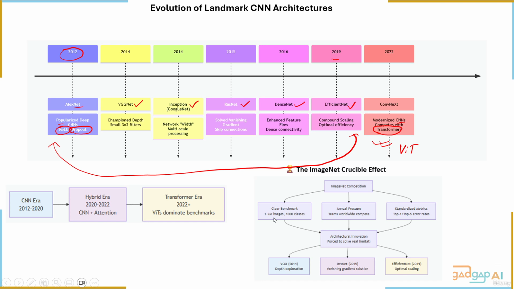

# 第 10 章 经典 CNN 架构：LeNet、AlexNet 与 VGG

卷积神经网络的发展并不是简单堆叠层数，而是围绕特征学习、计算可行性和训练稳定性不断改进。LeNet-5 证明了可学习卷积能够替代手工特征，AlexNet 借助 ReLU、Dropout 与 GPU 让深层 CNN 走向大规模应用，VGG 则以统一的小卷积核和模块化结构展示了深度设计的价值。理解这些地标架构，既能掌握卷积块、分类头和参数量等基本概念，也为后续把预训练网络用作视觉骨干奠定基础。

## 地标架构与 ImageNet 基准

实际项目往往缺少从零设计并训练最先进模型所需的数据、算力和经验，因此成熟架构的意义不仅是历史坐标，更是可复用的工程起点。LeNet、AlexNet、VGG，以及随后出现的 ResNet、Inception、DenseNet 和 EfficientNet，分别解决了自动特征提取、深层训练、参数效率和特征复用等问题。这些网络常作为分类、检测等任务的骨干，其输出端再连接面向具体任务的分类头或其他预测头。

2012 年通常被视为深度 CNN 时代的开端，此后经历了纯 CNN、CNN 与注意力或 Transformer 混合，以及视觉 Transformer 等阶段。ImageNet 大规模视觉识别竞赛（ILSVRC）在这一演进中发挥了重要推动作用：约 120 万张训练图像、1000 个类别，以及统一的 Top-1、Top-5 错误率，使不同模型能够在同一基准上比较。竞赛提供的数据规模、评价指标和持续竞争共同促成了 AlexNet、VGG、ResNet、Inception 与 EfficientNet 等设计。

阅读架构时应同时关注四点：输入尺寸与各层张量如何变化，卷积核和步幅如何影响感受野与计算量，参数量主要集中在哪里，以及最终分类头为何必须随任务类别数调整。精度并非唯一标准；部署设备、训练成本和可复用性同样决定骨干网络是否合适。

{ .diagram }

图 10-1：LeNet、AlexNet 与 VGG 等地标 CNN 的演进。图中时间线还展示 ImageNet 基准对架构创新的推动。课程第 119 课时 03:03 抽帧。

## LeNet-5：可学习特征提取的起点

早期 LeNet-1 可追溯至 1989 年，而真正产生广泛影响的是 Yann LeCun 等人在 1998 年提出的 LeNet-5。该网络面向 MNIST 手写数字识别，输入为 \(32\times32\) 图像，最终输出 0—9 共十类。其主线是“卷积—下采样—卷积—下采样—卷积—全连接”，将局部特征提取与分类整合到一个可端到端训练的模型中。

卷积输出空间尺寸可用下式核对：

\[
H_{out}=\left\lfloor\frac{H_{in}+2P-K}{S}\right\rfloor+1,
\]

其中 \(K\) 为卷积核尺寸，\(P\) 为填充，\(S\) 为步幅。首层使用 6 个 \(5\times5\) 卷积核，步幅为 1、无填充，因此空间尺寸由 32 变为 \(32-5+1=28\)；随后 \(2\times2\)、步幅为 2 的平均池化将其降为 14。第二组卷积使用 16 个 \(5\times5\) 卷积核，再接平均池化。特征随后经过第三个卷积层并展平，送入含 84 个神经元的全连接层，最后由 10 个输出单元给出各类别结果。

| 组成 | 课程中的关键设置 | 作用 |
|---|---|---|
| 第一卷积层 | 6 个 \(5\times5\) 核，\(S=1,P=0\) | 学习边缘等初级局部特征 |
| 第一下采样 | \(2\times2\) 平均池化，\(S=2\) | 将空间尺寸减半 |
| 第二卷积与下采样 | 16 个 \(5\times5\) 核，随后平均池化 | 组合出更复杂的形状特征 |
| 第三卷积与全连接层 | 展平后连接 84 个神经元 | 汇总层次化表示 |
| 分类头 | 10 个输出单元 | 对应十类数字 |

第一层卷积的参数量可直接验证：每个核有 \(5\times5=25\) 个权重，6 个核共有 150 个权重，再加 6 个偏置，得到 156 个可训练参数；平均池化本身没有待学习参数。整个网络约有 6 万个参数，在当时的计算条件下已具有相当规模。

LeNet-5 的核心贡献可归纳为三项。其一，卷积核通过反向传播自动学习，取代 Sobel、Canny 等需要人工选择的规则式特征流程。其二，同一卷积核在整幅图像上滑动并共享权重，既减少参数，又使相同局部模式能够在不同位置被检测。其三，网络形成层次化表示：前层提取边缘和线条，中间层学习曲线、角点与数字部件，后层完成整字判别。当时使用平均池化而非后来更常见的最大池化，但这已确立“卷积块加分类器”的基本范式。该网络曾用于支票读取和邮政数字识别，说明 CNN 不只是理论构造，也能承担真实任务。

## AlexNet：深层 CNN 的工程转折

2012 年的 AlexNet 将 CNN 推向 ImageNet 规模。其输入为 \(224\times224\times3\) 或 \(227\times227\times3\) 的 RGB 图像，整体结构如下：

1. 96 个 \(11\times11\) 卷积核，步幅 4，随后最大池化；
2. 256 个 \(5\times5\) 卷积核，步幅 1，随后最大池化；
3. 连续三个 \(3\times3\)、步幅 1 的卷积层，再进行最大池化；
4. 展平后连接两个各含 4096 个单元的全连接层；
5. 输出层含 1000 个单元，对应 ImageNet 的 1000 类，得分经归一化后表示各类别概率。

AlexNet 约有 6200 万参数，接近 LeNet-5 的千倍。如此规模之所以可训练，首先依赖 GPU 的并行计算能力。课程所述实现将模型分配到两块 NVIDIA GTX 580 上，训练持续约 5—6 天；相比 CPU 核心较少、并行度有限的计算方式，GPU 使大型矩阵和卷积运算成为可承受的训练过程。

第二个关键是 ReLU：

\[
\operatorname{ReLU}(x)=\max(0,x).
\]

与 LeNet 时代使用的双曲正切等饱和激活相比，ReLU 计算简单，在正区间保持较直接的梯度通路，能够缓解深层反向传播中的梯度消失并加快训练。负值被置零还形成稀疏激活，但这并不意味着任意深度下都不会出现梯度问题。第三个关键是后部全连接层使用 Dropout，以抑制高容量分类器的过拟合；同时，最大池化取代 LeNet 的平均池化，保留局部最强响应。

AlexNet 的意义因而不能只归结为“层数更多”。数据基准、非饱和激活、正则化、GPU 并行和大参数量共同形成了可复制的深度学习工程方案，也使视觉研究从小规模手工特征流程转向大规模端到端学习。

课程还以训练时间说明激活函数与硬件的实际影响：在其引用的对比中，使用双曲正切时达到相应训练状态约需 6 天，而 ReLU 可缩短至约 1 天。负数置零带来的稀疏激活与正区间更直接的梯度通路共同改善优化，双 GPU 则承担大规模并行计算。这些数字属于特定历史实现，不能直接外推到今天的硬件，却能说明架构选择和计算平台必须协同设计。

这一组合也改变了研究与应用生态。课程回顾称，AlexNet 之后 CNN 论文数量快速增长，视觉方法开始扩展到人脸、图像搜索、自动驾驶和医学影像等领域。其持久价值不是要求新项目复刻双 GPU 结构，而是确立了“大数据基准、深层可训练模型与并行硬件”相互促进的路线。

## VGG：用小卷积核组织更深的网络

2014 年出现的 VGG 将设计重心从 AlexNet 的大卷积核转向统一的 \(3\times3\) 小卷积核，并借助 GPU 训练包含 16 或 19 个权重层的 VGG16、VGG19。多个小卷积层串联，可以在控制参数量的同时增加非线性变换次数和特征层次；固定卷积核规格还使网络更容易按块阅读、复现和扩展。

VGG 延续了 ReLU 与最大池化，并把“连续卷积后再池化”组织成规则模块，最后连接全连接分类器。它代表的并不是某一个特殊层，而是一种结构化设计原则：用简单、重复的计算单元换取深度和可预测性。其具体通道配置、参数比较及 PyTorch 检查方法将在下一章与 ResNet 一同展开。

| 架构 | 典型输入与输出 | 卷积与下采样特点 | 课程所列参数规模 | 核心启示 |
|---|---|---|---|---|
| LeNet-5 | \(32\times32\) 灰度图，10 类 | \(5\times5\) 卷积，平均池化 | 约 6 万 | 自动学习层次化局部特征 |
| AlexNet | 边长 224 或 227 的 RGB 图，1000 类 | 首层大核大步幅，后接小核，最大池化 | 约 6200 万 | 深度模型需要激活、正则化和 GPU 协同 |
| VGG | RGB 图，1000 类 | 统一 \(3\times3\) 卷积，按块重复并池化 | VGG16 约 1.38 亿 | 简单单元也能构成深层规则网络 |

比较可见，参数规模增长并不只由卷积层数决定。输入分辨率、通道数、卷积核尺寸以及尾部全连接层都会改变权重总量；平均池化或最大池化则主要调整空间尺寸，本身不引入卷积那样的待学习核参数。因此，“层数更多”与“每一处计算更昂贵”是必须分开的两个判断。

## 用 PyTorch 阅读经典模型

课程代码环境以 `torch`、`torch.nn`、`torchvision` 和 `torch.utils.data` 为主。`torchvision` 提供多种经典视觉模型及数据工具，因此不必逐层重写网络才能研究其结构。实践时可先实例化模型并打印完整结构，再逐层核对卷积核、步幅、填充、通道数与全连接层，最后统计可训练参数。这样的检查能把论文中的架构描述与张量实际流动对应起来。

具体核对可按“输入—特征—分类头”的顺序进行。先确认颜色通道和空间边长，避免把库中默认输入与历史论文设置混为一谈；再在每个卷积或池化后记录 \(H\times W\times C\)，用输出尺寸公式检查下采样发生的位置；随后区分权重、偏置与无参数的池化操作，解释参数为何在某些层集中增长；最后确认输出单元数来自类别数，而不是来自骨干特征维度。若要将模型用作新任务骨干，还需定位应保留的特征部分和应替换的分类部分，为后续迁移学习做好准备。

演示还接入了 DeepSeek API，用于询问架构设计背景和解释概念。该环节属于辅助说明，不参与卷积计算或参数训练；不需要大语言模型时可以关闭相关代码，模型定义与后续视觉实验仍可独立进行。

## 本章小结

- LeNet-5 以共享权重的卷积、下采样和全连接层实现端到端特征学习，确立了经典 CNN 的基本范式。
- AlexNet 将 ReLU、Dropout、最大池化和双 GPU 训练结合起来，使约 6200 万参数的网络能够处理 ImageNet 千类分类。
- VGG 通过统一的 \(3\times3\) 卷积核和重复模块提高深度，体现了规则化、小卷积核架构的设计思想。
- 阅读经典网络应同时核对空间尺寸、参数量、梯度训练和部署成本，而不能只比较最终精度。

<!-- course-lectures: 116-121 -->

<!-- ebook-navigation -->

---

[← 上一章](ch09.md) · [返回完整目录](../index.md) · [下一章 →](ch11.md)
