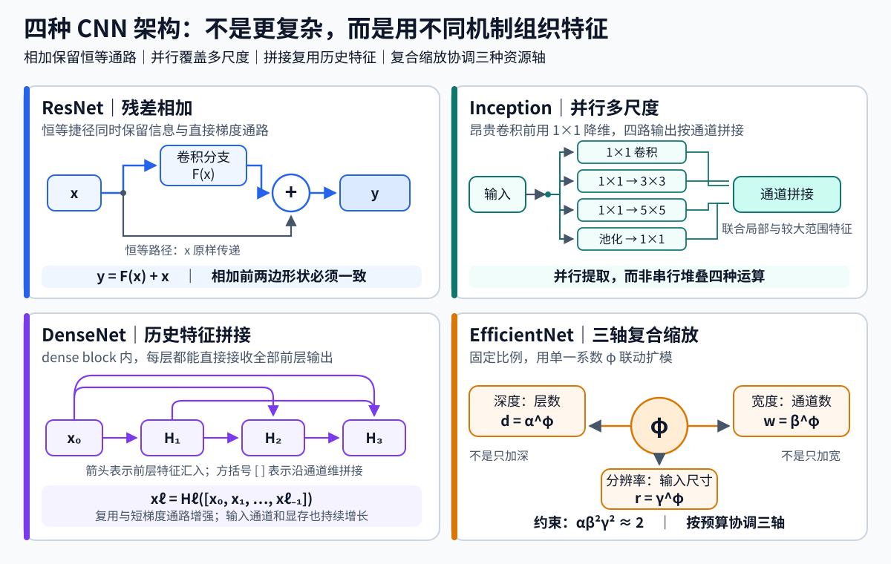

# 第 11 章 ResNet、Inception、DenseNet 与 EfficientNet

经典 CNN 的演进围绕一个持续存在的矛盾展开：模型需要更强的表示能力，却不能让参数、显存和梯度传播失控。VGG 用小卷积核构造规整深层网络，ResNet 以残差通路改善优化，Inception 在并行分支中提取多尺度特征，DenseNet 通过密集拼接复用历史特征，EfficientNet 则把深度、宽度和输入分辨率纳入统一缩放规则。这些方案并非简单的年代替换关系，而是不同资源约束下的架构工具箱。

## VGG：重复小卷积核的代价与收益

VGG16 与 VGG19 分别包含 16 和 19 个权重层。网络以 RGB 图像为输入，连续使用 \(3\times3\) 卷积和 ReLU，并通过最大池化逐步降低空间分辨率。各阶段通道数由 64 增至 128、256，再到 512，最深阶段维持 512 个通道。尾部展平特征，经两个各含 4096 个神经元的全连接层及后续分类层，以 1000 路 Softmax 输出完成 ImageNet 分类。

在输入、输出通道数相同且忽略偏置时，一个 \(7\times7\) 卷积约有 \(49C^2\) 个权重，而三个串联的 \(3\times3\) 卷积约有 \(3\times9C^2=27C^2\) 个权重。两者对应的理论感受野均可覆盖 \(7\times7\) 区域，但后者参数更少，并在三次卷积之间引入更多非线性和更丰富的层次表示。这正是 VGG 以小核替代大核的核心依据。

规整并不意味着轻量。VGG16 含 13 个卷积层和 3 个全连接层，总参数量约 1.38 亿，明显高于 AlexNet，尤其尾部全连接层带来沉重负担。因此，VGG 更适合用于理解模块化设计和作为教学、特征研究对象，而不是在资源紧张时默认选择。

用 `torchvision.models.vgg16` 可以直接检查这一结构。打印模型后，可看到卷积、ReLU 和最大池化的重复排列；卷积中的 `padding=1` 用于在 \(3\times3\) 核下保持空间尺寸。进一步遍历模块可统计 13 个卷积层、3 个全连接层及总参数量，从而验证理论阅读与库中实现的一致性。

## ResNet：让网络学习残差

在 ResNet 出现前，简单增加层数并不必然提高训练精度，甚至会出现较深网络反而更差的现象。反向传播依靠链式法则连续相乘；当许多梯度因子小于 1 时，连乘结果会迅速趋近于零，使前层难以获得有效更新。例如连续十次乘以 0.1，量级已降至 \(10^{-10}\)。深层网络因而面临的不只是拟合能力问题，更是信息和梯度能否跨层传播的问题。

Kaiming He 等人在 2015 年提出的 ResNet 将普通块的直接映射改为残差映射：

\[
y=\mathcal F(x)+x.
\]

网络不再要求卷积分支独自学习完整的 \(\mathcal H(x)\)，而是学习相对于输入的增量 \(\mathcal F(x)=\mathcal H(x)-x\)。恒等路径保留原始表示，卷积分支只需补充必要变化；即使某块没有学到有效增量，输入仍可经捷径传向后续层。

残差连接也提供直接的梯度通路。忽略张量批量维时，

\[
\frac{\partial y}{\partial x}
=I+\frac{\partial\mathcal F}{\partial x}.
\]

上游梯度乘以该雅可比后，既包含经过卷积分支的乘积项，也包含沿恒等路径传递的项。后者不依赖一串权重连乘，因此能显著缓解梯度消失，使百层以上网络的训练成为可能。ResNet 在 ILSVRC 上取得低错误率，也证明这种结构具有实际性能优势。

残差相加要求两边形状一致。课程用 `nn.Module` 定义简化残差块，在前向传播中先保存 `identity = x`，令卷积分支输出与 `identity` 相加，并检查块输入、输出形状是否相同。空间尺寸可通过适当填充保持，但通道数或步幅发生变化时仍须先对齐维度，不能直接相加。对于库中的 ResNet50，可通过 `model.children()` 查看顶层组成，再深入各残差层核对结构。

## Inception：并行多尺度特征与降维

GoogLeNet，即 Inception v1，于 2014 年提出。它不再强制同一输入只经过一种卷积，而是在模块内并行使用不同尺度的分支：小卷积核擅长捕捉局部纹理，大卷积核覆盖更大区域，多条路径拼接后能够同时保留不同尺度的信息。后续 v2、v3 于 2015 年继续发展这一思路。

并行计算若直接作用于高分辨率输入，成本很高，因此 GoogLeNet 先以 stem 压缩特征。课程中的流程为：\(224\times224\times3\) 输入先经过 64 个 \(7\times7\)、步幅 2 的卷积，空间尺寸降至 \(112\times112\)；再以 \(3\times3\)、步幅 2 的最大池化降至 \(56\times56\)；随后通过 \(1\times1\) 与 \(3\times3\) 卷积将通道数变为 192，并保持空间尺寸；最后池化得到 \(28\times28\times192\) 的模块输入。

一个典型 Inception 模块包含四条并行路径：

| 分支 | 中间与输出通道 | 作用 |
|---|---|---|
| 直接 \(1\times1\) 卷积 | 输出 64 | 保留通道级局部组合 |
| \(1\times1\) 后接 \(3\times3\) | 96 降维，输出 128 | 提取中小尺度特征 |
| \(1\times1\) 后接 \(5\times5\) | 输出 32 | 以较低成本提取较大尺度特征 |
| 池化后接 \(1\times1\) | 输出 32 | 保留池化响应并压缩通道 |

四路输出按通道拼接，总通道数为 \(64+128+32+32=256\)。其中，昂贵卷积之前的 \(1\times1\) 卷积是关键瓶颈层：它先降低通道维数，再执行 \(3\times3\) 或 \(5\times5\) 运算，而不是在空间层面简单压缩图像。整个网络由 2 个、5 个、2 个 Inception 模块分组构成，之后经平均池化和 1000 路全连接层输出。约 500 万的参数量远低于同年的 VGG16，说明多分支并不必然意味着参数膨胀。

以猫脸为例，较小卷积核更容易聚焦耳缘、眼部轮廓等局部结构，较大卷积核则能在一次运算中覆盖更完整的对象区域。并行分支让同一模块同时接触这些证据，不必等到网络很深处才获得较大范围的组合信息。这里的“多尺度”是多种卷积覆盖范围的联合学习，不是把同一幅图简单保存成多个分辨率副本。

这种思想也影响了后续视觉架构。课程特别提到特征金字塔网络和多尺度单阶段检测器等方向：它们虽然不等同于 Inception 模块，却同样重视在不同范围上组织和利用视觉特征。MobileNet、EfficientNet 对计算效率的关注，也与 \(1\times1\) 降维和受控分配计算量的思路相呼应。

## DenseNet：以拼接保留全部历史特征

ResNet 将输入与输出相加，特征会合并为新的张量；DenseNet 则选择沿通道维拼接，让每一层直接接收当前密集块内所有前层的输出：

\[
x_\ell=H_\ell\!\left([x_0,x_1,\ldots,x_{\ell-1}]\right).
\]

这里的方括号表示拼接而非加法。于是，后续层不仅获得相邻层的信息，还可直接利用更早层的原始特征映射；梯度也拥有通往各前层的短路径。特征复用减少了重复学习，使 DenseNet 在相近深度下可以采用更少参数。

网络由卷积、池化、多个 dense block 和块间 transition 组成，末端连接分类层。DenseNet121 含 121 层、约 800 万参数；课程将其与约 2500 万参数的 ResNet50、1.38 亿参数的 VGG16 对比，以突出其参数效率。

但“参数少”不等于“训练资源一定少”。拼接使后续层的输入通道持续增长，保存全部历史特征映射还会增加显存压力。相加与拼接的核心差异因此是：ResNet 更偏向紧凑的残差修正，DenseNet 更偏向完整保留和反复使用特征；生产选型时必须把显存和计算成本一并考虑。

## EfficientNet：深度、宽度与分辨率的复合缩放

传统扩模通常只增加层数、每层通道数或输入分辨率。EfficientNet 在 2019 年提出复合缩放，用单一系数 \(\phi\) 联动三者：

\[
d=\alpha^\phi,\qquad w=\beta^\phi,\qquad r=\gamma^\phi,
\]

并满足近似约束

\[
\alpha\beta^2\gamma^2\approx 2.
\]

深度增加时，计算量近似线性增长；宽度和分辨率增加时，FLOPs 近似按平方增长，因此约束中的指数分别取 1、2、2。课程给出的网格搜索结果为 \(\alpha=1.2\)、\(\beta=1.1\)、\(\gamma=1.15\)。固定这些比例后，\(\phi=0\) 对应基线 EfficientNet-B0，\(\phi=1\) 对应 B1，依次扩展至 B7；B0 的输入分辨率为 224。部分最终分辨率会结合硬件计算习惯调整，而不是机械保留所有小数计算结果。

例如 B1 的三个缩放因子就是 1.2、1.1、1.15；B2 则分别为 \(1.2^2=1.44\)、\(1.1^2=1.21\)、\(1.15^2=1.3225\)。这三个数不是分别增加的层数、通道数和像素数，而是相对于基线相应维度的缩放倍率。模型族因此具有一致的扩模规则，无须为每个尺寸重新任意组合三种比例。

复合缩放的目标是在相近计算预算下获得更好的精度，而非单纯追求最大模型。课程的 GPipe 对比中，EfficientNet-B7 以约 6600 万参数和 370 亿 FLOPs 达到 84.3% 的 Top-1 精度，而对照模型约为 5.56 亿参数、3170 亿 FLOPs、同样的 84.3%。这一结果展示了系统化缩放相对于盲目扩模的效率优势。

{ .diagram }

图 11-1：ResNet、Inception、DenseNet 与 EfficientNet 的核心机制对比。图中依次呈现残差相加、并行多尺度、历史特征拼接与三轴复合缩放。根据课程内容整理。

## 骨干网络的选择与核对

| 需求或约束 | 可优先考虑的方向 | 需要核对的事项 |
|---|---|---|
| 学习架构原理 | VGG、ResNet、Inception、EfficientNet | 结构清晰，算力是否足以复现 |
| 通用视觉任务 | ResNet50、EfficientNet-B0 | 泛化表现与资源平衡 |
| 追求较高精度且预算充足 | EfficientNet-B7 等较大模型 | 训练、推理成本同步上升 |
| 移动端或边缘部署 | MobileNet 或较小 EfficientNet | 模型大小、延迟、显存占用 |
| 强调历史特征复用 | DenseNet | 拼接带来的显存开销 |

实际选择应从任务与部署端反推，而不是默认采用年代最新或参数最多的网络。代码中可先打印模型、遍历子模块并统计参数，再用形状检查验证残差相加或分支拼接是否合法。课程中的大语言模型问答仅用于补充解释，结构判断仍应以模型定义和张量检查为准。

## 本章小结

- VGG 以三个 \(3\times3\) 卷积替代一个 \(7\times7\) 卷积，在相同理论感受野下减少权重并增加非线性，但整体参数仍很大。
- ResNet 通过 \(y=\mathcal F(x)+x\) 保留恒等信息与直接梯度通路；Inception 通过并行多尺度分支和 \(1\times1\) 降维兼顾宽度与效率。
- DenseNet 拼接所有前层特征以增强复用和梯度传播，但需要警惕通道增长及显存开销。
- EfficientNet 用复合系数协调深度、宽度和分辨率，形成 B0—B7 模型族；骨干选择应服从精度、算力和部署目标的共同约束。

<!-- course-lectures: 122-128 -->

<!-- ebook-navigation -->

---

[← 上一章](ch10.md) · [返回完整目录](../index.md) · [下一章 →](ch12.md)
