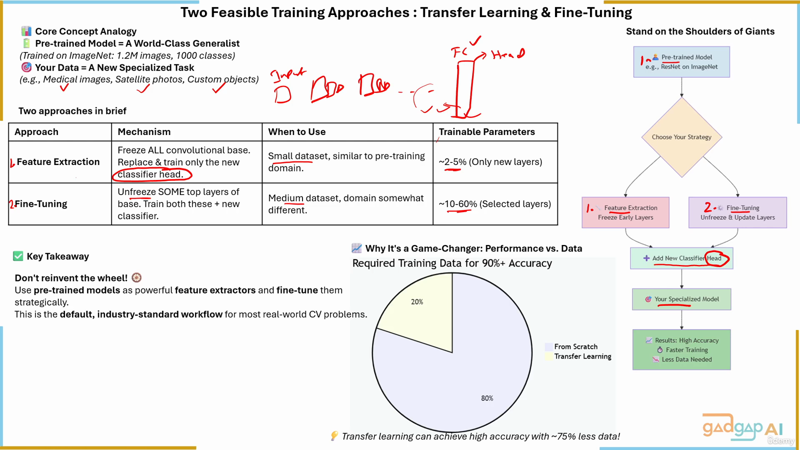

# 第 12 章 迁移学习与特征提取

从头训练大型 CNN 通常需要海量标注图像和昂贵算力，而许多实际任务只有数百或数千张领域图像。迁移学习利用已经在大规模数据上训练好的网络，把通用视觉表示带到新任务中，只调整必要的部分。特征提取是其中最保守、成本最低的起点：冻结预训练骨干，替换并训练新的分类头。它不仅减少可训练参数，也为后续是否需要微调提供了可靠基线。

## 为什么预训练表示能够迁移

迁移学习需要两项基本输入：一个预训练模型和一份面向目标任务的数据。模型可以选自 ResNet、VGG、EfficientNet 等成熟架构；数据则应反映真实应用，例如医学影像、卫星照片或工业对象，而不能只沿用原模型的训练类别。

这种复用之所以有效，源于 CNN 表示的层次性。靠近输入的浅层学习边缘、颜色、梯度与斑点等低级模式，这些模式广泛存在于自然图像和许多专业图像中，具有较强通用性。中间层把局部模式组合成纹理、形状和部件，多数情况下仍可迁移，但也可能需要适应领域差异。靠近输出的深层将部件组织为任务相关语义，例如区分不同动物或特定病变，专用性最强。原有千类分类头则直接绑定 ImageNet 标签空间，通常无法表达新任务的类别。

因此，迁移并不要求重写全部视觉知识。保留浅层的通用表示，替换或适度调整靠近分类头的部分，就能把训练集中在真正的任务差异上。课程用资源对比说明这一动机：从零训练可能需要百万级标注图像和多 GPU 数周计算，而数百张任务图像配合预训练模型，在单 GPU 上以小时级训练即可获得可用起点。这里的数量是场景示例而非性能承诺，实际成本仍取决于模型、数据和实现。

## 三条训练路线及选择依据

迁移学习包含两种主要策略：特征提取只训练新分类头；微调除分类头外，还解冻靠近输出的若干骨干层。若二者仍不能满足需求，才考虑更大范围的训练乃至从零开始。选择时应同时评估数据量、源域与目标域差异、算力和过拟合风险。

| 路线 | 参数更新范围 | 更合适的条件 | 主要特点 |
|---|---|---|---|
| 特征提取 | 仅新分类头 | 数据很少，目标域与预训练域较接近 | 快、成本低、过拟合风险较小 |
| 微调 | 新分类头及部分后部骨干层 | 数据较多，或领域存在明显差异 | 适应能力和性能上限更高，但训练风险增加 |
| 从头训练 | 全部参数随机初始化后学习 | 数据与算力充足，且已有迁移方案不能满足任务 | 成本最高，不应作为默认第一步 |

合理的实验顺序是先建立特征提取基线，在独立验证集上判断是否达标；若不足，再逐层扩大微调范围。直接从最复杂方案开始，会使计算成本、调参自由度和过拟合风险同时增加，也难以判断性能变化究竟来自哪一步。

数据量与域差异需要联合判断。数据少且领域相近时，冻结骨干最能发挥通用表示的价值；数据增加或目标图像明显偏离 ImageNet 时，才有理由让后部表示参与学习。即使领域差异很大，小数据也不意味着应立即全量训练，因为此时可训练参数越多，记忆少量样本的风险越高。可以先用特征提取确认骨干表示的可用程度，再依据验证缺口选择最小解冻范围。

{ .diagram }
<p class="figure-caption">图 12-1：特征提取与微调两种迁移学习路径。冻结骨干与解冻部分层对应不同的数据需求和参数更新范围。课程第 130 课时 07:49 抽帧。</p>

换头也不等于简单删除最后一项。新头输入维度必须承接骨干特征，内部层决定可训练容量，最终维度则由任务标签空间决定。类别标签与输出顺序要保持固定对应，训练、验证和后续推理都应使用同一映射，否则即使损失能够下降，输出也无法被正确解释。

## 特征提取的“换头”机制

预训练网络可划分为骨干（backbone）与分类头（head）。骨干由卷积、池化和相应特征块组成，负责把图像映射为特征向量；分类头把这些特征映射到类别得分。ImageNet 预训练模型通常输出 1000 类，而动物园应用可能只有 10 种动物，此时必须将原来的 1000 路输出替换为 10 路，而不能仅修改类别名称。

特征提取包含三个紧密关联的操作：

1. **冻结骨干。** 保留所有预训练层及其权重，训练时不更新这些参数。冻结不是删除层，也不是让特征失去作用，图像仍完整经过骨干前向计算。
2. **替换分类头。** 移除原分类头，根据骨干输出维度和新任务类别数建立新层。新增参数需要训练，用来学习领域特征到目标标签的映射。
3. **限制优化范围。** 反向传播只产生分类头所需的参数更新，骨干保持原有的 ImageNet 权重。训练完成后，骨干充当固定特征提取器，新头承担最终解释。

课程将这一策略所需训练的参数量概括为总参数量的约 2%—5%，具体比例取决于新头结构和类别数。由于待优化自由度较少，小数据下过拟合的风险通常低于大范围微调；同时，新头无法改变骨干已经形成的表示，所以当目标域差异很大时，其适应能力也有限。这正是“安全起点”与“性能上限”并存的含义。

## PyTorch 实现：数据、冻结与新分类头

课程的 ResNet50 示例完整展示了特征提取的准备过程。实验不依赖外部医学或花卉数据库，而是用 NumPy 生成五类合成花卉图像：Rose、Daisy、Tulip、Sunflower 和 Orchid。不同类别采用不同数值和颜色模式，共生成 500 张图像，并按类名写入 `flower_data` 下的目录。合成数据只用于跑通流程，实际应用应替换为具有真实标签和真实变化的领域数据。

数据处理分为训练与验证两条管线。训练端加入随机裁剪、翻转和颜色扰动等增强，使分类头接触到更多输入变化；验证端仅进行模型所需的尺寸调整等确定性处理，不施加随机增强，以免评价数据分布随迭代改变。数据按 80%∶20% 划分为 400 张训练图像和 100 张验证图像，类别数为 5，因此新分类头的最终输出也必须是 5 维。

模型端从 `torchvision.models` 取得 ResNet50，先打印结构和参数，再执行冻结。核心状态由 `requires_grad` 控制：

```python
for param in model.parameters():
    param.requires_grad = False

# 随后替换 model.fc；新分类头参数保持可训练
trainable_params = [
    param for param in model.parameters() if param.requires_grad
]
```

示例的新头先把骨干表示映射到 512 个单元，接 ReLU 和概率为 0.3 的 Dropout，再映射到 256 个单元并配置激活与 Dropout，最后输出 5 类。替换后应重新统计参数，而不能沿用冻结前的列表。课程统计结果约为：ResNet50 总参数近 2500 万，冻结约 2350 万，训练略多于 100 万，可训练比例约 4.8%。新头使用 \(10^{-3}\) 的学习率，以便在冻结表示上较快收敛；优化器中只应传入 `requires_grad=True` 的参数。

参数统计可直接利用张量的 `numel()`，并用 `requires_grad` 区分两组：

```python
total = sum(p.numel() for p in model.parameters())
trainable = sum(p.numel() for p in model.parameters()
                if p.requires_grad)
frozen = total - trainable
```

这一步不仅用于展示模型大小，也能发现换头顺序错误。如果冻结后没有恢复新头的可训练状态，`trainable` 会异常偏小；如果把优化器仍绑定到旧头参数，统计结果与真正更新的对象就可能不一致。训练前打印这些数量，是比进入多轮训练后再排查更高效的结构验证。

这一实现可用以下检查清单避免常见错误：

- 冻结操作发生在替换新头之前，避免把新增分类层也一并冻结。
- 最后一层输出数与数据的 5 个类别严格一致，而不是保留 ImageNet 的 1000 路输出。
- 参数统计区分总量、冻结量和可训练量，优化器只管理后者。
- 训练变换和验证变换分开定义，验证集不承担数据扩充任务。

## 训练观察与辅助工具

特征提取训练仍应遵循基本诊断原则：随着轮次增加，训练损失总体下降、训练准确率上升，同时在未参与更新的验证集上检查泛化。只观察训练指标无法判断新头是否记住了小数据集，也不能据此提前断言微调一定更好。先保存并评价这一低成本基线，后续扩大解冻范围才有明确比较对象。

代码还配置了 CUDA 环境和 DeepSeek 问答，用来辅助解释“有限数据为何需要迁移学习”以及特征提取与微调的区别。大语言模型输出只作为说明材料，不参与图像预处理、参数冻结或损失计算；不需要该功能时可以注释相关部分，不影响 ResNet50 的特征提取实验。

## 本章小结

- CNN 浅层的边缘、颜色等表示具有通用性，中层表示大多可迁移，深层语义和分类头更具任务专用性。
- 特征提取通过冻结骨干、替换分类头和仅优化新头，用较少数据与算力建立任务基线。
- ResNet50 示例以 500 张五类合成图像完成 80%∶20% 划分，仅训练约 4.8% 的参数，新头输出固定为 5 类。
- 应从特征提取开始，根据独立验证表现决定是否微调，而不是默认从头训练或一次解冻整个网络。

<!-- course-lectures: 129-134 -->

<!-- ebook-navigation -->

---

[← 上一章](ch11.md) · [返回完整目录](../index.md) · [下一章 →](ch13.md)
