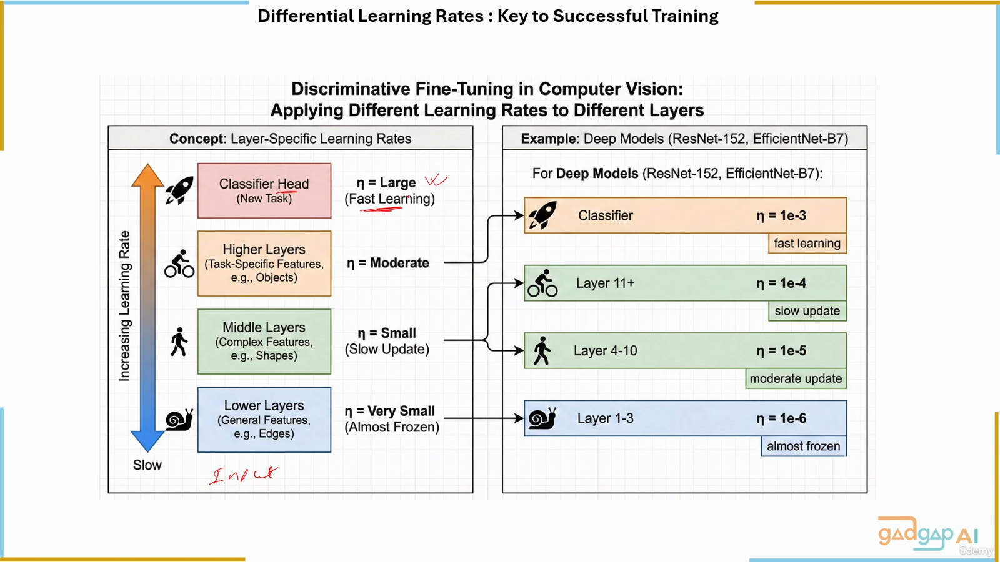

# 第 13 章 微调、分层学习率与持续学习

当冻结骨干无法适应目标领域时，微调允许预训练网络的后部层继续学习，以更高的数据和计算成本换取适应能力。它并不是简单地把所有 `requires_grad` 重新打开，而是在保留旧知识与学习新知识之间控制更新幅度：解冻多少层、各层使用多大学习率、何时恢复历史检查点，都会影响结果。若同一模型还要依次学习多个任务，则需要进一步约束重要旧参数，弹性权重巩固（EWC）正是为此引入的持续学习方法。

## 从保守解冻到全量微调

CNN 的设计先验来自图像的局部相关性与平移变化：卷积通过局部连接提取模式，同一卷积核在各位置共享权重，池化控制空间尺寸并增强一定的位置鲁棒性。微调保留这些结构，只改变哪些参数可以学习。与特征提取相比，它把任务适配从新分类头扩展到靠近输出的卷积块。

| 方案 | 更新范围 | 数据与成本 | 优势 | 主要风险 |
|---|---|---|---|---|
| 特征提取 | 仅新分类头 | 数据需求小，通常最快、最省算力 | 稳定的小数据基线 | 骨干不能适应新领域 |
| 部分微调 | 新头及后部一至数个块 | 中等数据与成本 | 通常在适应性和稳定性间取得平衡 | 解冻过多仍会过拟合 |
| 全量微调 | 骨干与新头全部参数 | 需要更多数据和较大算力，速度最慢 | 理论上调整自由度最大 | 灾难性遗忘、过拟合和训练不稳定 |

课程以数百张图像作为特征提取的典型小规模场景，以千张以上、尤其领域差异明显的任务作为可考虑微调的场景；医学、卫星、显微和工业检测图像与自然图像差异较大时，仅换头往往不足。这里的数量不是固定阈值，更重要的原则是：数据越少，解冻层数应越少；只有验证表现说明有必要时，才逐步扩大更新范围。

推荐从冻结骨干训练新头开始。如果验证结果不足，先解冻最后 1—2 个块并继续训练，再次评估；仍不足时才逐块向前扩展。这样的顺序既能控制成本，也能定位性能提升来自哪个阶段，而不是把“更多可训练参数”误当成“更好模型”的充分条件。

## 梯度流、更新幅度与分层学习率

设某层权重为 \(w\)，基础梯度下降更新为

\[
w_{new}=w_{old}-\eta\frac{\partial\mathcal L}{\partial w},
\qquad
|\Delta w|=\eta\left|\frac{\partial\mathcal L}{\partial w}\right|.
\]

冻结意味着对应参数不参与梯度更新，在 PyTorch 中通过 `param.requires_grad = False` 实现；解冻后设为 `True`，优化器才会根据梯度改变权重。特征提取只允许新头更新，部分微调则让梯度和参数更新延伸到选定的后部块，更浅层继续保持预训练权重。

学习率 \(\eta\) 直接缩放更新幅度。预训练权重已经包含有价值表示，若所有层都使用与新头相同的大学习率，梯度更新可能迅速覆盖旧知识。由此产生三类典型风险：

- **灾难性遗忘：** 大幅更新破坏原有的通用视觉表示，模型在旧任务或原有特征上的能力下降。
- **过拟合：** 小数据集与大量可训练参数结合，使模型记住少量任务样本，而非学习可泛化规律。
- **训练不稳定：** 梯度方差较大时，损失曲线剧烈波动，难以判断哪一轮权重最佳。

分层学习率让更新速度从输入端到分类头逐步增大。课程针对 ResNet152、EfficientNet-B7 等深网给出的理论示意是：第 1—3 层若必须更新，可采用 \(10^{-6}\)，第 4—10 层采用 \(10^{-5}\)，第 11 层及之后更靠近输出的层采用 \(10^{-4}\)，新分类头采用 \(10^{-3}\)。这些数值表达的是数量级关系，而不是对所有模型通用的最优配置，层号也应映射到实际网络的阶段后再使用。

{ .diagram }
<p class="figure-caption">图 13-1：从预训练骨干到新分类头的分层学习率。更新速度由浅层向新分类头逐步增大，右侧为课程给出的层级配置示例。课程第 137 课时 00:45 抽帧。</p>

ResNet50 的全量微调代码采用另一组具体配置：`layer1` 为 \(10^{-5}\)，`layer2` 为 \(5\times10^{-5}\)，`layer3` 和 `layer4` 均为 \(10^{-4}\)，最终分类层为 \(10^{-3}\)。在 Adam 中可通过参数组实现：

```python
optimizer = torch.optim.Adam([
    {"params": model.layer1.parameters(), "lr": 1e-5},
    {"params": model.layer2.parameters(), "lr": 5e-5},
    {"params": model.layer3.parameters(), "lr": 1e-4},
    {"params": model.layer4.parameters(), "lr": 1e-4},
    {"params": model.fc.parameters(),     "lr": 1e-3},
])
```

这段参数组突出四个残差层组和分类头的配置。若执行真正的全量微调，还必须先将全部参数设为可训练，并把 `conv1`、`bn1` 等未在该简表中列出的参数纳入相应优化组，避免部分权重被意外排除在优化器之外。

若只做部分微调，示例保留 `layer1`—`layer3` 冻结，仅解冻 `layer4`，并分别给 `layer4` 与新头配置 \(10^{-4}\) 和 \(10^{-3}\)。配合学习率调度器、逐轮保存检查点，可以在训练动态变化后调整步长，并恢复较早轮次而非被迫使用最后一轮。

## EWC：为旧任务的重要权重增加约束

普通微调关注当前任务损失，参数只要有助于降低新损失就可以移动。当模型先学 X 光、再学 CT、随后学习 MRI，或机器人依次适应多个环境时，这种更新可能让后续任务的表现提高，却损害先前任务。EWC 在总损失中加入以旧参数为中心的二次惩罚：

\[
\mathcal L_{total}=\mathcal L_{target}
+\frac{\lambda}{2}\sum_i F_i\left(\theta_i-\theta_{old,i}\right)^2.
\]

其中，\(\mathcal L_{target}\) 是当前新任务损失，\(\theta_i\) 是正在优化的参数，\(\theta_{old,i}\) 是旧任务训练后保存的参数，\(F_i\) 表示 Fisher 信息所衡量的旧任务重要性，\(\lambda\) 控制整体正则化强度。参数偏离旧值越远，惩罚越大；\(F_i\) 越高，同样偏离所造成的损失越大，优化就越倾向于保持该参数。

可以把它理解为不同刚度的“橡皮筋”：对旧任务至关重要的权重连接着粗橡皮筋，难以移动；不重要的权重连接细橡皮筋，可以为新任务自由调整。课程用浅层、过渡层和末层说明这一思想：对承载通用边缘等旧知识的参数施加较强保护，中间表示允许有限移动，面向新语义的末层保留更大可塑性。核心不是机械地按层号设值，而是让参数保护程度与其对旧任务的重要性相匹配。

\(\lambda\) 决定新任务拟合与旧任务保持之间的总体权衡。过小，约束可能不足以抵抗遗忘；过大，则新任务学习能力会被压制。EWC 并非单次换头或单次微调的必需步骤，它主要适用于连续任务、连续领域或连续环境学习，并需要保留旧任务参数及其重要性信息。

## 三种策略的受控比较

课程在同一 ResNet50 和同一五类、500 张合成花卉数据上比较三条路线。特征提取只训练约 100 万参数，约占总量的 4.8%；部分微调解冻 `layer4` 与新头后，约冻结 850 万、训练 1614 万参数，可训练比例约 65%；全量微调则训练接近 2500 万参数。部分微调的可训练参数规模约为特征提取的十几倍，但实际耗时还取决于硬件、数据管线和实现，不能仅按参数比例精确推算。

三种方案各训练 8 轮，最终**训练准确率**分别约为 93%、94.5% 和 93.5%。部分微调高于特征提取，符合增加任务适应能力的预期；全量微调并未继续提高，课程将小规模数据下的遗忘或过拟合作为可能解释。这一结果不能证明全量微调必然更差，也不能代替验证集结论，却清楚说明“更新全部参数”不自动等于最佳性能。

逐轮曲线还显示，部分微调总体下降的损失在第 7 轮附近出现回升，全量微调也存在明显波动；第 6 轮的部分微调权重或第 4 轮的全量微调权重可能比末轮更值得保留。正确做法是结合验证指标、损失与准确率曲线选择检查点，而不是看到某一轮训练表现好就忽略后续稳定性和真实泛化。

## 可复用的渐进式训练流程

以约 2000 张任务图像为例，可把实践组织成闭环：

1. **建立预训练基线。** 选择与任务和部署预算匹配的骨干，替换分类头，先检查未经适配的输出与完整数据流程。
2. **执行特征提取。** 冻结骨干，只训练新头 5—10 轮，以约 \(10^{-3}\) 的学习率快速建立基线，并在验证集上评价。
3. **逐步部分微调。** 若验证表现不足，从末端逐个解冻少量块；课程流程给出最后 3—5 个块作为渐进搜索范围，骨干学习率保持在新头之下，常用 \(10^{-4}\) 至 \(10^{-5}\) 的数量级进行试验。
4. **加入训练控制。** 根据曲线使用学习率调度、数据增强、Dropout 和早停，避免数据不足时继续自由扩大参数更新。
5. **保存并比较检查点。** 每轮记录训练与验证损失、准确率和配置，选择验证表现与稳定性合适的权重。达到目标后即停止扩大解冻范围。

这一流程保留了 CNN 的通用局部特征，又让任务相关层逐步适应新数据。若将来还要在同一模型上顺序学习其他任务，再评估是否需要 EWC，而不是把它默认加入所有训练。

## 本章小结

- 微调从后部少量块开始，数据越少越应保守解冻；全量更新并不保证优于部分微调。
- 分层学习率让浅层缓慢更新、新分类头快速学习，可降低灾难性遗忘、过拟合和训练不稳定风险。
- EWC 通过 \(F_i(\theta_i-\theta_{old,i})^2\) 惩罚重要旧参数的偏移，适用于连续任务或多领域学习。
- 同一 500 张合成数据实验中，8 轮后的训练准确率以部分微调最高，说明应依据验证表现和逐轮曲线选择策略与检查点。

<!-- course-lectures: 135-143 -->

<!-- ebook-navigation -->

---

[← 上一章](ch12.md) · [返回完整目录](../index.md) · [下一章 →](ch14.md)
