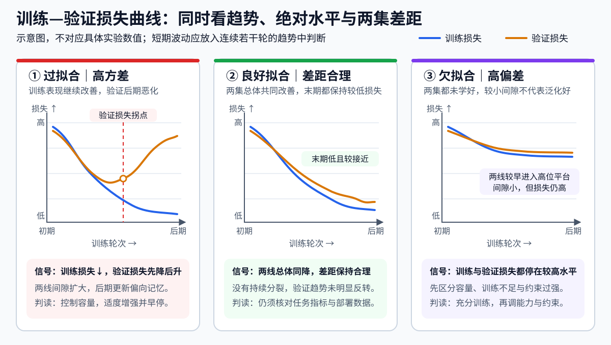

# 第 14 章 训练诊断与性能改进工作流

模型训练的目标不是在已知样本上取得孤立的最高分，而是在未见数据上保持稳定表现。训练集与验证集的损失、准确率及其随轮次变化的曲线，是判断这一目标是否实现的主要依据。过拟合与欠拟合分别对应高方差和高偏差，二者可能出现在同一迁移学习任务的不同配置中，却需要相反方向的调整。先辨认训练动态，再依次改变数据、模型容量或约束强度，才能避免无目的地叠加技巧。

## 从训练指标转向泛化诊断

训练准确率反映模型对参与参数更新样本的拟合程度，验证准确率则检验它对未参与训练样本的泛化程度。二者必须结合观察：训练指标很好而验证指标较差，不能称为良好模型；两者很接近但都停留在低水平，也同样不合格。

损失曲线比单个末轮数值包含更多信息。理想状态下，训练损失和验证损失总体共同下降，二者差距保持合理，训练与验证准确率都达到任务要求。实际曲线可能存在波动，因此诊断应关注若干轮的趋势，而不是把一次上下跳动直接解释为某种拟合状态。

可以把训练诊断拆成三个问题：模型是否已充分学习训练数据，训练与验证之间的差距是否持续扩大，以及当前改动究竟影响了拟合能力还是泛化能力。高偏差主要对应第一个问题，高方差主要对应第二个问题，数据增强与正则化则服务于第三个问题中的泛化目标。最终仍需用贴近部署条件的数据复核，因为随机划分的验证集不一定覆盖全部真实变化。

{ .diagram }
<p class="figure-caption">图 14-1：过拟合、欠拟合与良好拟合的曲线特征。图中对比三者的训练/验证损失趋势、两集差距与判读要点。根据课程内容整理。</p>

## 过拟合：高方差与训练—验证分裂

过拟合是模型把训练样本中的偶然细节、噪声乃至具体排列也当作规律。大型网络配合很小的数据集时尤其常见，例如在数百张图像上训练 ResNet152 或 EfficientNet-B7，模型拥有足够自由度记住有限样本，却未必学到稳定语义。

猫的分类可以说明这种差异。若训练集中的猫恰好都出现在绿草地上，记忆型模型可能把“绿色背景”当作猫的必要条件；学习有效特征的模型则更应利用尖耳、胡须等与类别真正相关的结构。面对新背景中的猫，前者容易失败，后者才有较好的泛化机会。

过拟合通常具有以下信号：

1. 训练准确率显著高于验证准确率。课程用接近 99% 与约 70% 的对比说明大间隙，但这些数值不是统一判定阈值。
2. 训练损失继续下降，验证损失却在若干轮后停止下降甚至上升，两条曲线逐渐分离。
3. 随训练轮次增加，训练表现改善而验证表现停滞或恶化，说明后续更新更多是在记忆样本。
4. 模型在新采集或真实部署数据上的表现明显弱于训练表现。

“高方差”强调模型对训练样本具体组成过于敏感。样本稍有变化，所学函数或预测就可能明显变化。解冻过多预训练层、模型容量相对数据过大、训练时间过长，都可能加剧这一现象。因而不能仅通过继续训练来解决训练—验证差距，也不能因为训练损失很低就判断模型已经收敛到可部署状态。

## 欠拟合：高偏差与学习不足

欠拟合是模型尚未学到数据中的基本结构。它的简化假设过强、有效训练不足，或输入与约束没有给模型提供足够学习条件，结果是在训练集和验证集上都表现不佳。这与“训练集好、验证集差”的过拟合有本质区别。

典型曲线是训练损失和验证损失都停在较高水平，训练损失没有呈现正常下降，二者准确率同时偏低。两条曲线距离很小并不代表泛化良好，因为模型可能根本没有学会任务。课程中的常见原因包括：

- 网络太浅或模型复杂度过低，无法表达图像中的层次模式；
- 训练轮数不足，参数尚未充分优化就停止；
- 数据预处理、特征表达或增强配置不合理，有效信息没有被模型利用；
- 正则化过强，例如权重约束或神经元抑制过度，使模型容量无法发挥。

| 诊断维度 | 过拟合（高方差） | 欠拟合（高偏差） |
|---|---|---|
| 训练表现 | 往往很好，损失持续降低 | 较差，损失高或很早进入平台 |
| 验证表现 | 明显落后于训练，后期可能恶化 | 同样较差 |
| 两集差距 | 较大并可能继续扩大 | 通常较小，但两者水平都低 |
| 主要机制 | 记忆噪声和样本偶然性 | 表示能力或有效学习不足 |
| 优先调整 | 增加有效数据变化、加强适度约束、控制解冻和训练轮次 | 增强模型能力、充分训练、检查数据表达、减弱过强约束 |

诊断时还应区分“模型能力不足”和“优化没有完成”。盲目加深网络可能让原本只是训练不足的问题变成过拟合；盲目加强正则化也可能把高方差推向高偏差。每次调整都应回到训练、验证两条曲线上验证。

## 两条改进路线与迭代顺序

改善性能的两条主要路线是数据增强和正则化。数据增强对训练图像施加保持语义的变换，如翻转、旋转、随机裁剪和颜色变化，让同一类别以更丰富的形式出现。它并非增加独立采集的真实样本，而是增加训练分布内的有效变化，迫使模型学习跨姿态、尺度和光照保持不变的特征。几何增强与光度增强的数学和实现将在下一章展开。

正则化则对模型学习过程增加约束，常见手段包括 Dropout、权重衰减和早停，标签平滑也可用于抑制过度自信。它减少模型对个别权重、神经元或极端预测的依赖，目标同样是泛化而非追求训练集满分。增强主要改变输入经验，正则化主要约束学习行为，两者可以互补。

课程给出的经验估计中，基础增强在合适的小数据任务上可能带来约 5%—8% 的精度改善，多种方法合理组合时可能达到更高收益；这些是教学中的经验范围，不是所有数据集上的保证。过度增强会制造不符合现实的样本，过度正则化会造成欠拟合，最终方向必须由验证结果决定。

一个可执行的迭代流程是：

1. 固定数据划分、指标和基础模型，保存未加复杂策略的基线曲线。
2. 若两集都差，先检查数据与训练是否充分，再考虑提高模型容量或降低过强约束。
3. 若训练好而验证差，先加入简单且符合语义的增强，再逐项加入适度正则化。
4. 每轮只增加少量改动，记录训练损失、验证损失和准确率，比较差距与绝对水平。
5. 当训练损失持续偏高、收敛明显变慢时，检查是否约束过度；当验证损失重新上升时，检查是否开始记忆训练集。
6. 用独立、贴近真实应用的样本复核最终模型，不以训练准确率作为部署依据。

## 小样本实验的搭建与边界

课程代码使用 PyTorch、TorchVision、NumPy、Matplotlib、Pillow 和操作系统工具搭建诊断环境。NumPy 用于生成数组，Pillow 负责图像转换与保存，目录工具按类别组织数据。实验故意采用小样本，以便观察复杂模型在有限数据上的训练动态。

合成数据包含 Normal、Pneumonia 和 COVID 三个类别，每类 50 张。图像以如下数组形式构造，再按类别写入 `medical_limited` 目录：

```python
image = np.zeros((224, 224, 3), dtype=np.uint8)
```

随后依据类别向数组加入不同数值模式。这里的三通道数组和类别名称只用于模拟三分类流程，并不具备医学诊断意义；小样本上的高精度也不能外推为临床性能。该实验的价值在于控制数据规模和类别设置，使过拟合、曲线分裂以及后续增强和正则化的影响能够被清楚观察。

代码同样接入 DeepSeek 生成关于过拟合的辅助解释，但实验结论应来自实际损失、准确率与数据配置，而不是模型生成的文字。保留原始基线、数据目录和每次实验配置，后续比较增强与正则化时才有可追溯的起点。

## 本章小结

- 良好拟合要求训练与验证损失总体共同下降、准确率均达到任务水平，且两集差距保持合理。
- 过拟合表现为训练表现好、验证表现差和曲线分裂；欠拟合则表现为两集都差、损失停在高位。
- 高方差应优先增加有效数据变化并施加适度约束，高偏差应检查容量、训练充分性、数据表达和过强正则化。
- 小样本合成实验适合展示诊断方法，但其指标不代表真实医学或部署性能；每次改动都应通过验证曲线复核。

<!-- course-lectures: 144-149 -->

<!-- ebook-navigation -->

---

[← 上一章](ch13.md) · [返回完整目录](../index.md) · [下一章 →](ch15.md)
