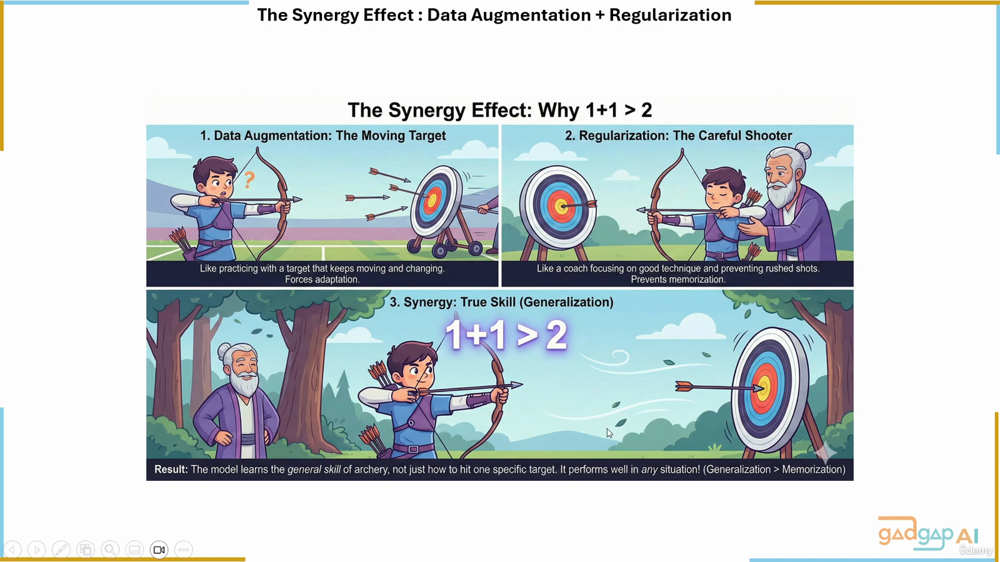

# 第 15 章 数据增强与正则化

当训练集表现良好而验证集表现落后时，改进的重点不是继续追求对原样本的精确记忆，而是提高模型面对新变化的稳定性。数据增强通过有语义的输入变换扩展训练经验，正则化通过约束神经元、权重或标签目标抑制过拟合。二者分别回答“模型还应见过哪些合理变化”和“模型应避免形成哪些脆弱依赖”，合理组合能够改善泛化，但过度使用也会把高方差转化为高偏差。

{ .diagram }

图 15-1：数据增强与正则化对泛化的协同作用。数据增强提供合理变化，正则化约束学习过程，二者共同服务于泛化而非记忆。课程第 159 课时 01:13 抽帧。

## 数据增强：学习合理变化下的不变特征

### 几何变换与语义边界

几何增强改变像素在图像网格中的位置，包括水平翻转、旋转、平移、缩放、随机裁剪、剪切和仿射变换。其目标是让模型认识到，类别不应依赖对象的朝向、视角或距离。例如汽车左右翻转、适度旋转或远近缩放后仍是汽车，模型应更多依靠稳定结构而非固定位置作答。

二维点 \((x,y)\) 旋转角度 \(\theta\) 的关系为

\[
\begin{bmatrix}x'\\y'\end{bmatrix}
=
\begin{bmatrix}
\cos\theta&-\sin\theta\\
\sin\theta&\cos\theta
\end{bmatrix}
\begin{bmatrix}x\\y\end{bmatrix}.
\]

图像旋转就是把这一坐标映射应用到像素网格。课程示例将常用随机旋转幅度设为 \(-15^\circ\) 至 \(15^\circ\)，体现“先温和、后加强”的原则，而非角度越大越好。

增强必须保持标签语义。含文字图像随意水平翻转可能破坏可读性，胸片等医学图像有相对固定的解剖方向，不应任意倒置；对象的不对称性、任务所需方向和实际采集条件也应保留。大量不符合真实分布的变换会迫使模型学习无关不变性，甚至改变原标签的正确性。

### 光度变换与 MixUp

光度增强不改变像素坐标，主要改变像素强度及颜色分布，包括亮度、对比度、饱和度、色调和噪声扰动。对 8 位图像而言，操作对象通常是 0—255 的强度值。适度扰动可模拟光照、成像设备与色彩差异，使模型对低光、颜色偏移或噪声更稳健。几何与光度增强可以组合，因为二者分别覆盖空间变化和成像变化。

MixUp 进一步把两张图像及其标签同时线性混合。给定样本 \((x_i,y_i)\)、\((x_j,y_j)\) 和混合系数 \(\lambda\)，有

\[
x'=\lambda x_i+(1-\lambda)x_j,
\qquad
y'=\lambda y_i+(1-\lambda)y_j.
\]

若 \(\lambda=0.7\)，第一张图像及其标签占 0.7，第二张占 0.3。模型不再被要求把混合输入绝对归为某一类，类别之间的决策边界因而更柔和，过度自信和强硬记忆也会受到抑制。混合强度需要通过验证调整。课程建议二分类任务以及含边界框回归等输出的检测任务谨慎或避免直接套用这种图像—标签混合方式，不能把分类中的用法无条件扩展到所有视觉任务。

### 三条 TorchVision 数据管线

课程以同一合成医学图像建立三条可比较的变换管线：

| 管线 | 主要处理 | 目的 |
|---|---|---|
| 无增强 | 调整到 \(224\times224\)，张量化并归一化 | 保留确定性基线 |
| 基础增强 | `RandomResizedCrop`、`RandomHorizontalFlip`、`RandomRotation(15)`，再张量化与归一化 | 引入常见空间和尺度变化 |
| 高级增强 | 在基础策略上加入 `ColorJitter` 与 `RandomAffine` | 同时覆盖颜色和更复杂几何变化 |

`RandomHorizontalFlip`、`RandomRotation`、`RandomResizedCrop`、`ColorJitter` 和 `RandomAffine` 分别对应翻转、旋转、随机裁剪缩放、颜色扰动和仿射变化。演示另外生成原图及水平翻转、旋转、亮度、对比度、饱和度、平移和缩放版本，用于核对变换是否符合预期。可视化检查应先于长时间训练，因为配置错误造成的标签破坏不能靠更多训练轮次修复。

实践顺序应是无增强基线、简单几何增强、适度光度或仿射增强，必要时再考虑 MixUp。训练集使用随机增强，验证集保持确定性预处理；否则验证输入不断变化，难以比较各轮模型。

## Dropout：削弱神经元共适应

Dropout 在训练时以概率 \(p\) 随机屏蔽激活，迫使网络不能把预测持续依赖于少数“明星神经元”。若某些神经元总是共同出现，其他神经元可能依赖它们而停止学习独立特征；随机关闭部分单元可减少这种共适应，使表示更加冗余和稳健。它类似于在单个网络中训练许多共享权重的子网络，并具有集成学习的直观效果。

设激活向量为 \(a\)，二值掩码为 \(m\)，保留概率为 \(1-p\)。采用倒置 Dropout（inverted dropout）时，训练阶段计算

\[
\tilde a=\frac{m\odot a}{1-p}.
\]

被保留的激活除以 \(1-p\)，使缩放在期望意义上与完整激活相匹配。课程用激活 \((2,4,6,8)\)、\(p=0.5\) 和掩码 \((0,1,0,1)\) 说明：掩码后只剩 \(4+8=12\)，保留值还需乘以 \(1/(1-0.5)=2\) 进行尺度校正。现代框架会自动完成相应处理，评估时应切换到 `model.eval()`，使用完整网络并关闭随机掩码，不能继续沿用训练时的随机丢弃行为。

常用丢弃概率可从 0.2—0.5 中试验，小网络通常从较低值开始，大网络可适度增加。Dropout 常放在全连接层的激活函数之后；课程自定义分类器就在两层全连接表示的 ReLU 后分别应用 Dropout。卷积层不宜默认使用较高丢弃率，若确有需要，可从约 0.1 的较低值谨慎试验。训练准确率在加入 Dropout 后略有下降并不一定是坏事，关键是验证差距是否缩小；若训练损失持续偏高，则可能是约束过强。

## 权重衰减、批归一化与早停

### 以 L2 惩罚限制大权重

权重衰减通过在损失中加入 L2 项抑制过大的参数：

\[
\mathcal L=\mathcal L_{CE}+\lambda\sum_i w_i^2.
\]

其中 \(\mathcal L_{CE}\) 为原始交叉熵损失，\(\lambda\) 为正则化强度。大权重会使输出对微小输入变化过度敏感，二次惩罚促使模型采用更平滑、由多项较小贡献共同形成的决策，而不是让个别权重主导结果。\(\lambda=0\) 时不施加该约束；增大 \(\lambda\) 会增强惩罚，但过强会导致欠拟合。

小数据与较大模型通常需要更重视权重约束，大数据下则可能使用较弱衰减。课程代码把 \(10^{-5}\) 至 \(10^{-4}\) 作为演示量级，最终值仍应通过验证集调节。Dropout 与权重衰减可以组合，AdamW 则提供了与 Adam 更新相分离的权重衰减方式，选择时应按所用优化器语义设置，而不是把名称相同的不同实现视为完全等价。

### 批归一化与训练轮次控制

批归一化对批内激活进行中心化与尺度标准化，其基本形式是减去均值再除以标准差。它已作为标准组成嵌入许多 CNN 块，有助于稳定激活分布和梯度传播、支持深层网络训练，不必为了正则化实验再重复添加一套机制。Dropout 与批归一化同时使用时需要观察相互作用，避免多个约束叠加后过度抑制模型。

早停则限制训练继续记忆样本的时间。应逐轮保存检查点，在验证损失开始持续恶化时恢复合适的早期权重，而不是默认采用最后一轮。它控制的是训练过程，与作用于输入、神经元或权重的其他方法形成互补。

## 标签平滑：把绝对标签改为软目标

独热标签要求模型把正确类别概率推向 1、其余类别推向 0，容易形成过度自信。标签平滑用非零概率质量覆盖其他类别。课程采用的写法是：总类别数为 \(K\)、平滑系数为 \(\varepsilon\) 时，

\[
\tilde y_k=
\begin{cases}
1-\varepsilon, & k\text{ 为真实类别},\\[4pt]
\dfrac{\varepsilon}{K-1}, & k\text{ 为其他类别}.
\end{cases}
\]

例如三分类中真实类别为猫，取 \(\varepsilon=0.1\)，目标由 \((1,0,0)\) 变为 \((0.9,0.05,0.05)\)。模型仍可保持对正确类别的偏好，却不再被训练成对每次预测都绝对确定。

标签平滑有助于改善概率校准和泛化，减轻过拟合，并降低对部分错误硬标签的过度追随。课程建议一般分类可先从 \(\varepsilon=0.05\) 等较小值开始，小数据可尝试 0.1，标签噪声明显时也需要结合数据治理调整更强策略。它应与其他方法协同使用，并持续观察训练—验证差距和预测概率；若置信度被压得过低，就应减小平滑或撤销该配置，而不是继续增加强度。

## 联合实验与渐进式调参流程

课程将增强和正则化放入同一 ResNet50 部分微调实验：冻结前三个卷积层组，解冻 `layer4`，替换包含 512、256 个中间单元及三路输出的分类器，并在 ReLU 后使用 Dropout。150 张三类别合成数据按 80%∶20% 分为 120 张训练图像和 30 张验证图像，各配置训练 10 轮。

实验比较无正则化、仅 Dropout 和完整组合。无正则化时 \(p=0,\lambda=0\)；仅 Dropout 时 \(p=0.5,\lambda=0\)，配合基础增强；完整组合采用高级增强，并同时使用 Dropout 与权重衰减。三种配置并未穷举增强和正则化的全部组合，所以不能把结果差异全部归因于某一个因素。

无正则化组最终训练准确率超过 98%，验证准确率为 96.67%，差距约 1.67 个百分点。仅 Dropout 后训练准确率下降、验证结果近似不变，但差距没有如预期缩小；完整组合中两种准确率都有所下降，训练—验证差距则降为 0。由于数据极小且为合成模式，这个“零差距”只是教学结果，不是生产目标或普遍规律。它反而说明正则化效果并不单调，必须同时检查绝对准确率、差距和曲线，不能只挑一个最有利指标。

| 方法 | 主要作用位置 | 核心价值 | 过量时的信号 |
|---|---|---|---|
| 数据增强 | 训练输入 | 增加合理变化，学习不变特征 | 真实语义被破坏，验证表现下降 |
| Dropout | 神经元激活 | 减少共适应与单点依赖 | 学习缓慢、训练损失偏高 |
| 权重衰减 | 参数与损失 | 惩罚大权重，平滑决策 | 权重过度受限，出现欠拟合 |
| 标签平滑 | 监督目标 | 减少过度自信，改善校准 | 预测概率过低，类别区分受抑 |
| 批归一化 | 网络特征块 | 稳定激活与梯度传播 | 与其他约束叠加后需关注训练动态 |

综合实践应从简单基线开始，依次加入基础增强、Dropout、权重衰减和必要的标签平滑，每一步都记录训练与验证损失、准确率及其差距。学习曲线稳定后仍应保存逐轮检查点并考虑早停。若训练损失高、收敛缓慢，应减少重叠约束；若训练损失下降而验证损失分叉，应检查数据覆盖、增强合理性和模型自由度。最终目标是未见数据上的可靠表现，而不是训练集上的 100% 记忆。

## 本章小结

- 几何增强改变像素位置，光度增强改变强度与颜色，MixUp 同时混合图像和标签；所有变换都必须服从任务语义。
- Dropout 通过随机屏蔽和期望尺度校正减少神经元共适应，训练与评估模式必须正确切换。
- 权重衰减约束大权重，标签平滑约束过度自信，批归一化稳定激活与梯度，早停和检查点控制训练过程。
- 小样本实验表明正则化收益并非单调，增强与约束的组合也不能凭单项结果判断因果。
- 应按“基线—简单增强—逐项正则化—验证复核”的顺序调参，在训练—验证差距与绝对性能之间取得平衡。

<!-- course-lectures: 150-161 -->

<!-- ebook-navigation -->

---

[← 上一章](ch14.md) · [返回完整目录](../index.md) · [下一章 →](ch16.md)
