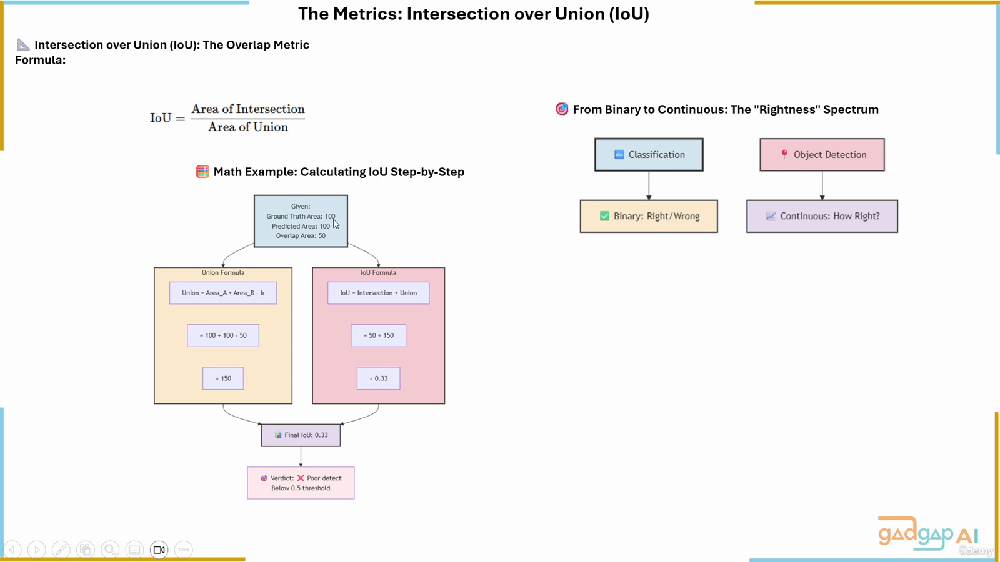
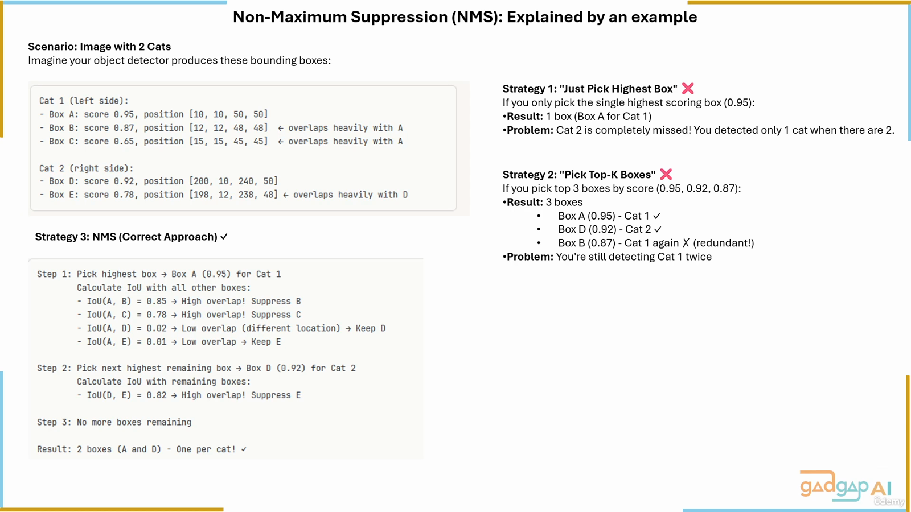

# 第 16 章 目标检测基础：输出、IoU、mAP 与 NMS

图像分类回答“图中有什么”，目标检测还必须回答“目标在哪里”。这一变化使模型不再只输出一个类别分布，而要同时处理数量不定的目标、连续的位置坐标与预测可信度，并在推理后清理重复结果。多目标、尺度变化、遮挡、视角与复杂背景进一步增加了任务难度，实时应用又对延迟提出约束。本章建立贯穿两阶段、单阶段与端到端检测器的共同语言：检测输出及其坐标表示、IoU、精确率与召回率、mAP，以及非极大值抑制。它们分别描述一次预测包含什么、一个框定位得多准、整个模型表现如何，以及怎样把密集候选整理为可用结果。

## 检测任务与输出结构

一次检测可表示为

$$
d=(b,c,s),\qquad b=(x,y,w,h),
$$

其中 $b$ 是包围框，$c$ 是类别，$s$ 是置信度。与整图分类相比，检测器通常共享一个视觉骨干网络，再接两个任务头：**分类头**输出各类别的概率或 logits，回答“是什么”；**回归头**输出连续的框坐标或其修正量，回答“在哪里”。训练目标因此至少包含分类与定位两部分：

$$
L=L_{\mathrm{cls}}+L_{\mathrm{loc}}.
$$

模型还必须把正确的类别与正确的框关联起来。图像中目标数量和排列并不固定，所以实际输出通常是检测集合，而不是单个三元组。类别概率、目标存在性和定位质量在概念上不能混为一谈。课程采用的 YOLO 式置信度定义为

$$
s=\Pr(\mathrm{object})\times \operatorname{IoU}(b_{\mathrm{pred}},b_{\mathrm{gt}}),
$$

它同时表达“是否有物体”和“框应有多好”的监督目标；其他检测器的得分定义可能不同，读取结果时应以具体实现为准。置信度阈值用于过滤低分预测，常见示例从 $0.5$ 起步，高风险任务也可能采用更高阈值，但阈值越高并不必然越好，因为漏检也会随之增加。

检测是跟踪、分割和三维重建等任务的重要基础。自动驾驶需要定位行人、车辆和交通标志，零售系统需要识别货架商品，医学影像不仅关心是否存在病灶，也关心病灶的位置。这些应用共同说明：检测评价不能只看类别是否命中，还必须衡量空间定位。

## 包围框格式与 IoU 计算

不同数据集和框架使用不同的框表示。格式名称描述的是四个数的含义，而不是改变了物体本身。

| 格式 | 四个分量 | 常见特点 |
|---|---|---|
| Pascal VOC | $(x_{\min},y_{\min},x_{\max},y_{\max})$ | 用左上、右下两个角点表示 |
| COCO | $(x,y,w,h)$ | 左上角坐标加框宽、框高 |
| YOLO | $(c_x,c_y,w,h)$ | 中心坐标加宽、高，常相对图像尺寸归一化到 $[0,1]$ |

由角点格式可以得到

$$
w=x_{\max}-x_{\min},\quad h=y_{\max}-y_{\min},\quad
c_x=\frac{x_{\min}+x_{\max}}2,\quad c_y=\frac{y_{\min}+y_{\max}}2.
$$

反向转换则使用 $x_{\min}=c_x-w/2$、$y_{\min}=c_y-h/2$，再由宽、高求出右下角。代码中的 `convertBBox_format` 演示正是围绕这些等价关系展开。实现时应先确认坐标原点、角点顺序以及是否归一化，不能把一个格式的四个数直接交给另一个接口。

**交并比**（Intersection over Union，IoU）衡量预测框与真实框的重合程度：

$$
\operatorname{IoU}(A,B)=\frac{|A\cap B|}{|A\cup B|}
=\frac{|A\cap B|}{|A|+|B|-|A\cap B|}.
$$

若两框面积均为 $100$、交集为 $50$，并集就是 $100+100-50=150$，故 IoU 为 $50/150\approx0.33$，而不是 $0.5$。完全重合时 IoU 为 $1$，没有交集时为 $0$；课程示例把 $0.5$ 左右视为开始具有可用定位质量的参考点，但合格阈值仍取决于数据集与任务。

{ .diagram }

图 16-1：预测框与真实框的交集、并集及 IoU 计算。两框面积均为 100、交集为 50 时，并集为 150，IoU 约为 0.33。课程第 169 课时抽帧。

角点格式下，交集宽、高可写为

$$
\begin{aligned}
w_I&=\max(0,\min(x_{\max}^A,x_{\max}^B)-\max(x_{\min}^A,x_{\min}^B)),\\
h_I&=\max(0,\min(y_{\max}^A,y_{\max}^B)-\max(y_{\min}^A,y_{\min}^B)).
\end{aligned}
$$

`calculateIOU(box1, box2)` 的核心流程就是计算 $w_Ih_I$、两框各自面积与并集，最后返回交集除以并集。对宽高取 $\max(0,\cdot)$ 很重要，否则两框分离时可能得到虚假的负尺寸。可视化时可用 NumPy 建立画布、OpenCV 的 `cv2.rectangle` 绘制框，再用 Matplotlib 比较结果；绘制发生在模型预测之后，并不是检测头的一部分。

## 精确率、召回率与 mAP

IoU 描述一对框，检测指标则描述整个数据集。计算指标前，需要在给定的 IoU 阈值下把预测与真实目标匹配：类别正确、位置重合达到要求且未被其他预测占用的匹配记为真正例 TP；错误类别、错误位置或重复占用同一目标的预测记为假正例 FP；没有得到匹配的真实目标记为假负例 FN。于是

$$
P=\frac{TP}{TP+FP},\qquad R=\frac{TP}{TP+FN},\qquad
F_1=\frac{2PR}{P+R}.
$$

精确率关注已输出结果中有多少正确，召回率关注真实目标中有多少被找回。提高置信度门槛通常会减少 FP，却可能增加 FN；降低门槛则常带来相反变化。课程计算示例中 $TP=3$、$FP=1$、$FN=0$，所以 $P=0.75$、$R=1$、$F_1\approx0.857$。代码先按置信度从高到低排列预测，再完成匹配与计数，并用已匹配真实框数量计算 FN；分母为零时需要显式处理。

匹配顺序会直接影响计数。预测按得分降序逐一处理时，每个真实框只能被占用一次：若两个高分框都覆盖同一目标，先完成匹配者计为 TP，后一个即使 IoU 很高，通常也因重复检测计为 FP；直到处理结束仍未匹配的真实框才计入 FN。把这套规则应用于不断变化的置信度截断集合，才能得到一致的 PR 曲线，而不是分别用随意选出的框计算若干互不可比的点。

**平均精度**（Average Precision，AP）把单一工作点扩展为一条曲线。对某个类别，先固定判定检测正确的 IoU 规则，再改变置信度截断点，得到一系列 $(R_t,P_t)$，形成精确率—召回率曲线，其下面积即为该类别的 AP。对所有类别求均值得到 **平均精度均值**（mean Average Precision，mAP）：

$$
\mathrm{mAP}=\frac1C\sum_{c=1}^{C}\mathrm{AP}_c.
$$

因此，IoU 阈值和置信度阈值承担不同职责：前者决定一次匹配是否算正确定位，后者决定哪些预测进入当前工作点。改变 IoU 标准会得到不同严格程度的 AP 结果，不能把不同数据集、不同 IoU 规则下的 mAP 直接横向比较。高 $P$、低 $R$ 表示结果谨慎但漏检多；低 $P$、高 $R$ 表示找回较多目标却夹杂误报。$F_1$ 概括一个工作点的折中，mAP 则综合多个置信度工作点及各类别表现。课程以 mAP 高于 $0.5$、高于 $0.8$ 分别作为“较好”和“优秀”的粗略示例，但真正的判读必须结合任务难度和评测协议。

## 非极大值抑制与重复框清理

锚框或密集候选会让同一物体附近出现许多高分框。**非极大值抑制**（Non-Maximum Suppression，NMS）是推理后的去重过程，不参与特征学习。其算法为：

1. 过滤低置信度候选，并按得分从高到低排序；通常按类别分别处理。
2. 取出当前最高分框，加入保留集合。
3. 计算其余框与该框的 IoU，删除 IoU 大于设定阈值的候选。
4. 对剩余候选重复上述过程，直到没有可处理的框。

{ .diagram }

图 16-2：非极大值抑制逐步保留高分框并去除重复候选。两只猫的五个候选经两轮抑制后各保留一个。课程第 177 课时抽帧。

NMS 中用于比较的最高分框只是当前参考框，不是真实标注。阈值越低，越容易删除相邻框；阈值越高，保留的高度重叠框可能越多。不能只取全局最高分框，因为图中可能有多个物体；也不能固定取前 $K$ 个，因为同一物体仍可能占据多个名额。两只猫各有多个候选时，第一轮保留第一只猫的最高分框并抑制其重复框，距离较远的另一只猫候选因 IoU 较低而留下，第二轮即可保留它。课程的五框示例最终留下两个分离实例，正体现了这一逻辑。

除标准 NMS 外，还有降低邻近框得分而非直接删除的 Soft-NMS、跨类别处理的 class-agnostic NMS 等方式。选择时应意识到：NMS 去除的是“高重叠重复候选”，并不能保证拥挤场景中每个真实物体都被正确保留。

## 通用检测流水线与代码组织

传统 CNN 检测器可概括为“图像输入—骨干特征提取—候选或锚框生成—分类与框回归—置信度过滤与 NMS—格式转换”。早期滑动窗口枚举大量位置，计算冗余；选择性搜索改为提交约数千个候选区域；锚框进一步用预设尺度和长宽比限定搜索空间，回归头只需学习相对锚框的偏移。后续 CenterNet 等方法又探索了无锚框预测。骨干可在 ResNet、EfficientNet 等网络之间替换，两阶段与单阶段方法的主要差别则在候选处理和预测路径。

基础代码可以按职责拆成四个函数：坐标转换、IoU 计算、指标统计和 `non_max_suppression(boxes, scores, iou_threshold)`。完整模型推理时，再增加图像读取、张量预处理、设备选择与结果绘制。课程用 TorchVision 的 Faster R-CNN 和 SSD 做了快速演示：前者先产生候选再精修，后者直接由特征给出预测；样例中两个不同的置信度数值只是一次图像结果，不能代替统一测试集上的 mAP。最终交给下游程序前，还应把归一化中心框等模型输出转换成接口需要的角点坐标，并保留类别、置信度与框之间的一一对应关系。

## 本章小结

- 检测输出由框、类别和置信度组成，分类与定位共享特征但承担不同目标。
- IoU 是交集面积与并集面积之比，是判定定位质量和执行 NMS 的共同基础。
- AP 汇总单类的精确率—召回率曲线，mAP 再对类别求均值；报告结果必须说明 IoU 与数据协议。
- NMS 通过迭代保留高分框、抑制高重叠候选来去重，同时必须保留其他物体所在的低重叠框。
- 坐标转换、指标计算、后处理和可视化应分层实现，单次样例置信度不能替代系统评测。

<!-- course-lectures: 162-179 -->

<!-- ebook-navigation -->

---

[← 上一章](ch15.md) · [返回完整目录](../index.md) · [下一章 →](ch17.md)
