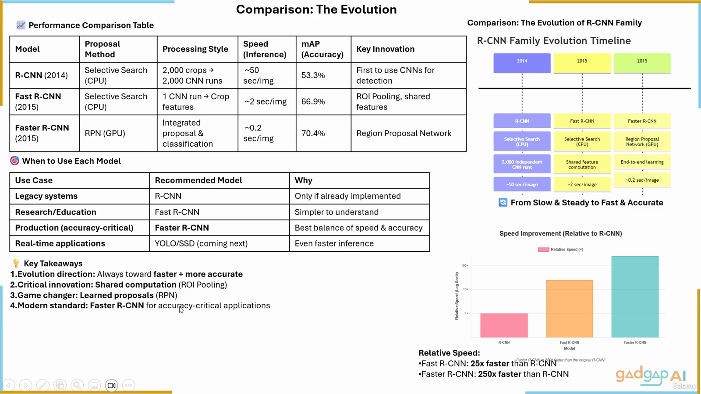

# 第 17 章 两阶段检测器：R-CNN、Fast R-CNN 与 Faster R-CNN

两阶段检测器把目标检测拆成“先寻找可能含物体的区域，再判断类别并精修位置”两个步骤。候选区域机制使模型能够把计算集中在较有希望的局部，并通过第二轮处理获得细致定位，因此成为早期高精度检测的重要范式。R-CNN 家族的演进并不是简单增加层数，而是持续消除重复计算：R-CNN 用 CNN 取代手工特征，Fast R-CNN 让整幅图共享一次卷积特征，Faster R-CNN 又用神经网络生成候选区域。理解这条路径，就能看清特征共享、RoI 池化、区域建议网络与多任务损失为何成为现代检测器的基本构件。

## 两阶段范式与 R-CNN 的奠基流程

第一阶段生成区域建议（region proposals），回答“哪里可能有物体”；第二阶段对每个建议区域分类并回归边界框，回答“是什么、准确在哪里”。这与直接在整图上密集预测的单阶段方法形成对比。课程所列经典模型中，两阶段方法通常定位更精细，适合精度优先、允许较高延迟的场景；单阶段方法则更利于实时处理。不过，实际精度仍取决于骨干、训练数据、尺度和实现，不能把“两阶段必然更准”当作普遍定律。

2014 年的 R-CNN 首次把区域建议与深度卷积特征有效结合，其完整流程为：

1. **选择性搜索**：依据颜色、纹理和区域大小等低层信息，从每张图提出约 2000 个候选区域。大量候选并不含物体，重叠区域也很多。
2. **区域规整**：将每个候选裁剪并缩放到 AlexNet 所需的 $224\times224$ 输入。不同长宽比的区域被强制变形，可能破坏物体形状。
3. **独立特征提取**：每个区域分别通过一次在 ImageNet 上预训练的 AlexNet，得到约 2000 个特征向量。即使两个区域高度重叠，卷积也不会共享。
4. **分类与位置精修**：用支持向量机 SVM 对特征分类，再用线性回归器预测边界框调整量，使候选框更贴近物体。

R-CNN 证明了 CNN 特征不仅能用于整图分类，也能显著提高区域识别能力，并由此确立两阶段范式。但它的模块彼此分离：CNN、SVM 和框回归器分别训练，特征还要为大量候选逐一保存。课程报告其 GPU 推理约为每图 47 秒，其中选择性搜索约 2 秒、约 2000 次 CNN 前向约 40 秒、SVM 分类约 5 秒，之后还需框回归。这里的核心瓶颈不是“CNN 本身一定慢”，而是相同图像内容被反复计算，以及外部候选算法与学习网络脱节。

## Fast R-CNN：共享特征与 RoI 池化

Fast R-CNN 保留选择性搜索，却改变了候选区域使用特征的方式。整幅图只通过一次 VGG16 骨干，得到共享特征图；每个候选区域再按照空间位置投影到特征图上，形成感兴趣区域（Region of Interest，RoI）。这样，原图中互相重叠的建议不再分别触发完整 CNN 前向，特征也不必按候选逐一重复计算。

不同 RoI 的大小并不一致，而后续全连接层需要固定长度输入。**RoI Pooling** 将每个 RoI 划分为固定网格，在各子窗口执行最大池化。课程示例将其整理为 $7\times7\times512$ 的定长表示，随后同时送入两个分支：

- 分类分支输出语义类别及相应概率；
- 回归分支输出 $d_x,d_y,d_w,d_h$，用于修正候选框的中心与宽高。

这一结构用统一的多任务目标替代 R-CNN 的分散训练：

$$
L_{\mathrm{det}}=L_{\mathrm{cls}}+L_{\mathrm{reg}}.
$$

分类项衡量类别误差，回归项约束框修正量。两项共同反向传播，使定位监督也能影响共享特征。回归中常采用 **Smooth L1** 来兼顾小误差与大误差：令 $t$ 为预测和目标的差，

$$
\operatorname{smooth}_{L1}(t)=
\begin{cases}
0.5t^2, & |t|<1,\\
|t|-0.5, & |t|\ge 1.
\end{cases}
$$

小误差区域使用二次形式，优化平滑；大误差区域转为线性增长，避免普通 L2 在离群误差上产生过大的梯度。相比普通 L1 在零附近不可微的形式，它也更容易优化。

Fast R-CNN 的关键收益因此有三点：一次骨干前向替代约 2000 次独立前向，RoI 池化统一不同候选的表示尺寸，双头损失统一分类与定位训练。课程的家族对比把推理时间从 R-CNN 的约 47 秒降到 Fast R-CNN 的秒级，同时训练耗时和特征存储需求也显著下降。然而，选择性搜索仍位于网络之外，候选质量与候选生成速度成为新的瓶颈。

## Faster R-CNN：区域建议网络与共享主干

Faster R-CNN 在 2015 年用**区域建议网络**（Region Proposal Network，RPN）替代选择性搜索。RPN 不再依据手工颜色、纹理规则提议区域，而是在骨干生成的同一特征图上学习“哪里像物体”。于是，一份卷积特征同时服务于候选生成和后续检测头。

RPN 是一个在特征图上滑动的小网络。每个位置配置若干预定义**锚框**，其尺度与长宽比覆盖不同物体形状。课程用三种尺度 $128$、$256$、$512$ 与三种比例——高而窄、方形、宽而矮——说明每个位置 $k=3\times3=9$ 个锚框的设计。对每个锚框，RPN 给出两类结果：

1. **objectness**：该区域含任意物体还是背景，不区分猫、狗等语义类别；
2. **框修正量**：$d_x,d_y,d_w,d_h$，描述如何平移并缩放锚框。

因此，RPN 不是直接替代最终分类头，而是学习生成较高质量的候选。课程示例从原先约 2000 个外部建议缩减为约 300 个候选，再将这些候选映射回共享特征图，经 RoI Pooling 后交给语义分类头和框回归头。完整数据流为：

> 图像 → ResNet、VGG16 或其他合适骨干 → 共享特征图 → RPN 候选与框修正 → RoI 特征 → 类别与最终边界框 → 后处理。

训练目标同时约束 RPN 和检测器：

$$
L=L_{\mathrm{RPN}}+L_{\mathrm{det}},
$$

展开后包含 RPN 的物体性分类与锚框回归，以及检测头的语义分类与候选框精修。候选生成由数据驱动后，系统不再依赖独立的选择性搜索流程，速度、候选质量和训练一致性都得到改善。课程汇总中的典型推理时间约降至每图 $0.2$ 秒，Pascal VOC 示例 mAP 报告为 $70.4$；这些数字对应课程所用设置，不应脱离硬件与评测协议泛化。

## 三代架构的统一比较

| 维度 | R-CNN | Fast R-CNN | Faster R-CNN |
|---|---|---|---|
| 候选来源 | 选择性搜索，约 2000 个 | 仍是选择性搜索 | 学习型 RPN，课程示例约 300 个 |
| 骨干计算 | 每个候选独立经过 AlexNet | 整图一次 VGG16，候选共享特征图 | 整图共享骨干，RPN 与检测头共用特征 |
| 区域定长表示 | 裁剪并缩放至固定图像尺寸 | RoI Pooling | RoI Pooling |
| 分类与回归 | SVM 与独立线性回归器 | 双头联合训练 | RPN 双任务加检测双头 |
| 主要进步 | CNN 特征用于区域检测 | 共享卷积、统一多任务学习 | 学习候选、进一步整合流程 |
| 主要瓶颈 | 重复卷积、存储大、训练分散、图像变形 | 外部选择性搜索仍慢且不参与学习 | 结构较复杂，计算与显存仍高于许多单阶段方案 |

从时间指标看，课程把 Fast R-CNN 概括为比 R-CNN 快约一个数量级以上，Faster R-CNN 又进一步明显加速；不同段落采用的计时环境并不相同，因此最重要的是相对机制，而不是拼接出跨环境的精确倍率。Mask R-CNN 则在这一检测框架上扩展到实例掩码，属于后续分割主题。

{ .diagram }

图 17-1：R-CNN、Fast R-CNN 与 Faster R-CNN 的流程演进。读图重点是逐候选独立卷积、整图共享特征和学习型 RPN 三次机制变化。课程第 191 课时抽帧（04:05）。

## TorchVision 实践与部署检查

课程实践使用 PyTorch、TorchVision 中的 Faster R-CNN、OpenCV 和 PIL 等工具，流程可整理为：加载并检查 COCO 类别映射；实例化模型并选择 CUDA 或 CPU；将 URL 图像读入并转换为张量；切换评估模式执行推理；按得分筛选 `boxes`、`labels`、`scores`；最后用 OpenCV 绘制。类别名称表包含背景及 `N/A` 占位项时，不能把列表长度直接当成前景类别数；COCO 目标检测实际有 80 个前景类别，而模型可能沿用带占位的类别索引表。

Notebook 展示的模型配置包括五档锚尺度 $32,64,128,256,512$，长宽比 $0.5,1.0,2.0$；RPN 的 NMS 阈值示例为 $0.7$，检测置信度与检测 NMS 示例分别出现 $0.05$ 和 $0.5$。训练与测试还可分别设置 RPN 在 NMS 前后保留的候选数量。它们是课程演示配置，不是所有数据集的通用最优值：小物体需要检查浅层尺度是否覆盖，密集场景需要检查候选数量与 NMS，显存不足时则应同时审视输入尺寸、骨干和候选数。

部署时可按以下顺序核对：先用 GPU 承担骨干与 RPN 计算，再检查锚框是否匹配真实物体尺度和比例，随后分别调节 RPN 与最终检测的阈值，最后才比较端到端延迟与 mAP。R-CNN 家族适合医学影像、遥感与质量检测等精度优先任务，在小目标和拥挤场景中常有优势，但极小目标或极端密集场景仍可能失败。工程选型应在统一数据上验证，而不能只凭“两阶段”标签作决定。

## 本章小结

- R-CNN 建立了“区域建议加 CNN 特征”的两阶段范式，但逐候选卷积与分散训练造成巨大冗余。
- Fast R-CNN 通过整图特征共享、RoI Pooling 和分类—回归联合损失消除重复计算。
- Faster R-CNN 用 RPN 学习物体性与锚框修正，使候选生成也进入神经网络训练体系。
- RPN 只判断物体性并建议位置，最终检测头才负责语义分类和进一步精修，两者不可混淆。
- 实践中应联合检查骨干、锚框、候选数、双阶段阈值及硬件，课程参数不能直接视为通用配置。

<!-- course-lectures: 180-192 -->

<!-- ebook-navigation -->

---

[← 上一章](ch16.md) · [返回完整目录](../index.md) · [下一章 →](ch18.md)
