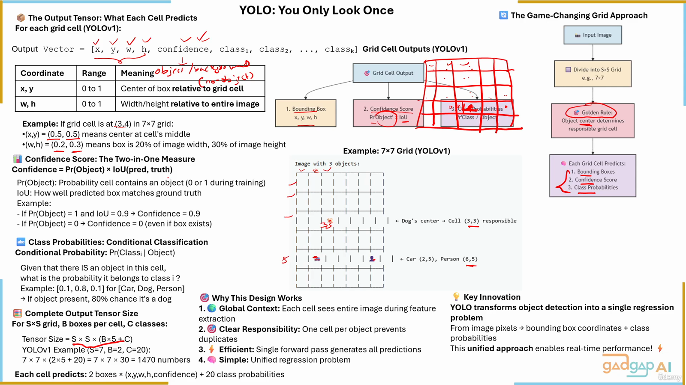

# 第 18 章 单阶段检测与 YOLO

单阶段检测器取消了“先生成候选、再逐区精修”的串行路径，把类别、位置和置信度统一为一次网络前向中的密集预测。它以更直接的结构换取低延迟，使视频监控、机器人、增强现实和在线体育分析等应用能够在连续画面中获得及时反馈。YOLO（You Only Look Once）是这一思路的代表：整幅图经过一次网络，空间网格直接给出候选框与类别。理解 YOLO，关键不只是记住网格数量，而是弄清网格责任如何分配、输出张量如何计数、四类损失怎样互相制衡，以及早期固定网格为何限制小目标和拥挤场景。

## 从区域建议到一次密集回归

两阶段流程先生成中间候选 $Z=G(X)$，再计算检测结果 $Y=F(Z)$，第二阶段必须等待第一阶段完成，其耗时近似为 $t_1+t_2$。单阶段方法直接学习

$$
Y=F(X),
$$

其中 $X$ 是图像，$Y$ 包含边界框、类别和置信度。这里没有独立的区域建议网络，骨干提取的特征直接供给分类与回归输出。所谓“一次”并不意味着每个框都天然只出现一次，而是指候选生成不再构成单独的串行检测阶段；许多实现仍需 NMS 清理重叠预测。

课程把 Faster R-CNN 与早期 YOLO 的典型示例列为约 $5$ FPS、$200$ ms 对约 $45$ FPS、$22$ ms，用于说明结构带来的速度差异，而非所有版本的固定性能。单阶段模型还具备端到端流程较短、整图上下文参与预测、较易部署到轻量设备等优点。相应代价是早期模型在定位精细度、极小目标和密集目标上往往不及精细的两阶段流程。速度与精度是具体模型和任务上的折中，不能由阶段数单独决定。

## YOLOv1 的网格责任与输出张量

YOLOv1 首先把输入缩放为 $448\times448$，经卷积网络得到 $S\times S$ 的空间网格。每个网格负责预测中心落入该网格的物体，而不是依据物体是否有一部分伸入网格来分配责任。一个物体可能跨越多个网格，但仍由其中心所在网格承担预测。这种规则把图像位置映射为明确的监督目标，也让所有网格能在同一次前向中并行给出结果。

每个预测框包含五个数：

$$
(x,y,w,h,s).
$$

$x,y$ 是物体中心相对所在网格的位置，通常落在 $[0,1]$；$w,h$ 是框宽、高相对整幅图宽、高的比例。置信度的训练目标为

$$
s=\Pr(\mathrm{object})\cdot \operatorname{IoU}_{\mathrm{pred}}^{\mathrm{truth}},
$$

即物体存在性与预测框定位质量的乘积。每个网格还输出 $C$ 个条件类别概率，用于回答“若这里有物体，它属于哪一类”。

这里应区分三种量的含义：物体性只回答候选是否包含任意物体；条件类别概率在假定有物体时比较各类别；框置信度还携带定位质量。要得到某一类别的排序分，可将该类的条件概率与框置信度相乘。NMS 通常依据类别得分进行，因此物体性、最高类别概率和最终排序分不是同一个字段。若把三者混读，就无法解释为何类别概率很高但框很差的候选仍可能得到较低分，也会错误判断阈值究竟作用于哪一步。

此外，v1 每格两个框并非两次完整分类：框分支可以给出不同位置与置信度，类别分支却只有一套，这也是同格近邻多目标难以分开的原因。还原坐标时，格内相对中心需先结合网格索引定位，再按整图尺度换算；相对宽、高则直接乘图像宽、高。

若每格预测 $B$ 个框，则输出张量形状为

$$
S\times S\times (B\times5+C).
$$

YOLOv1 使用 $S=7$、$B=2$，在 $C=20$ 时得到 $7\times7\times(2\times5+20)=7\times7\times30$，总共 $1470$ 个数。注意，两个框共享该网格的一套类别概率，并不是每个框都另带一份 20 类向量。$B$ 增加的是框候选数，不等于网格可以无限制地区分更多物体。

这一设计让网络从整图特征理解场景，避免逐窗口重复卷积，并以统一张量完成训练。不过，“中心落格”的空间归纳偏置也埋下限制：网格太粗时，相邻中心会挤在同一格，小物体则可能在下采样后失去可分辨信息。模型输出之后仍需进行得分过滤、坐标还原与 NMS；原始张量中的 1470 个数不是最终要画出的 1470 个框。

{ .diagram }

图 18-1：YOLO 的网格责任与单次密集预测。物体中心决定负责网格，各网格并行预测边界框、置信度与类别概率。课程第 198 课时抽帧（10:32）。

## YOLO 损失的四项协同

YOLO 训练同时优化定位、含物体置信度、背景置信度和类别。按 YOLOv1 的原始形式，可把总损失紧凑写成

$$
\boxed{
L=\lambda_{\mathrm{coord}}L_{\mathrm{box}}
+L_{\mathrm{obj}}
+\lambda_{\mathrm{noobj}}L_{\mathrm{noobj}}
+L_{\mathrm{class}}
}
$$

课程采用 $\lambda_{\mathrm{coord}}=5$ 与 $\lambda_{\mathrm{noobj}}=0.5$。这四个分量并非可以任意替换的名称，而是对应不同预测职责。

**定位损失 $L_{\mathrm{box}}$。** 只对负责真实物体的预测框计算，原始 YOLOv1 对中心坐标及宽、高的平方根使用平方误差：

$$
L_{\mathrm{box}}\sim\sum_{\mathrm{responsible}}
\left[(\Delta x)^2+(\Delta y)^2+
(\Delta\sqrt{w})^2+(\Delta\sqrt{h})^2\right].
$$

训练时，在同一网格的多个候选中由负责该真实框的预测承担定位监督，避免所有候选同时拟合同一目标。使用 $\sqrt w$、$\sqrt h$ 是为了缓解尺度差异：宽为 10 像素时偏差 5 像素是 $50\%$ 的相对误差，而宽为 100 像素时同样偏差只有 $5\%$。直接对原始宽高施加大致相同的平方惩罚，会让大框主导梯度；平方根压缩大尺度差异，使小框的定位偏差得到相对更多关注，但并不意味着两种框的所有误差已完全等价。

**含物体置信度损失 $L_{\mathrm{obj}}$。** 对负责物体的候选，监督其置信度趋近物体存在性与 IoU 的目标乘积，使高分不仅表示“有物体”，也鼓励框定位准确。

**无物体置信度损失 $L_{\mathrm{noobj}}$。** 对大量不负责物体的候选压低置信度。图像中通常只有少数物体，背景候选数量远多于正样本，若所有背景项与正样本等权累计，模型可能倾向于普遍输出低物体性。以 $0.5$ 降低该项权重，是在控制背景梯度的支配程度，而不是忽略背景。

**类别损失 $L_{\mathrm{class}}$。** 只在含物体的网格上约束各类别预测，避免大量空格参与语义分类。YOLOv1 的原始求和式使用类别概率的平方误差；后续 YOLO 版本的分类与置信度实现已有变化，不应把某一现代损失 API 倒套为 v1 的定义。

提高 $\lambda_{\mathrm{coord}}$ 体现对定位的重视，降低 $\lambda_{\mathrm{noobj}}$ 则处理正负候选失衡。训练早期各项通常较大，随后应共同下降；若只观察总损失，就可能掩盖“分类变好但定位变差”等分量之间的抵消，因此实践中有必要分别记录各项。

## YOLOv1 的局限与后续改进

| 局限 | 产生原因 | 直接后果 |
|---|---|---|
| 单格候选与类别容量有限 | 每格仅 $B=2$ 个框，并共享一套类别预测 | 同格多个物体可能漏检，近距离物体容易合并 |
| 空间分辨率较粗 | 仅一个 $7\times7$ 输出网格 | 小物体中心与细节难以区分，拥挤场景召回受限 |
| 形状适应性不足 | 早期输出缺少丰富的尺度和比例先验 | 非常规长宽比下框容易产生偏移 |
| 单尺度特征 | 只在最终一种空间尺度上预测 | 深层特征利于大物体，却不利于保留微小结构 |

后续版本围绕这些瓶颈逐步修改。YOLOv2 在 2017 年引入锚框，用不同形状改善框预测，并将典型网格提高到 $13\times13$；YOLOv3 使用 $13\times13$、$26\times26$、$52\times52$ 三种尺度，让较细网格承担小目标、较粗网格承担大目标；YOLOv4 在 2020 年继续结合更强的数据增强等训练策略；课程还把 YOLOv5 的自动锚框调整概括为从数据适配候选形状。演进的主线不是单纯增加网格，而是让空间分辨率、候选先验与训练策略共同适应目标分布。

## YOLOv5 推理实践

课程代码通过 PyTorch Hub 加载 YOLOv5s，下载的 `.pt` 文件保存逐层参数，而不是检测结果。推理配置中，`model.conf` 控制低分候选过滤，`model.iou` 控制 NMS 的重叠抑制；二者分别对应得分门槛与后处理门槛，不能混用。

完整流程可整理为：

1. 加载模型与权重，准备人物、街道等输入图像；
2. 逐图调用模型，读取检测结果表中的框、置信度与类别；
3. 将中心格式的 $(x,y,w,h)$ 转为便于绘制的 $(x_{\min},y_{\min},x_{\max},y_{\max})$；
4. 用 OpenCV 绘制矩形、类别和置信度，并检查遮挡目标的得分变化。

YOLOv5 的结果接口已经可以提供角点坐标，因此看到 `xyxy` 并不与理论中的 `xywh` 矛盾，只是输出阶段完成了等价转换。演示中，画面边缘只露出少量人体特征的人获得较低置信度，说明分数会反映可见证据不足；但低分究竟应保留还是删除，仍须结合漏检与误报成本，而不能只追求画面整洁。

## 本章小结

- 单阶段检测用一次网络前向直接产生类别、框和置信度，省去独立候选生成阶段，但仍可能需要 NMS。
- YOLOv1 按物体中心分配网格责任，其输出尺寸由 $S\times S\times(B\times5+C)$ 决定。
- YOLO 损失联合定位、物体置信度、背景置信度和类别误差；权重 $5$ 与 $0.5$ 分别强化定位并抑制背景项支配。
- 宽高平方根用于缓和尺度造成的惩罚差异，粗网格与有限单格容量则解释了早期小目标和拥挤场景问题。
- 推理时应区分置信度阈值、NMS 的 IoU 阈值及 `xywh`—`xyxy` 坐标转换，并用后续多尺度思想理解版本演进。

<!-- course-lectures: 193-201 -->

<!-- ebook-navigation -->

---

[← 上一章](ch17.md) · [返回完整目录](../index.md) · [下一章 →](ch19.md)
