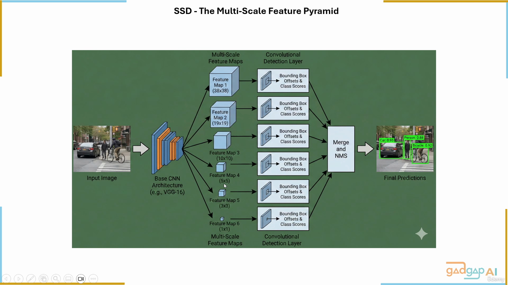

# 第 19 章 SSD：多尺度特征与默认框

SSD（Single Shot MultiBox Detector）在保留单阶段低延迟结构的同时，直接回应早期 YOLO 的两个弱点：单一输出网格难以兼顾不同尺度，固定候选形状难以覆盖多样物体。它从骨干网络的不同深度取出多种分辨率的特征图，在各空间位置布置一组默认框，再用卷积预测类别与框修正量。高分辨率层保留局部细节，低分辨率层提供更大感受野，二者共同形成由细到粗的预测体系。SSD 因而不是把“多次检测”重新引入网络，而是在一次前向中并行组织多尺度、多形状的候选。

## 多尺度特征图与单次前向

早期 YOLOv1 只在 $7\times7$ 的最终网格上预测，空间细节经过多次下采样后已经有限。SSD 以 VGG16 等 CNN 为骨干，在多个层级设置检测输出。课程重点列出的特征图包括 $38\times38$、$19\times19$、$10\times10$、$5\times5$ 和 $3\times3$，空间尺寸逐级缩小，构成多尺度特征金字塔。

| 特征层级 | 空间特点 | 更适合承担的目标 |
|---|---|---|
| 高分辨率层，如 $38\times38$ | 网格密、单元对应的原图区域较小，局部细节较多 | 小物体、彼此靠近的物体 |
| 中间层，如 $19\times19$、$10\times10$ | 细节与上下文折中 | 中等尺度物体 |
| 低分辨率层，如 $5\times5$、$3\times3$ | 网格疏、有效感受野更大，场景上下文更充分 | 较大物体 |

每个尺度上的 $3\times3$ 卷积既汇聚局部特征，也直接产生该层负责的类别分数和边界框偏移。各层预测汇集后，经置信度筛选和 NMS 得到最终检测。这里没有 RPN 式的独立候选阶段，所有层级都随同一次网络前向计算，因此“多尺度”不等于“多次运行完整模型”。

多尺度的本质是**让目标尺度与特征分辨率相匹配**。小物体若只在粗特征图上出现，可能连一个有效单元都难以占据；大物体若只依靠高分辨率局部层，又可能缺少覆盖整体所需的上下文。SSD 用层级分工缓解这一矛盾，所以课程将其小目标表现列为优于早期单网格 YOLO 的重要原因。后来 YOLOv3 也采用多尺度预测，说明这一设计并非 SSD 独有，而是逐渐成为密集检测器的共同思想。

{ .diagram }

图 19-1：SSD 在多尺度特征图上设置检测输出。不同分辨率的特征图分别产生框偏移与类别分数，再汇集候选并执行 NMS。课程第 202 课时抽帧。

## 默认框：在每个位置预设形状先验

SSD 的默认框（default boxes）与 Faster R-CNN 的锚框思想相近，都是设置在特征位置上的初始候选。它们具有不同尺度和长宽比：较高而窄的框适合竖长物体，宽而矮的框适合横向物体，近似方框则对应另一批形状。课程用“三种尺度乘三种比例”解释时，共得到九种候选；这是说明组合关系的示例，不应误解为 SSD 每个层级在所有实现中都固定输出九个框。

对于每个默认框，网络需要学习两组信息：

- **类别分数**：判断该位置与形状对应哪一类物体或背景；
- **四个框修正量**：$(\Delta x,\Delta y,\Delta w,\Delta h)$，描述中心平移与宽高调整。

最终框不是直接抛弃默认框重新生成，而是由默认框与预测修正共同确定。训练时依据默认框与真实框的 IoU 等规则建立监督匹配，使不同尺度、不同位置的候选承担相应目标；推理时再还原坐标并进行 NMS。

默认框与 RPN 锚框虽然都是形状先验，所处流水线却不同。RPN 锚框先接受物体性判断，入选候选还要交给第二个检测头做语义分类；SSD 默认框则直接承担语义分类和位置回归，没有后续逐候选精修网络。多尺度也不是把同一组框机械复制到所有层，而是让不同层按照空间分辨率和负责尺度组织候选，再共同接受监督。

默认框的价值在于给回归一个合理起点。若完全没有形状先验，网络既要发现位置，又要从任意初始状态学会所有长宽与尺度，优化更困难，形状覆盖也容易受数据偏差影响。有了默认框，学习任务转为“选择与已有候选接近的目标，再修正偏差”，通常更容易收敛，并能在各层预先覆盖多类物体形状。不过，先验并非越多越好：默认框配置若与数据严重不符，也会留下无效计算或匹配空缺，因此应结合目标尺寸和比例分布检查。

## SSD 的完整预测与性能含义

把多尺度层和默认框结合，SSD 的计算可概括为：

1. 将图像缩放到模型规定的输入尺寸，经骨干网络提取层级特征；
2. 在每个检测层的每个位置布置相应默认框；
3. 用卷积输出每个候选的类别分数与四个偏移量；
4. 解码偏移得到图像坐标，过滤低分候选；
5. 汇集各尺度结果并执行 NMS，输出类别、置信度和最终框。

这种结构同时利用浅层分辨率、深层语义和形状先验。课程列出的原始性能示例为：SSD300 使用 $300\times300$ 输入，报告 mAP $74.3$、速度 $59$ FPS；SSD512 使用 $512\times512$ 输入，报告 mAP $76.9$。相应速度说明以 NVIDIA Titan X、12 GB 显存环境为背景。输入增大后精度提高，体现更充分的空间信息，但这些数字必须连同数据集、硬件和实现版本理解，不能据此推断任意 SSD512 都必然优于其他检测器。

| 对比维度 | Faster R-CNN | 早期 YOLO | SSD |
|---|---|---|---|
| 预测路径 | RPN 候选后再分类、精修 | 单次前向、单网格密集预测 | 单次前向、多层特征密集预测 |
| 尺度处理 | 依赖候选区域与后续精修 | v1 仅一个输出尺度 | 多层特征分别负责不同尺度 |
| 形状先验 | RPN 锚框 | v1 候选形式较受限 | 各层默认框，直接预测偏移 |
| 后处理 | 置信度过滤与 NMS | 置信度过滤与 NMS | 跨层汇总后过滤与 NMS |
| 课程中的典型倾向 | 精度优先、延迟较高 | 极低延迟、早期小目标较弱 | 兼顾速度和多尺度覆盖 |

这张表比较的是课程中的代表结构，而不是冻结技术演进。后续 YOLO 已引入多尺度与锚框改进，Faster R-CNN 也可搭配不同骨干；不能只凭家族名称给最新模型排序。

## 代码复现与结果辨析

课程实践把 YOLOv5s 与 SSD300 放在同一个 Zidane 图像推理示例中，分别计时。该次 notebook 记录 YOLOv5s 约 $21.38$ ms、$46.8$ FPS，SSD300 约 $211$ ms、$4.7$ FPS。这与前述 SSD 原始报告的 $59$ FPS 并不构成可直接比较的矛盾：模型版本、运行环境、输入处理和计时方式不同，不能把论文配置下的数字与另一次 notebook 实测混成统一排行榜。可靠比较应在同一设备上统一预处理、批量大小、预热（warm-up）与计时口径，并同时检查检测质量。

后处理代码再次使用五个模拟框及其得分：先按置信度降序排列，再以 IoU 阈值 $0.5$ 迭代抑制高重叠框，最终保留两个位置分离的候选。这个简化例子的作用是验证 `scores` 排序、IoU 计算和保留索引之间的逻辑；换到 SSD 多层输出时，算法本身不变，只是候选来自不同特征层，需要先统一解码到同一图像坐标系。

实践中的结果检查应分成三层：首先确认默认框解码与坐标格式正确，其次确认各层候选在 NMS 前确实存在，最后才分析阈值和模型能力。如果 NMS 后漏掉小物体，不应立即归因于网络未学会，也可能是高分辨率层候选不足、匹配设置不当或邻近框被过度抑制。

## 检测器选择与部署折中

课程给出的选择流程以实时性为起点：若不要求实时且精度优先，可优先评估 Faster R-CNN；若要求实时，再根据硬件和目标尺度选择 YOLO 或 SSD。这个流程是工程启发式，最终仍需数据验证。

| 条件 | 可优先评估的方向 | 需要核对的因素 |
|---|---|---|
| 精度优先、延迟约束较松 | Faster R-CNN | 小目标、困难样本、显存和候选数 |
| GPU 或加速器可用，目标尺度混合 | YOLOv5、YOLOv8 等 | 速度与精度平衡、模型规格、开发生态 |
| CPU、移动端或边缘设备 | SSD 搭配 MobileNet 等轻量骨干 | 默认框是否匹配已知目标、实际端侧延迟 |
| 目标尺寸和比例较稳定 | SSD | 利用可预测的默认框先验 |
| 目标类型与尺度变化较大 | 优化后的 YOLO | 多尺度能力和训练数据覆盖 |

速度、精度、硬件、目标尺寸与开发支持应共同进入决策。对于边缘部署，还可评估量化和剪枝，但压缩后必须重新测试 mAP 与延迟。单阶段家族也在继续演化：2017 年的 RetinaNet 推动单阶段精度提升，2020 年的 EfficientDet 以 EfficientNet 骨干强调效率。SSD 的历史价值正在于用简洁的多尺度加默认框结构，把实时预测与尺度覆盖放进同一框架。

## 本章小结

- SSD 在一次前向中从多层特征图预测，以高分辨率层照顾小目标、低分辨率层利用大感受野。
- 默认框提供尺度与形状先验，网络输出类别分数和四个修正量，而不是从零构造每个框。
- 多尺度候选必须解码到统一坐标系后过滤与 NMS；漏检可能来自特征、匹配或后处理任一环节。
- 论文指标和 notebook 实测受模型、硬件及计时条件影响，只有统一协议下的速度—精度比较才有意义。
- 选型应综合实时性、硬件、目标尺度和生态，轻量骨干、量化与剪枝也需重新验证检测质量。

<!-- course-lectures: 202-206 -->

<!-- ebook-navigation -->

---

[← 上一章](ch18.md) · [返回完整目录](../index.md) · [下一章 →](ch20.md)
