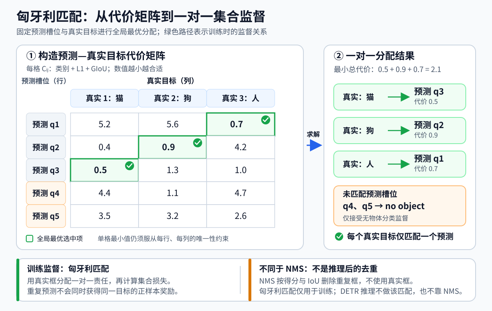

# 第 20 章 DETR：Transformer 检测流水线与二分匹配

DETR（Detection Transformer）在 2020 年把目标检测重新表述为**直接集合预测**：不再为图像铺设大量锚框，也不靠 NMS 在预测后删除重复项，而是用固定数量的对象查询一次输出整个检测集合。它保留 CNN 骨干的局部特征提取能力，再以 Transformer 编码器建立全局关系、解码器逐步细化对象查询，最后由类别头和框头产生结果。真正使这一范式成立的关键，是训练时使用匈牙利算法进行最优一对一匹配，让每个真实目标只监督一个预测，其余查询学习“无物体”。本章沿特征、序列、查询、匹配与推理的次序拆解这一流水线，并说明原始 DETR 的训练成本、小目标限制及 Deformable DETR 的改进。

## 从密集候选到直接集合预测

传统两阶段与单阶段检测器通常先产生远多于真实物体数量的候选，再依据得分与 IoU 规则筛选。R-CNN 家族需要区域建议，早期 YOLO 需要网格候选，SSD 需要多尺度默认框；它们往往还要设计锚框尺度、长宽比和 NMS 阈值。DETR 改用一个固定大小的预测集合：设查询数为 $N$，课程中的标准示例为 $N=100$，模型就输出 100 个“类别加边界框”候选。图像若只有三个物体，三个预测应分别对应真实目标，其余 97 个预测为 `no object`。

这里有两个不能混淆的机制。**对象查询**决定并行提出多少个可学习的对象槽位；**二分匹配**在训练时决定哪个槽位负责哪个真实目标。前者替代密集锚框式的输出组织，后者以一对一监督抑制重复预测，从而使 NMS 不再是必要步骤。DETR 并非完全取消 CNN，也不是把手工操作全部消灭：输入仍需预处理，输出仍需概率转换、阈值筛选与坐标还原。它消除的是锚框设计和 NMS 这类检测专用启发式主干。

课程将原始 DETR 在 COCO 上的精度概括为可与 Faster R-CNN 基线相比较，推理也有竞争力，但训练明显更慢。其优势主要来自三点：全局自注意力能够联系远距离区域，集合输出直接面向最终检测目标，统一架构减少随数据集反复设计锚框与 NMS 的工作。相应代价是更多训练数据与计算需求，以及全局注意力的二次复杂度。

## CNN 骨干与视觉 Token 化

DETR 第一阶段与许多 CNN 检测器相同：用 ResNet-50 等骨干把像素转换为层次化特征。卷积擅长提取边缘、角点、纹理等局部模式，具有参数共享和平移等变等归纳偏置，也比直接在原始像素上做全局注意力更节省计算。骨干并非可有可无的遗留组件，而是整个混合架构的局部视觉前端。

课程示例使用约 $H=800$、$W=600$、三通道的输入。骨干经过多次步长为 2 的下采样，将空间分辨率约降低 $32=2^5$ 倍，同时把通道扩展到 2048，得到约

$$
[3,800,600]\longrightarrow[2048,25,19].
$$

其中 $600/32$ 不是整数，实际实现通过卷积尺寸规则得到约 19 个位置。把空间维展开后共有 $25\times19=475$ 个位置，每个位置在 2048 个通道上的取值构成一个特征向量。这样，二维特征图被整理成 475 个视觉 token，类似语言模型把句子组织为词元序列；在课程模型中，特征随后与 Transformer 的 256 维隐藏表示对齐。

这种转换揭示了 CNN 与 Transformer 的分工：CNN 先在局部高效压缩视觉信息，Transformer 再在压缩后的 token 之间建立关系。如果直接让每个原图像素关注所有其他像素，序列会过长；先下采样再编码降低了成本，却也会损失微小物体信息。后续出现的纯 Transformer 骨干改变了这一前端选择，但课程中的 DETR 仍是 CNN 与 Transformer 的混合结构。

## Transformer 编码器、解码器与预测头

### 编码器：建立全局上下文

自注意力通过查询、键、值三类表示计算信息权重：

$$
Q=XW_Q,\quad K=XW_K,\quad V=XW_V,
$$

$$
\operatorname{Attention}(Q,K,V)=
\operatorname{softmax}\!\left(\frac{QK^\top}{\sqrt{d_k}}\right)V.
$$

直观地说，Query 表示当前位置要寻找什么，Key 用于衡量其他位置与该请求的相关程度，Value 提供最终被加权汇集的信息。头部、尾部等相距较远的局部特征不必等许多卷积层逐层扩大感受野，就能在注意力层直接建立联系。多头注意力让不同子空间并行学习不同关系；课程模型采用 8 个注意力头。

Transformer 本身不能从序列顺序自动恢复二维位置，所以视觉 token 必须加入**位置编码**。编码器块随后包含多头自注意力、前馈网络、残差连接与层归一化：前馈网络施加非线性变换，残差连接保留原始信息并改善梯度传播，层归一化稳定训练。该块重复 6 次，使输出嵌入从“这里有曲线或圆形”逐步丰富为包含物体组成、背景区分和场景布局的上下文表示。注意力图可提供观察模型关系的线索，但不能把可视化直接等同于完整因果解释。

若 token 数为 $n$，全局自注意力的两两关系计算随 $O(n^2)$ 增长。课程用 $O(nk^2)$ 与小卷积核 $k$ 对比卷积的局部计算，说明全局关系的成本。这里应把 $n$ 理解为序列位置数，而不是通道数；下采样虽缩短了序列，较大特征图仍会带来显著开销。

### 解码器：用对象查询提取实例

解码器同时接收编码器记忆和 $N$ 个可学习的对象查询。每个查询起初不是图像中的具体框，而是一个对象槽位；训练中，不同查询可学到对特定位置、尺度或形状模式的偏好。解码器包含三种关键计算：

1. **查询间自注意力**：让不同对象槽位交换信息，协调集合内部的预测；
2. **交叉注意力**：以对象查询检索编码器中的图像特征，把全局视觉证据写入查询；
3. **前馈网络及残差、归一化结构**：进一步变换并稳定表示。

课程示例的解码器同样为 6 层。经过逐层更新，通用查询变为对象特定的 256 维表示。这里的“100 个查询”不是人工写出 100 句问题，而是 100 组通过训练优化的向量。

### 双预测头：类别与归一化边界框

每个细化查询分别进入两个轻量预测头。类别头用线性层输出 $C+1$ 个 logits，多出的一个位置专用于 `no object`；推理时再归一化为概率。框头采用三层前馈网络，课程示例的维度为 $256\rightarrow256\rightarrow4$，输出归一化中心坐标和宽高：

$$
\hat b=(\hat c_x,\hat c_y,\hat w,\hat h),\qquad \hat b\in[0,1]^4.
$$

因此，一组查询对应一组 $(\hat p_i,\hat b_i)$，而不是先产生锚框再预测偏移。模型可以直接学习图像坐标中的集合结果，训练标签中的无物体槽位则负责吸收多余查询。

{ .diagram }

图 20-1：DETR 从 CNN 特征到对象查询和集合预测的完整流水线。单次前向经骨干、编码器和解码器产生 100 组预测，训练再用匈牙利匹配分配监督。课程第 217 课时抽帧。

## 匈牙利匹配与集合损失

### 从代价矩阵到全局最优一对一分配

设模型有 $N$ 个预测 $\hat y_i=(\hat p_i,\hat b_i)$，图像有 $M\le N$ 个真实目标 $y_j=(c_j,b_j)$。为处理数量差，可把真实集合补入 `no object`，但真实物体之间的分配必须保持一对一。对每一对预测 $i$ 和真实目标 $j$，计算包含三项的匹配代价：

$$
\mathcal C_{ij}=
 w_{\mathrm{cls}}\mathcal C_{\mathrm{cls}}(\hat p_i,c_j)
+w_{\mathrm{box}}\lVert\hat b_i-b_j\rVert_1
+w_{\mathrm{giou}}\mathcal C_{\mathrm{giou}}(\hat b_i,b_j).
$$

类别代价衡量把预测 $i$ 分给类别 $c_j$ 是否合适，$L_1$ 项衡量中心与宽高差异，IoU 相关项衡量框的空间重合；课程将第三项概括为 IoU 损失，原始 DETR 通常具体写为 GIoU 代价。各项权重用于平衡量纲和训练偏好，本章不为课程未给出的权重指定数值。

随后，匈牙利算法在所有合法的一对一分配中寻找**总代价最小**的方案：

$$
\hat\sigma=\arg\min_{\sigma\in\Pi_M}
\sum_{j=1}^{M}\mathcal C_{\sigma(j),j}.
$$

$\Pi_M$ 表示把 $M$ 个真实目标分配给不同预测的全部可行方案。这里不能简单地为每个真实框独立挑一个最小值，因为多个目标可能选中同一个预测；匈牙利算法解决的是带唯一性约束的全局分配，而非逐行贪心。比如 100 个预测中只有猫、狗、人三个真实目标，算法可能把第 47、12、83 号查询分别分给它们，其余 97 个查询全部标记为 `no object`。

匹配完成后才计算训练损失并反向传播。已匹配查询同时接受类别、$L_1$ 框回归和 GIoU 相关监督，未匹配查询接受无物体分类监督。由于每个真实目标只分配给一个预测，同一物体的多个高分框不能都获得正样本奖励，重复预测在训练目标内部就受到抑制。这正是 DETR 能省去 NMS 的根本原因；匈牙利匹配不是挂在推理末尾的另一个去重滤波器，而是训练标签分配机制。

{ .diagram }

图 20-2：匈牙利算法在预测与真实目标之间进行一对一最优分配。每个真实目标只匹配一个预测，未匹配槽位学习 no object；代价数值用于说明全局分配逻辑。根据课程内容整理。

### 训练与推理的边界

完整流程可以分成两种状态理解：

| 阶段 | 数据流与必要操作 |
|---|---|
| 训练前向 | 图像 → CNN 特征 → 位置编码与编码器 → 对象查询解码 → 100 组类别和框 |
| 训练标签分配 | 构造预测—真实目标代价矩阵 → 匈牙利最优一对一匹配 → 多余查询标为 `no object` |
| 训练更新 | 对匹配对计算分类与框损失，对多余查询计算无物体损失，反向传播 |
| 推理 | 直接前向得到集合 → 排除 `no object`、按类别得分阈值筛选 → 坐标还原，无需真实框、匈牙利匹配或 NMS |

因此，“端到端”指检测监督从图像一直贯通到最终集合，不需要锚框生成与 NMS 这类外置检测步骤；匈牙利算法虽产生离散分配，分配后的类别与框损失仍可微并用于反向传播。它也不意味着推理不需要任何格式转换。传统方法常是“大量生成再规则过滤”，DETR 则是“固定集合输出加学习得到的一对一责任分配”。

## Transformers 实践、局限与 Deformable DETR

课程代码使用 Hugging Face Transformers 加载图像处理器和 `facebook/detr-resnet-50`。示例配置包括 ResNet-50 骨干、6 层编码器、6 层解码器、256 维隐藏表示、8 个注意力头和 100 个对象查询。实践步骤为：

1. 用处理器把输入图像转换为模型要求的张量与尺寸；
2. 在评估模式下用 `torch.no_grad()` 关闭梯度图构建，执行前向；
3. 从输出中读取 `logits` 与 `pred_boxes`。课程演示每张图得到 100 组结果，类别维为 92，其中额外一位对应 `no object`，框维为 4；
4. 调用相应后处理，把 $[0,1]$ 的中心框转换为原图像素坐标，再按得分保留 `scores`、`labels`、`boxes`；
5. 使用 OpenCV 绘制。演示既检出了狗，也在第二张图给出狗和 couch 等类别，个别高分或类别现象只能作为单次输出观察，不能替代系统评价。

| 维度 | Faster R-CNN | YOLO | 原始 DETR |
|---|---|---|---|
| 核心组织 | RPN 候选与二次精修 | 网格密集回归 | 固定对象查询的集合预测 |
| 全局关系 | 主要由深层卷积逐步形成 | 整图特征加卷积上下文 | 编码器自注意力直接建模 |
| 手工先验 | 锚框、候选数、NMS 阈值 | 网格、候选与 NMS 设置 | 查询数固定，无锚框和 NMS |
| 训练特点 | 相对稳定 | 较快，调参依赖实现 | 收敛较慢、计算需求较高 |
| 小目标 | 通常较有优势 | v1 较弱，后续多尺度改善 | 原始版本受单次大倍率下采样制约 |

课程特定对比把三者训练时间列为约 12 小时、约一天和约 3—6 天，这些数值不能脱离硬件与训练配置迁移，但能说明原始 DETR 的收敛成本。其小目标困难也很直观：原图中 $20\times20$ 像素的物体经过约 32 倍空间下采样后不足一个特征单元，即使后续注意力能建立全局联系，也无法凭空恢复已经丢失的细节。

2021 年的 **Deformable DETR** 将每个查询对所有位置的全局稠密注意力，改为在少量可学习采样位置上聚合信息。若每个查询关注 $k$ 个位置且 $k\ll n$，注意力成本可由 $O(n^2)$ 降为与 $O(nk)$ 相关的形式。这里的稀疏化是学习“看哪里”，不是简单把普通注意力矩阵中的若干数置零。课程报告其训练约提速十倍并改善小目标表现，核心原因包括降低全局注意力开销和更有效地利用关键位置及多尺度信息。DETR 的范式意义因此不在于初版已经全面胜出，而在于把集合预测、全局关系与可微的一对一监督组合成了一条可持续改进的检测路线。

## 本章小结

- DETR 用 CNN 提取局部视觉特征，再由 Transformer 编码器、解码器和固定对象查询直接预测检测集合。
- 位置编码补足空间信息，自注意力建立全局关系，交叉注意力把编码器证据写入对象查询。
- 匈牙利算法依据类别、框 $L_1$ 与 GIoU 相关代价求全局最优一对一分配，多余查询学习 `no object`。
- 一对一训练监督抑制重复预测，从而省去 NMS；推理只需前向、概率与阈值处理及坐标还原，不执行匈牙利匹配。
- 原始 DETR 训练较慢且受下采样影响小目标，Deformable DETR 以可学习稀疏采样降低计算并改善这一问题。

<!-- course-lectures: 207-220 -->

<!-- ebook-navigation -->

---

[← 上一章](ch19.md) · [返回完整目录](../index.md) · [下一章 →](ch21.md)
