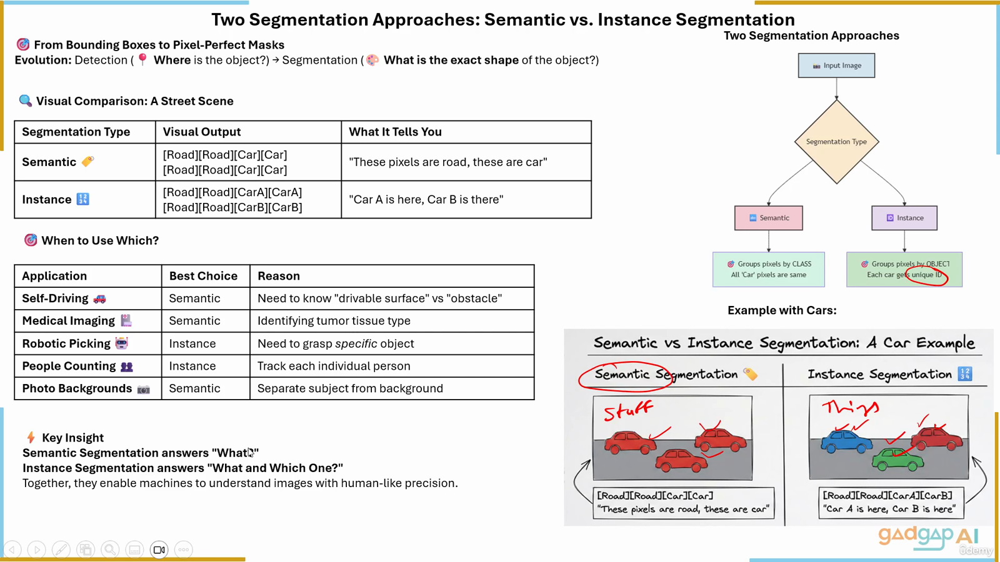

# 第 21 章 图像分割基础：语义、实例与像素级损失

图像分类为整幅图像给出标签，目标检测用边界框定位对象，而图像分割进一步把识别落实到每一个像素，使模型不仅知道场景中有什么，还能恢复道路、器官或物体的精确轮廓。分割并不是单一任务：语义分割建立类别与像素的对应关系，实例分割还要区分同类对象的不同个体，全景分割则统一处理无定形区域与可计数对象。沿着这一任务定义，后续架构从 FCN、U-Net 的逐像素预测，发展到 Mask R-CNN 的检测与掩膜联合学习，再发展到 SAM 的提示式通用分割，以及 SAM2 的视频记忆和 SAM3 的概念提示。理解这些模型的前提，是先明确输出标签、损失函数与评价指标究竟在像素层面表示什么。

## 从图像张量到像素标签

设输入彩色图像为 \(X\in\mathbb{R}^{H\times W\times 3}\)，其中高、宽分别为 \(H,W\)，三个通道对应 RGB。语义分割模型通常输出 \(C\) 个类别的 logits：

\[
Z\in\mathbb{R}^{H\times W\times C},\qquad
\hat y_{ij}=\arg\max_c \operatorname{softmax}(Z_{ij})_c .
\]

最终标签图仍具有 \(H\times W\) 的空间尺寸，但每个位置不再是颜色，而是类别 ID。例如可把背景记为 0、汽车记为 1、行人记为 2、交通灯记为 3。颜色只是可视化标签的手段，不是模型输出的本质；同一 ID 必须对应一致的类别定义。

实例分割不能只用一张类别 ID 图完整表示。它通常为第 \(k\) 个对象给出类别 \(c_k\)、边界框 \(b_k\) 和二值掩膜 \(M_k\)。于是，两辆相邻汽车可以都属于“汽车”类别，却分别拥有 \(M_1\) 与 \(M_2\)。这一区别也决定了标注方式：语义标注告诉模型“这个像素属于哪一类”，实例标注还要告诉模型“它属于哪一个对象”。

## 语义、实例与全景分割的分工

语义分割擅长回答“这里是什么”，实例分割回答“这里是什么，以及具体是哪一个”。课程用 stuff 与 things 区分两类场景：天空、道路、草地、水面等通常属于无定形的 stuff；汽车、行人、动物等具有可辨认个体边界，属于可计数的 things。不过，语义分割的类别集合也可以包含汽车、行人等 things，只是它不会继续分配实例 ID。

| 维度 | 语义分割 | 实例分割 | 全景分割 |
|---|---|---|---|
| 基本输出 | 每像素一个类别 | 每实例的类别、框与掩膜 | 统一的类别与实例标识 |
| 同类相邻对象 | 合并为同一类别区域 | 分离为不同掩膜 | 对 things 分离实例 |
| 典型关注点 | 区域性质与整体轮廓 | 个体边界、数量与身份 | stuff 和 things 的一致表达 |
| 典型应用 | 可驾驶区域、肿瘤区域、背景替换 | 机器人抓取、人数或车辆计数 | 同时理解道路、天空和多个交通参与者 |

任务选择应由下游操作决定。自动驾驶若只需区分可行驶表面与障碍区域，语义输出已经足够；机器人必须抓取某一个物体，或系统需要统计人数时，就必须保留实例身份。医学影像若关注整个病灶范围，语义分割很自然；若需分别测量多个病灶，则要进一步区分实例。全景分割融合两种视角：对天空、海洋等区域采用语义表达，对可数对象保留独立实例，而不是简单把两张彩色图叠加。

{ .diagram }

图 21-1：语义分割按类别标记像素，实例分割进一步为同类对象保留独立 ID，并对应不同的下游应用。课程第 223 课时 05:15 抽帧。

## 编码器—解码器如何恢复轮廓

语义分割的常见骨架是“编码器—瓶颈—解码器—像素预测头”。编码器可以是 ResNet 等 CNN 主干，通过卷积、步幅和池化逐级缩小高宽并增加通道数。若连续进行 \(s\) 次二倍下采样，理想情况下空间尺寸由 \(H\times W\) 变为 \(H/2^s\times W/2^s\)。较深的特征具有更大的感受野和更强的语义表达，瓶颈进一步融合上下文，因此更适合判断“图中有什么”。

仅有深层特征还不能形成精细掩膜。解码器通过上采样或转置卷积逐步恢复空间分辨率，并减少通道，最终产生 \(H\times W\times C\) 的类别响应。跳跃连接把编码器较早层的高分辨率特征送往解码器，补充在下采样中减弱的边缘与位置细节。编码器提供语义，解码器恢复几何，跳跃连接把二者对齐，三者共同避免只得到“知道有汽车、却画不准汽车轮廓”的结果。

例如，课程用 \(224\times224\times3\) 输入和 \(7\times7\times2048\) 深层特征说明这种压缩：空间尺寸显著减小，语义通道显著增加。解码器再从低分辨率表示逐步恢复原图尺寸，并由预测头完成逐像素分类。这里的“恢复”不是无损还原原图，而是学习一张与输入几何对齐的标签图。

## 逐像素损失与类别不平衡

语义分割本质上是 \(H\times W\) 个相互关联的分类问题。令 \(y_{ijc}\) 为真实标签的 one-hot 分量，\(p_{ijc}\) 为预测概率，则平均逐像素交叉熵可写为

\[
\mathcal L_{\mathrm{CE}}
=-\frac{1}{HW}\sum_{i=1}^{H}\sum_{j=1}^{W}\sum_{c=1}^{C}
y_{ijc}\log p_{ijc}.
\]

它与整图分类使用相同的概率原则，只是损失要在类别维与所有像素上汇总。训练时比较的是概率分布和真实掩膜，而不是两张可视化图的颜色是否接近。

实际图像常有大量天空、道路或背景像素，前景目标只占很小面积。若所有像素等权，模型可能通过偏向多数类降低总损失，却忽略行人、小病灶等关键区域。课程引入 focal loss，将目标类预测概率记为 \(p_t\)：

\[
\mathcal L_{\mathrm{focal}}
=-\alpha(1-p_t)^\gamma\log p_t .
\]

当样本很容易、\(p_t\) 接近 1 时，\((1-p_t)^\gamma\) 很小，其损失被显著下调；困难样本保留更大的相对权重。\(\alpha\) 用于平衡类别，\(\gamma\) 控制对易分类样本的抑制程度。课程给出的常用起点是 \(\alpha=0.25,\gamma=2\)，但它们仍是需要结合数据验证的超参数，而不是所有分割任务的固定答案。

调制因子的作用可以直接代入数值理解。当 \(p_t=0.9,\gamma=2\) 时，\((1-p_t)^\gamma=0.01\)；当 \(p_t=0.05\) 时，该因子为 \(0.9025\)。不过，完整损失还包含 \(-\log p_t\)，所以不能说增大 \(\gamma\) 就必然放大困难样本的绝对损失。准确的说法是：易分类样本的损失被更快地压低，训练信号的相对重心转向难分类像素。对极小目标而言，这种重加权尤其重要，因为即使漏掉整个目标，其像素数在总损失中也可能微不足道。

还要注意，类别不平衡与实例混淆不是同一个问题。focal loss 可以改变不同像素对训练的贡献，却不能把同属“汽车”类的相邻对象自动拆成不同实例。若下游需要计数，仍需实例级标注和相应模型；若只需道路或天空的区域类别，则没有必要为每个连通区域强行附加实例身份。

评价区域重叠时，先对每个类别计算交并比，再求平均：

\[
\operatorname{IoU}_c=\frac{|P_c\cap G_c|}{|P_c\cup G_c|},
\qquad
\operatorname{mIoU}=\frac1C\sum_{c=1}^{C}\operatorname{IoU}_c .
\]

其中 \(P_c,G_c\) 分别是预测与真实的类别区域。mIoU 能同时反映漏分与多分，且不会因背景面积巨大而只报告表面的像素准确率。平均发生在类别维，而不是把所有像素混成一个总区域，所以大面积道路与小面积交通灯都按一个类别参与最终平均。这使稀有类别不会被总面积轻易淹没，但也意味着小类的较差结果可能明显拉低 mIoU。比较实验时必须保持类别集合和空类别处理规则一致。课程以 mIoU 70、80 以上说明较强结果，但具体阈值依赖数据集、类别难度和评价协议，不能跨任务直接排名。

## 用合成场景核对标签语义

课程的入门代码没有加载 PyTorch 模型，而是用 PIL 创建 \(400\times300\) 的简化场景：三个矩形表示汽车，椭圆与矩形组合表示树木，再补充天空和道路。其核心不是训练网络，而是验证标签结构。

1. 用 `Image.new` 与 `ImageDraw` 绘制原图。
2. 创建与原图高宽一致的整数掩膜，约定天空为 0、道路为 1、汽车为 2、树为 3。
3. 在语义版本 `create_semantic_segmentation_mask` 中，所有汽车区域都写入 2，所有树木区域都写入 3。
4. 将标签映射为颜色，并把原图与掩膜叠加，检查边界是否错位、是否发生区域外溢。
5. 在实例版本中，根据对象位置分别建立框和掩膜，使三辆汽车、两棵树各自获得不同实例颜色。

这个演示清楚地区分了“按已知坐标生成教学标签”和“模型从图像预测标签”。它没有证明任何网络精度，却让类别共享、实例独立和 overlay 检查成为可操作的流程，为理解后续真实模型奠定基础，也便于后续对照真实网络的输出。

## 本章小结

- 语义分割输出逐像素类别，实例分割还要分离同类个体，全景分割统一表达 stuff 与 things。
- 编码器提取语义，解码器恢复分辨率，跳跃连接补充空间细节，最终形成与原图对齐的预测。
- 逐像素交叉熵在所有位置和类别上汇总；focal loss 通过降低易分类样本权重缓解背景占优。
- mIoU 按类别计算预测与真实区域的交并比再取平均，比整体像素准确率更能反映分割质量。
- 合成掩膜代码用于理解标签和实例 ID，不应把手工生成结果误认为训练模型的预测性能。
<!-- course-lectures: 221-233 -->

<!-- ebook-navigation -->

---

[← 上一章](ch20.md) · [返回完整目录](../index.md) · [下一章 →](ch22.md)
