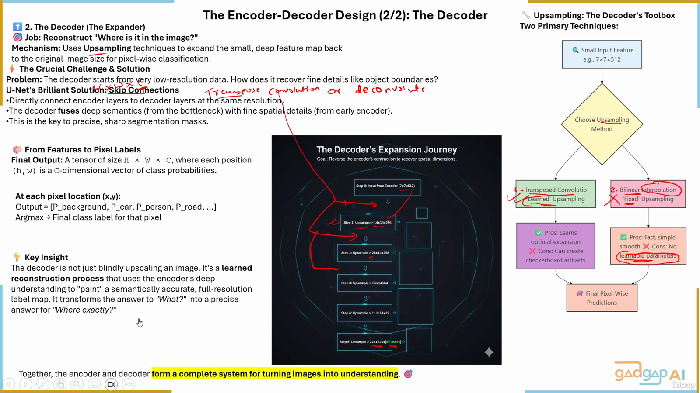

# 第 22 章 FCN 与编码器—解码器架构

把整幅图像判定为“猫”与把猫占据的每个像素标出来，是两种不同粒度的视觉理解。传统分类网络不断压缩空间信息，最终只保留一个全局答案；语义分割却必须在识别内容之后重建几何。2015 年前后出现的全卷积网络（FCN）以卷积保留空间布局，并通过上采样直接生成像素标签图，确立了端到端分割的基本范式。随后，U-Net 用更对称的解码路径和拼接式跳跃连接强化细节恢复。二者共享的核心并不是一条固定网络，而是一种分工明确的计算结构：编码器压缩图像以获得语义，解码器扩展特征以恢复位置，跨层连接则在两种信息之间建立通道。

## 从全局标签到像素地图

分类器的目标可以概括为把 \(H\times W\times3\) 的输入映射为一个类别向量。为获得平移不变性和高层语义，网络逐级降低空间分辨率；对象位于左上角还是右下角，不应改变最终类别。然而，分割要求输出与原图同高同宽的标签图，对象移动时，掩膜也必须随之移动。因此，分类网络完成的只是“理解内容”这一半任务，分割还需要“重建空间”。

课程以 ResNet-50 风格的特征压缩为例：\(224\times224\times3\) 的输入可变为 \(7\times7\times2048\) 的特征。后者语义强、计算紧凑，却难以独立指出原始边界。另一个示意从 \(512\times512\) 压缩到 \(16\times16\)，高宽各缩小 32 倍；若只把这一低分辨率结果直接放大，轮廓容易粗糙。不同例子的通道数取决于主干，但其共同矛盾相同：深层特征更善于回答 what，浅层特征保留更多 where。

FCN 的突破在于取消依赖固定长度向量的全连接分类尾部，使特征在卷积运算中始终保持二维布局，再通过解码路径回到像素级输出。U-Net 沿用这一方向，并加强编码器与解码器同级特征的联系。因而，从分类到分割的关键不是给图像多涂几种颜色，而是把高层语义重新展开为空间精确的预测。

## 编码器：以空间压缩换取语义

编码器通常由卷积、归一化、非线性激活与池化或带步幅卷积组成。每经过一个下采样阶段，特征高宽大致减半，通道数则逐步增加。课程用 \(224\times224\times3\) 到 \(7\times7\times512\) 的路径说明这一过程；这里的 512 是该示意的末端通道数，并非所有编码器的统一配置。

设第 \(l\) 层特征为 \(E_l\in\mathbb{R}^{H_l\times W_l\times C_l}\)，典型的阶段变化为

\[
H_{l+1}\approx\frac{H_l}{2},\qquad
W_{l+1}\approx\frac{W_l}{2},\qquad C_{l+1}>C_l .
\]

这种设计带来三方面收益。首先，更大的感受野使局部响应能够结合场景上下文；其次，层次化卷积把边缘、纹理逐步组合为部件和对象；最后，较小的特征图降低后续计算量。代价则是纹理、细边界和准确位置被压缩，对小幅平移更不敏感的同时也削弱了对精确位移的表达。

因此，不能把编码器的模糊特征简单视为“错误”。它是有意的信息重组：牺牲部分空间精度，换取稳定语义。分割架构真正需要解决的是如何在解码时重新引入浅层细节，而不是完全取消下采样。

## 解码器：学习上采样与逐像素判别

解码器执行与编码器相反方向的尺寸变化：逐级扩大高宽、调整通道，最终输出 \(H\times W\times C\)，其中 \(C\) 是类别数。若末端特征为 \(7\times7\times512\)，就需要通过多个阶段恢复到目标输出分辨率，而不是把一个小图像机械拉伸后结束。

课程比较了两类上采样方式。双线性插值依据邻近像素和固定权重估计新位置，没有可学习参数；转置卷积也称 deconvolution，其卷积核能够在训练中学习，用于实现可学习的空间扩展。它并不是普通卷积的严格数学逆运算，也不能凭空找回已经丢失的信息。更准确的理解是：它学习一种从低分辨率特征到高分辨率响应的映射。

每个解码阶段可概括为

\[
D_l=\phi\!\left(\operatorname{Up}(D_{l+1}),E_l\right),
\]

其中 \(\operatorname{Up}\) 表示上采样，\(E_l\) 是经跳跃连接送来的同尺度编码特征，\(\phi\) 表示特征融合与后续卷积。FCN 常以相加融合，U-Net 则以通道拼接融合；二者都要先保证空间尺寸对齐。

最后一层把通道数映射为类别数。对每个像素执行 softmax 可得到类别概率，执行 argmax 则得到最终标签。也就是说，输出通道不是 RGB 颜色通道，而是类别响应平面；显示时才把各类别 ID 映射为颜色。

从信息流看，编码器与解码器并不是两个可以相互撤销的函数。编码器把多个邻域响应压缩成较少的空间位置，解码器则在这些位置上重新分配并组合特征。若输入高宽从 224 依次变为 112、56、28、14、7，解码路径需要按相反顺序逐级恢复；每次恢复都应明确对应的特征层级，而不是只检查最后输出是否回到 224。最终尺寸相同也不代表边界已经正确，因为边界质量还取决于特征内容与训练监督。

瓶颈的价值在于聚合较大范围的上下文。例如，仅凭一个局部灰色区域可能难以判断它属于道路还是建筑，结合周围车道、行人和天空后才更容易作出一致分类。解码器则把这种全局判断分配给具体像素。浅层特征不必独自理解完整场景，深层特征也不必独自保存全部纹理，两者通过跨层融合形成互补。

{ .diagram }

图 22-1：编码器输出的低分辨率深层特征经解码器逐级上采样，并结合跳跃连接与两类上采样方式形成像素级预测。课程第 240 课时 06:44 抽帧。

此外，应区分 logits、概率与标签三种张量状态。解码器直接产生的是未归一化 logits；softmax 把同一像素的类别响应转换为总和为 1 的概率；argmax 再把概率向量压缩为一个整数 ID。计算交叉熵、可视化掩膜和统计各类面积分别对应不同状态，混用它们会造成训练或评价错误。

## 跳跃连接与沙漏式信息闭环

仅靠瓶颈特征解码，模型拥有上下文却缺乏局部参照。跳跃连接将编码阶段的高分辨率特征直接送往对应解码阶段，使网络在每次扩展时都能重新利用原始边缘和位置。它与 ResNet 的跨层连接在思想上相通，但目的有所不同：这里不仅是改善梯度传播，更是显式融合语义与几何。

完整路径因而形成先收缩、后扩展的沙漏结构。收缩路径逐级回答“这是什么”，瓶颈整合全局上下文，扩展路径逐级回答“它在哪里”。课程中对 FCN 与 U-Net 的初步比较正落在融合方式上：前者类似 ResNet 的相加，后者类似后来 DenseNet 所采用的拼接。连接方式影响原始信号能否以独立通道保留，也影响解码器的参数量和显存占用。

需要区分“上采样让图变清楚”与“分割学习变准确”。双线性插值、转置卷积都可以改变尺寸，但只有结合标注、损失和端到端训练，模型才学会哪些响应应当成为目标边界。算子本身并不自动产生正确掩膜。

## 合成数据与分辨率演示的正确读法

课程的 Notebook 先导入 `torch`、`torchvision` 等依赖，再构造 \(256\times256\) 合成场景。图像中绘制绿色、红色、蓝色、黄色和紫色的矩形或椭圆，顶部天空与底部地面另有区域标签。生成图像时同步创建 ground-truth mask，通过 NumPy 数组切片把像素写入相应类别 ID，并用 overlay 将原图与标签叠加，以核查标注位置。

随后，代码用缩小与放大模拟编码器—解码器过程：输入从 \(256\times256\) 依次变为 \(128\times128\)、\(64\times64\) 等低分辨率表示，再逐步放大。视觉化显示了下采样后细节变模糊、上采样后空间尺寸恢复的过程，但这一模拟并不等价于训练好的 FCN，也不能据此声称恢复了原始信息。

把演示转化为真实实现时，应保持以下检查顺序：

1. 核对图像与掩膜的空间尺寸、类别 ID 和颜色表，避免把实例编号误当语义类别。
2. 逐层记录编码特征的形状，确认每次下采样与通道变化符合设计。
3. 检查解码器上采样后的尺寸是否与待融合的编码特征一致。
4. 确认最终 logits 为 \(H\times W\times C\) 或相应的批次形式，再以 argmax 生成标签图。
5. 将随机初始化的结构演示与经过数据训练的模型分开评价，后者才可讨论损失、精度和泛化。

## 本章小结

- FCN 将分类网络转为全卷积的端到端像素预测，U-Net 则进一步强化对称解码和跨层特征融合。
- 编码器通过缩小高宽、增加通道获得语义与上下文，但会减弱边界和位置细节。
- 解码器通过插值或可学习转置卷积恢复分辨率，末端以类别通道和 argmax 形成标签图。
- 跳跃连接把浅层空间信息送回解码路径，是连接 what 与 where 的关键，而非简单的图像放大。
- 合成场景和缩放可视化用于检查张量及标签关系，不能代替真实训练与定量评价。
<!-- course-lectures: 234-241 -->

<!-- ebook-navigation -->

---

[← 上一章](ch21.md) · [返回完整目录](../index.md) · [下一章 →](ch23.md)
