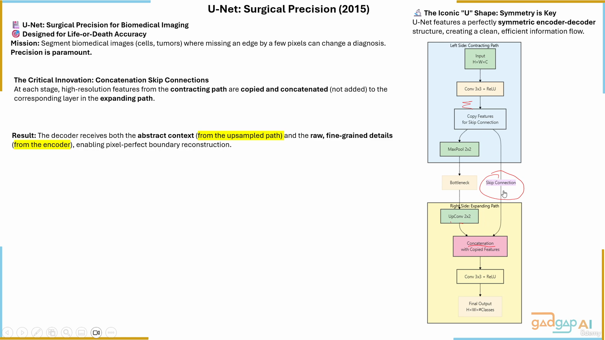

# 第 23 章 U-Net：跳跃连接、特征拼接与场景选择

FCN 与 U-Net 都把图像映射为像素标签图，但二者处理空间细节的方式代表了两种不同设计取向。FCN 从分类网络出发，以全卷积化保留二维布局，再将不同层级的响应融合到解码过程；U-Net 则建立近似对称的收缩路径与扩展路径，把同尺度的编码特征直接拼接到解码特征之后。前者的贡献是打通端到端语义分割，后者进一步强化精细边界、小样本训练和梯度传播。理解二者不能停留在“一个相加、一个拼接”的口号上，还要同时考察信号如何融合、后续卷积如何学习，以及参数、显存、速度与任务精度之间的取舍。

## FCN 的第一项革新：以卷积替代全连接尾部

传统 CNN 在分类前通常将特征图展平，再送入神经元数固定的全连接层。展平把二维空间排列转成向量，全连接层又要求输入长度固定，这适合输出整图标签，却不利于恢复逐像素位置。FCN 用 \(1\times1\) 卷积替代这一尾部，在每个空间位置上完成通道到类别响应的映射。

若某位置的特征为 \(v_{ij}\in\mathbb{R}^{C_{\mathrm{in}}}\)，则 \(1\times1\) 卷积计算

\[
z_{ij}=Wv_{ij}+b,
\]

同一组 \(W,b\) 在所有位置共享。它与逐位置的全连接变换等价，却不需要展平特征图，因而保留空间拓扑。课程以带 512 个通道的卷积替换 dense 层说明这一变化；真正决定输出类别数的是最后分类卷积的通道配置，而中间通道数可依网络而异。

全卷积化带来三项直接收益：不再由全连接层锁定固定输入长度；同一网络可处理不同高宽的图像；卷积权重在整个特征图上共享，避免对每个图像块重复执行独立分类。实际使用仍要处理下采样倍率、填充和解码尺寸对齐，但“全局标签网络”由此转变为可端到端训练的统一像素预测网络。

## FCN 的第二项革新：用跨层融合修复瓶颈

仅将最深层特征上采样，会得到语义明确而空间粗糙的结果。编码器可能把高宽压缩数十倍，细边界、小目标和精确位置已难以从单层低分辨率响应中恢复。FCN 因而把较早层的特征引入预测过程，使解码不仅依赖瓶颈中的 what，也能利用中间层保留的 where。

相加式融合可抽象为

\[
D_l=\phi_l\!\left(U(D_{l+1})+E_l\right),
\]

其中 \(U\) 是上采样，\(E_l\) 为同尺度编码特征，\(\phi_l\) 为后续变换。两路张量需要先对齐空间尺寸与通道数。其形式与残差网络中的相加相似：深层语义和较浅层细节汇成一路，再参与后续预测。无跨层连接的 FCN-32 风格路径只利用最粗尺度响应，因此更适合说明“为什么单靠瓶颈不够”，而不是代表所有 FCN 变体。

跳跃连接还提供从输出返回较早编码层的更短梯度路径。其作用并非让解码器直接复制原图，而是让网络在上下文化判断之外保留局部证据，从而减轻掩膜模糊和边界偏移。

## U-Net 的对称结构与拼接机制

U-Net 的收缩路径和扩展路径在层级上近似镜像，整体呈 U 形。每个解码阶段先上采样来自更深层的特征，再复制同尺度编码特征，并沿通道维拼接：

\[
D_l=\phi_l\!\left(\left[U(D_{l+1});E_l\right]\right).
\]

若两路输入通道分别为 \(C_d,C_e\)，拼接后的通道数为 \(C_d+C_e\)，而相加仍保持同一通道数。拼接没有在融合入口把两路响应压成一个数值，而是让解码器同时访问抽象上下文和细粒度编码信号。后续卷积再学习如何加权、筛选和组合这些信息，因此 U-Net 的精度优势来自“保留独立信息通道＋可学习融合＋对称多级恢复”的整体设计。

相加并非在所有网络中都必然破坏信息，拼接也不自动保证正确边界。二者的实质差别在于归纳偏置和计算代价：拼接保留了更明确的两路表示，却让后续卷积面对更宽的输入，通常增加参数与显存；相加更紧凑，但要求两路特征在通道上直接对齐。课程称 U-Net 具有“外科手术般的精度”，主要是在医学影像等精细任务中强调这种设计经验，而不是无需训练即可获得的性质。

跳跃连接还改善了反向传播。梯度可以经跨层路径到达早期编码器，减少完全穿越深层瓶颈的依赖。这使 U-Net 在标注样本有限时仍具有较强吸引力，但“小样本有效”不等于十几张图像就能普遍获得可靠模型，数据多样性、预处理和评价方式仍然重要。

{ .diagram }
<p class="figure-caption">图 23-1：U-Net 在对称的收缩路径与扩展路径之间复制同尺度特征，通过拼接式跳跃连接融合抽象上下文与细粒度细节。课程第 247 课时 01:45 抽帧。</p>

## 从 PyTorch 结构演示看融合位置

课程先用四个卷积块构造无跳跃连接的 FCN 教学网络：卷积核均为 \(3\times3\)、padding 为 1，空间尺寸逐步减半，通道由输入的 3 逐步增加到 512；瓶颈之后用 `nn.ConvTranspose2d` 上采样。其简化前向流程为：

```text
输入图像 → 四个卷积/下采样块 → 瓶颈
        → 转置卷积逐级上采样 → 类别响应图
```

这个示例有意不接入浅层特征，用来观察仅依赖低分辨率表示时细节恢复的困难。它说明的是连接结构，不是对 FCN 全系列性能的完整测量。

U-Net 示例则分别建立卷积块、瓶颈和对称解码块。卷积块使用 \(3\times3\) 卷积、padding 1 与 ReLU；每一级上采样后，将解码特征和对应编码特征执行：

```python
merged = torch.cat([decoder_feature, encoder_feature], dim=1)
```

`dim=1` 对应批次张量中的通道维，四个层级采用对称拼接，形成 U 形路径。代码还收集中间状态，用循环观察下采样时细节逐渐减少、上采样时结构响应逐步展开。`torch.no_grad()` 只表示前向过程不记录梯度；示例没有完成数据驱动训练，不能把一次随机或冻结权重的前向结果当作精度对比，更不能由“看起来更清楚”推出 mIoU 更高。

## 结构落地时的三组核对

第一组是空间尺寸核对。相加要求两路特征的高宽一致，拼接虽然放宽了通道数必须相同的限制，却仍要求高宽一致。若某一级上采样结果无法与编码特征对齐，后续 `torch.cat` 会在通道操作之前失败。因而，逐层打印批次、通道、高、宽，比只观察最终彩色掩膜更能定位结构错误。

第二组是信息与参数核对。拼接后的通道数为两路之和，后续卷积的输入通道也必须同步调整。若仍沿用拼接前的卷积配置，即便张量拼接成功，下一层也无法正确前向。解码器越宽，特征图和卷积权重占用的资源通常越多；这也是 U-Net 精细融合需要付出的实际成本。

第三组是学习效果核对。结构正确只代表数据能够流过网络，不代表模型已经学会分割。应分别检查训练掩膜与真实标签是否对齐、损失是否基于类别 logits 计算、验证集是否来自未参与训练的样本。课程展示的中间特征、损失趋势和架构对比可用于理解机制，但跨模型结论必须在一致的数据划分和训练条件下获得。尤其不能把冻结权重的前向输出、模拟缩放结果和真实训练曲线混为一谈。

这三组核对也解释了为什么“U-Net 拼接更好”不是充分的工程结论。拼接解决的是信息如何进入解码器，训练目标决定模型如何利用这些信息，数据规模与增强方式决定它能否泛化，部署约束则决定额外通道是否值得。只有四者同时成立，架构优势才会转化为可用的分割质量。

## 架构比较与场景选择

| 维度 | FCN | U-Net |
|---|---|---|
| 基本形态 | 分类主干改造而来，解码路径较灵活 | 编码器与解码器多级对称 |
| 跨层融合 | 以特征相加为代表 | 复制编码特征并按通道拼接 |
| 信息侧重 | 高效融合深层语义与较浅层响应 | 显式保留两路信息，再由卷积学习融合 |
| 典型代价 | 结构和融合较紧凑 | 拼接增加通道，常带来更多参数与显存 |
| 课程所示场景 | 一般场景、道路分割、重视速度的任务 | 医学、卫星、精细轮廓和小样本任务 |

双线性插值没有学习权重，转置卷积可以学习上采样核，但 FCN 与 U-Net 的差别不能简单归结为“前者固定、后者可学习”。选择模型时应同时比较实际 backbone、解码器宽度、输入尺寸和融合方式，而不是只按名称推断速度。

在自动驾驶等重视时延的场景，可用较简洁的 FCN 类结构平衡速度与精度；在肿瘤边界、遥感细节或人像发丝等任务中，U-Net 的多级拼接通常更有吸引力。医学影像中 U-Net 常被视为基础架构，并不意味着 FCN 无法使用；同样，U-Net 参数较多也不意味着任何实现都更慢。最终选择应落在同一数据和硬件上的验证结果：既看掩膜质量，也看显存、参数量、吞吐和标注成本。

## 本章小结

- FCN 用 \(1\times1\) 卷积取代全连接尾部，保留空间布局并支持端到端像素预测。
- FCN 通过跨层相加引入较浅层细节，缓解仅依赖瓶颈上采样造成的粗糙边界。
- U-Net 在对称路径上执行通道拼接，让后续卷积学习融合语义与细粒度信息，但会增加计算和显存压力。
- `torch.cat(..., dim=1)` 是课程实现拼接的关键；未训练的结构演示不能作为模型精度证据。
- 模型选择应综合精度、数据规模、时延和资源，而不是把 FCN 与 U-Net 固化成单一场景答案。
<!-- course-lectures: 242-250 -->

<!-- ebook-navigation -->

---

[← 上一章](ch22.md) · [返回完整目录](../index.md) · [下一章 →](ch24.md)
