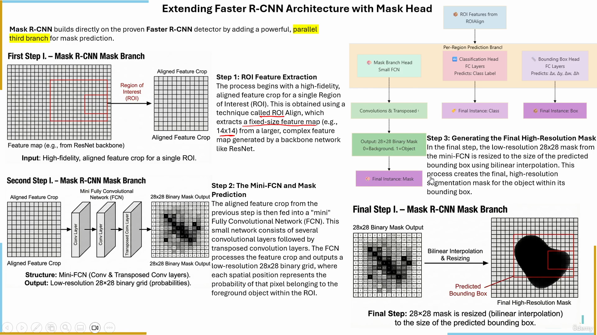
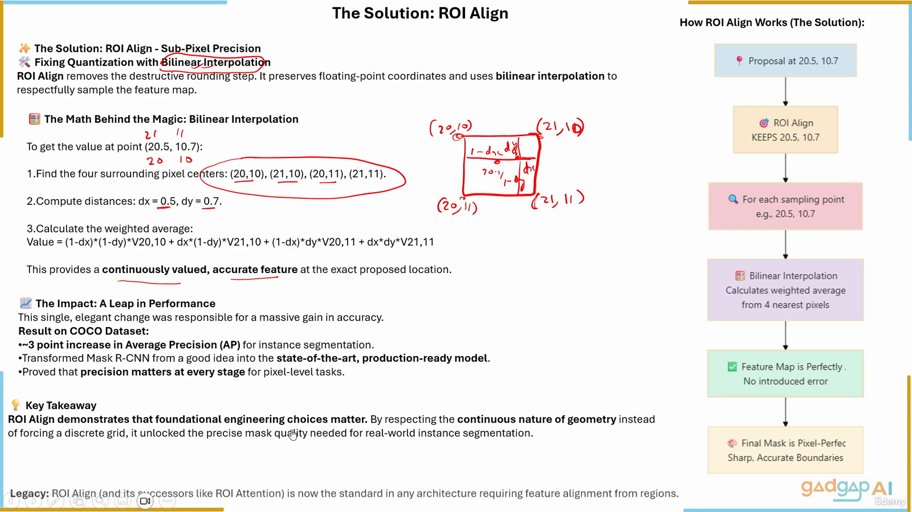

# 第 24 章 Mask R-CNN：实例分割、ROI Align 与多任务损失

语义分割为每个像素指定类别，却不会自动区分相邻的同类对象。实例分割需要同时保留类别、位置、个体身份和精确轮廓，Mask R-CNN 因而把 Faster R-CNN 的两阶段检测框架扩展为多任务系统：主干提取共享特征，RPN 提出候选区域，ROI Align 无取整地提取区域特征，分类头、框回归头与掩膜头并行预测。它不是在检测框内简单运行一次普通语义分割，而是让每个候选实例拥有自己的前景掩膜。其设计要解决三个相互关联的问题：如何解耦类别与形状，如何避免区域量化破坏像素对齐，以及如何用统一损失协调检测和分割。

## 从 Faster R-CNN 到三路实例预测

Mask R-CNN 的第一步是共享卷积特征。输入图像经 CNN backbone 得到特征图；也可加入特征金字塔网络（FPN），用多尺度特征兼顾不同大小的对象。FPN 不是必要条件，它通常改善多尺度表达，但会增加计算量和时延。

随后，区域提议网络（RPN）在同一特征图上产生可能包含对象的 proposals。ROI Align 将每个候选区域转换为对齐的定长特征，再送入三个分支：

| 分支 | 主要输出 | 回答的内容 |
|---|---|---|
| 分类头 | 各类别概率 | 这个实例是什么 |
| 框回归头 | \(\Delta x,\Delta y,\Delta w,\Delta h\) | 候选框应如何调整 |
| 掩膜头 | 前景/背景像素概率 | 这个实例具有怎样的轮廓 |

前两个分支继承 Faster R-CNN 的检测能力，掩膜分支则是一个小型全卷积网络，而非把特征展平后直接输出整图类别。课程以 \(14\times14\) 对齐区域特征为例，经过卷积与转置卷积得到固定 \(28\times28\) 掩膜，再通过插值和尺寸变换投回对应边界框。0 表示背景，1 表示对象；多个 ROI 分别经过这一过程，便可为同类对象生成不同实例掩膜。

这一架构同时面对两种位置要求。分类希望具有**平移不变性**：猫位于图像何处都应是猫。掩膜则要求**平移等变性**：对象平移若干像素，掩膜也应精确地平移相同距离。共享主干负责稳健识别，RPN 定位候选对象，ROI Align 保留连续几何，多任务头再把类别、位置和形状组合起来。

{ .diagram }

图 24-1：Mask R-CNN 以 ROI Align 提取区域特征，让分类、框回归与掩膜分支并行预测，并将低分辨率实例掩膜投回预测框。课程第 253 课时 03:47 抽帧。

## 类别无关掩膜：分离语义与几何职责

课程将掩膜头概括为类别无关：它专注前景与背景，分类头才负责猫、狗或汽车等语义。若让掩膜损失同时承担细分类别，分类损失与掩膜损失会在同一目标上重复竞争，使训练更复杂。解耦之后，分类分支回答“是什么”，掩膜分支集中学习轮廓、边缘、纹理边界和前后景分离，最后把预测类别附着到该实例形状上。

掩膜监督只在包含对象的正 ROI 上计算，负 ROI 主要承担背景分类监督。推理时没有真实类别可用，分类分支与掩膜分支共同给出结果：前者提供实例语义，后者提供对象区域。不同实例分别预测，即使类别相同，也不会天然合并成一张语义掩膜。

这里的“类别无关”重点在于**职责与监督解耦**，不应简单外推为所有 Mask R-CNN 实现的内部张量都只能有一个通道。课程采用前/背景二值预测突出核心思想；评价具体框架时，还需检查其掩膜输出与类别选择方式。解耦有利于学习和复用形状规律，但也不等于模型无需训练就能识别任意未见类别。

## ROI Pooling 的量化误差为何不可接受

Faster R-CNN 的 ROI Pooling 会把候选区域在特征图上的浮点坐标取整，再划分网格并池化。例如课程给出的坐标 \(20.5,10.7,45.3,60.1\) 被离散化为整数位置。对分类而言，候选区域少一部分边缘仍可能得到正确类别；对掩膜而言，坐标偏移会直接表现为轮廓错位。

设主干相对原图的步长为 32，特征图上丢失 \(0.5\) 个单位，投回原图尺度就对应

\[
0.5\times32=16\ \text{个像素}.
\]

因此，检测阶段看似轻微的舍入，在分割阶段可能变成明显锯齿、边缘截断或背景混入。问题不在于整数网格本身，而在于 ROI 投影、分箱等位置被强制量化后，区域特征与原对象不再严格对齐。

## ROI Align 的连续采样与双线性插值

ROI Align 保留 proposal 的浮点坐标，不把位置先取整。对于需要取值的连续位置，它读取邻近四个格点的特征，并按距离进行双线性插值。设目标位置 \((x,y)\) 被 \((x_0,y_0),(x_1,y_0),(x_0,y_1),(x_1,y_1)\) 包围，\(dx=x-x_0,dy=y-y_0\)，则

\[
\begin{aligned}
f(x,y)={}&(1-dx)(1-dy)f(x_0,y_0)
+dx(1-dy)f(x_1,y_0)\\
&+(1-dx)dyf(x_0,y_1)+dxdyf(x_1,y_1).
\end{aligned}
\]

距离越近的邻居权重越大，所得特征随坐标连续变化。课程以 \((20.5,10.7)\) 为例，其四个邻居横跨 \(x=20,21\) 与 \(y=10,11\)。ROI Align 并非“平均原图四个像素”这么简单，而是在共享特征图上按采样位置插值，从而获得与 proposal 几何一致的区域表示。

因此，从 Faster R-CNN 到 Mask R-CNN 不能只写成“增加 mask head”。完整变化至少包括：新增全卷积掩膜分支，以 ROI Align 替代会量化坐标的 ROI Pooling，并用统一多任务目标训练。ROI Align 所体现的连续几何原则，也适用于其他需要精确区域特征对齐的视觉架构。

{ .diagram }

图 24-2：ROI Align 保留 proposal 的浮点坐标，在连续采样位置读取四个相邻格点并进行双线性插值，避免额外量化造成区域错位。课程第 257 课时 04:03 抽帧。

ROI Align 消除的是区域特征提取时额外引入的量化，而不是撤销主干下采样造成的全部信息损失。掩膜质量仍受主干分辨率、proposal 位置、FPN 表达和掩膜头学习能力影响。因此，不能把使用 ROI Align 等同于获得像素级正确答案；它提供的是连续、可微且与原区域对齐的特征基础。

从固定掩膜网格回到整图时，还要保留实例归属。每个正 ROI 的 \(28\times28\) 输出先被放回相应框的区域，再与该 ROI 的类别和置信度组合。不同实例的掩膜可以相邻或重叠，系统不能为了得到一张整洁类别图而随意丢失这种归属。最终可视化可以把不同实例填成不同颜色，但内部数据仍应能追溯每块掩膜属于哪个候选。

置信度筛选与重复候选抑制也不是同一操作。前者删除低分实例，直接改变可能保留的目标数量；后者处理多个高分候选指向同一对象的情况。只提高阈值可能漏掉低置信度对象，只做重叠抑制又无法去掉所有低质量预测。阅读推理结果时，应分别记录原始候选、阈值筛选和去重后的数量，才能判断遗漏发生在哪一步。

## 三项损失与训练动态

端到端训练优化分类、框回归和掩膜之和：

\[
\mathcal L=\mathcal L_{\mathrm{cls}}+\mathcal L_{\mathrm{box}}
+\mathcal L_{\mathrm{mask}}.
\]

必要时可给后两项或各项增加权重 \(\lambda\)，但课程建议通常从等权开始。掩膜权重过大可能削弱检测，过小则可能使轮廓学习不足，调整应依据验证结果。

| 损失 | 常用形式 | 输出激活与监督对象 |
|---|---|---|
| \(\mathcal L_{\mathrm{cls}}\) | 多类交叉熵 | softmax 类别概率 |
| \(\mathcal L_{\mathrm{box}}\) | Smooth L1 | 线性输出的框坐标调整量 |
| \(\mathcal L_{\mathrm{mask}}\) | 逐像素二元交叉熵 | sigmoid 前景概率 |

对 \(28\times28\) 掩膜中的像素 \(i\)，真实值 \(y_i\in\{0,1\}\)，预测概率为 \(\hat p_i\)，掩膜损失为

\[
\mathcal L_{\mathrm{mask}}=-\frac1{784}\sum_{i=1}^{784}
\left[y_i\log\hat p_i+(1-y_i)\log(1-\hat p_i)\right].
\]

三项任务共享主干，因而可以协同学习：更合适的框有利于掩膜对齐，更明确的轮廓也能改善区域特征。正 ROI 对三项损失均有贡献，负 ROI 没有对象掩膜，主要贡献分类损失。训练时仍需关注各项数值和梯度，而不是仅看总损失下降。

## 预训练推理、后处理与评价

课程代码从 Torchvision 加载以 ResNet-50＋FPN 为主干的预训练 Mask R-CNN，检查 backbone、RPN、ROI heads 和 mask predictor，并读取两张网络图片：一张包含狗，另一张包含水面船只。流程可归纳为：

1. 准备 RGB 图像并组成模型输入，保持预训练权重，不开展训练。
2. 前向得到每个候选的 `boxes`、`labels`、`scores` 与 `masks`。
3. 按置信度阈值筛选，再把边界框和实例掩膜叠加到原图。
4. 分别统计保留下来的实例，并检查低分候选是否被合理排除。

代码使用 0.7 阈值。狗图像最初出现 3 个候选，阈值后保留 2 个；船只图像最初出现 14 个候选，阈值后仅保留 1 个。这个对比说明阈值会改变召回与误检，并不代表阈值越大越好，也不应把候选数直接当作真实对象数。课程输出类别层为 91 维，这是所用预训练模型的类别编号约定，不应直接解释成 COCO 中恰好有 91 个实际物体类别。

定量评价应在具有真实掩膜的数据上计算 mask IoU，并沿精确率—召回率关系得到 AP。AP50 使用 0.5 的掩膜 IoU 阈值，AP75 使用更严格的 0.75。单张推理图上的掩膜面积、保留实例数或视觉效果都不是 AP；没有 ground truth，就不能据此声称模型达到了某个精度。

## 本章小结

- Mask R-CNN 以 Faster R-CNN 为基础，并行预测类别、边界框和每实例掩膜，FPN 可提供多尺度特征。
- 类别与掩膜职责解耦，使分类头和掩膜头分别聚焦语义与前后景几何。
- ROI Align 保留浮点坐标并用双线性插值采样，避免 ROI Pooling 的量化误差被放大到掩膜边界。
- 总损失由交叉熵、Smooth L1 和逐像素二元交叉熵组成，三项任务通过共享特征协同训练。
- 预训练演示中的 0.7 阈值用于候选筛选；正式性能必须用真实掩膜和 AP50、AP75 等协议评价。
<!-- course-lectures: 251-259 -->

<!-- ebook-navigation -->

---

[← 上一章](ch23.md) · [返回完整目录](../index.md) · [下一章 →](ch25.md)
