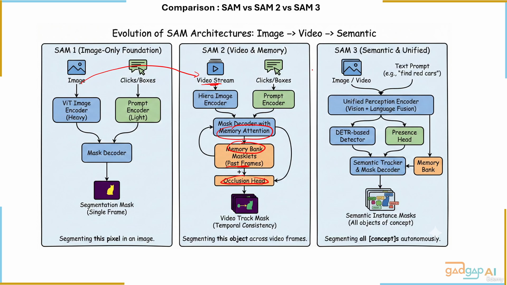

# 第 25 章 SAM：提示分割、整体架构与 SAM2／SAM3

FCN、U-Net 和 Mask R-CNN 通常在既定类别与数据域上训练：面向汽车学习的分割器不能直接等同于斑马分割器，基于固定类别训练的检测分割系统也会受到类别表约束。Segment Anything Model（SAM）把任务改写为“给定图像和用户提示，返回提示所指对象的掩膜”，使分割从专用类别预测转向可交互、可零样本迁移的基础模型能力。初代 SAM 解决单幅图像中的视觉提示分割，SAM2 以记忆机制把掩膜延续到视频，SAM3 再引入文本概念提示与统一检测分割。三者的递进不是简单扩大模型，而是依次扩展输入提示、时间范围和目标表达方式。

## 从固定类别专才到提示式通才

SAM 于 2023 年由 Meta（课程称 Facebook 团队）开放。其训练使用 SA-1B 数据集，课程给出的规模为约 1100 万幅图像、11 亿个掩膜。大规模训练使模型学习的是“对象性”和提示条件，而不只是一个封闭类别表。用户通过点、框或掩膜提供位置与范围线索，模型便可为未见过的图像和对象生成候选掩膜。

这里的**零样本分割**指无需为目标任务再提供示例并进行专门微调，并不意味着模型从未训练，也不保证任意领域都能得到完美边界。与传统模型相比，工作流由“收集大量标注—训练专用网络—按固定类别推理”转为“编码图像—给出提示—选择或修正掩膜”。

| 维度 | U-Net、Mask R-CNN 等专用模型 | 初代 SAM |
|---|---|---|
| 学习目标 | 既定任务、类别和数据域 | 提示条件下的对象与背景分离 |
| 推理输入 | 图像 | 图像＋交互提示 |
| 主要输出 | 类别掩膜，或类别、框、实例掩膜 | 提示区域的高质量候选掩膜及质量分数 |
| 新对象处理 | 常需补充标注、微调或重新训练 | 可尝试直接提示，无需任务专用微调 |
| 用户作用 | 主要提供输入图像 | 用提示指定对象并处理歧义 |

SAM 可以返回多个合理粒度的掩膜。例如，一个点可能同时落在车轮、汽车和整组车辆上，模型不必武断地只选一种解释，而可输出多个候选供用户选择。这使“处理歧义”成为架构目标，而不只是后处理问题。

## 三组件架构与一次性图像编码

SAM 的主干流程由图像编码器、提示编码器和轻量级掩膜解码器组成。它可在查询机制上与 DETR 类比：DETR 使用一组对象查询，SAM 则把用户提供的动态提示编码为查询信息。但这种相似不等于二者具有相同任务或完整结构。

### 图像编码器：建立可复用的视觉表示

课程示例将输入缩放为 \(1024\times1024\times3\)，由预训练 Vision Transformer 切分为图像块，并通过自注意力整合低层纹理、中层结构和高层语义。图像编码器约有 6.32 亿个参数，输出密集特征：

\[
1024\times1024\times3
\;\longrightarrow\;64\times64\times256 .
\]

高宽缩小 16 倍，特征通道保留丰富的语义与空间布局。计算量最大的图像编码只需执行一次，所得 image embedding 可保存在内存中；用户随后连续添加点或修改框，无需反复运行整个 ViT。课程以 GPU 上约一秒完成初次编码、后续轻量解码达到毫秒级作直观说明，实际时延仍取决于模型规格和硬件。

### 提示编码器：把用户意图变成向量

提示编码器很轻量，负责把不同提示转换成解码器可使用的 embedding。原始 SAM 的核心提示应区分如下：

| 提示 | 编码内容 | 交互作用 |
|---|---|---|
| 点提示 | \(x,y\) 坐标及前景/背景标签 | 指定要包含或排除的位置 |
| 框提示 | 左上角与右下角两个角点 | 限定目标的大致范围 |
| 掩膜提示 | 已有掩膜的稠密信息 | 提供形状先验或继续修正 |
| 自动模式 | 不由用户逐一指定目标 | 自动产生图像中的候选掩膜 |

点与粗略涂抹可作为视觉位置线索，但不能因此把**自由文本**列为原始 SAM 的标准提示能力。文本概念提示是后文 SAM3 扩展的重点，不能倒填到初代架构中。

### 掩膜解码器：融合提示并处理歧义

掩膜解码器是轻量 Transformer，结合自注意力与交叉注意力，让提示 token 查询图像 embedding，关注与提示相关的区域。它通常给出三个不同粒度或解释的掩膜候选，并为每个候选预测 IoU 质量分数，再形成高分辨率掩膜。分数用于辅助选择，不应直接等同于经人工真值验证的实际 IoU。

交互效率来自明确分工：图像编码器承担一次性重计算，提示编码器与掩膜解码器承担每次轻量交互。完整流程为

```text
图像 → 图像编码器 → 缓存图像 embedding ─┐
                                        ├→ 掩膜解码器 → 多个掩膜＋质量分数
点/框/掩膜 → 提示编码器 → prompt embedding ┘
```

课程的 Notebook 使用 Meta 示例图，并模拟点、框、掩膜和自动模式，其中重点展示点与框。示例图约为高 1200、宽 1800、3 通道。该活动主要用代码和可视化说明提示工作流，并借助 DeepSeek 回答概念问题，并不是一套完整的本地 SAM 推理实现；阅读时不应把模拟结果当成某次真实模型 benchmark。

## SAM2：用时间记忆延续实例掩膜

视频由连续帧组成，逐帧独立运行初代 SAM 会要求重复提示，也难以稳定维持同一对象的身份。SAM2 在 2024 年引入持久时间记忆、memory attention 与 memory bank，把过去帧中的对象外观、特征和掩膜信息用于后续预测，从单图 Promptable Visual Segmentation（PVS）扩展到视频场景。

典型操作是：在第一帧点击或框选一个人，模型形成目标表示并保存相关记忆；处理后续帧时，记忆与当前特征共同帮助掩膜传播和跟踪。对象被车辆短暂遮挡时，历史信息可为重新出现后的匹配提供依据。记忆机制是缓解遮挡和身份中断的工具，而不是保证任何长视频都不漂移。

因此，初代 SAM 强调“按提示分割”，SAM2 进一步体现“按提示跟踪”。这一变化支持视频编辑、体育分析和自动监控等任务：用户不必对每一帧重新框选，分割结果也从独立图片扩展为具有时间连续性的对象轨迹。

## SAM3：从视觉位置提示到概念提示

SAM2 的主要提示仍是点、框等视觉线索，擅长说明“看哪里”，却不直接表达“寻找哪一类概念”。课程将 SAM3（2025 年 11 月）的核心变化概括为 Promptable Concept Segmentation（PCS）：用户可输入“黄色校车”“红色背包”或“毛茸茸的动物”，模型依据语言概念寻找并分割所有匹配实例，而不必先由用户点中其中一个。

其架构演进包括三个相互衔接的部分：

1. **统一感知编码**：将文本概念与点、框等视觉提示纳入共同处理框架。课程用 CLIP 解释视觉—语言对齐，即把词语转换为能与视觉特征匹配的语义向量。
2. **概念检测与分割**：采用受 DETR 启发的解码器并加入 presence head，协同判断目标概念是否存在，再输出匹配对象的框与逐实例掩膜。
3. **视频记忆与跟踪**：延续 SAM2 的 memory bank 和 tracker，使概念命中的对象能够跨帧保持掩膜与身份，并借助历史信息应对暂时遮挡。

课程还把其训练资源描述为扩展到图像与视频、约 20 亿掩码，用以说明概念分割所需的数据规模。与 SA-1B 的数字一样，这些规模信息用于理解训练基础；真正的工作能力仍应通过具体提示、数据域和评价集检验。

| 维度 | SAM（2023） | SAM2（2024） | SAM3（2025） |
|---|---|---|---|
| 主要输入 | 单幅图像 | 图像与视频帧 | 图像、视频与概念描述 |
| 典型提示 | 点、框、掩膜 | 在帧上点选或框选目标 | 文本概念，并统一视觉提示 |
| 关键新增机制 | ViT 图像编码＋提示编码＋轻量解码 | 时间记忆、memory attention、memory bank | 统一感知、概念检测分割、presence head |
| 目标延续 | 当前提示对应的候选掩膜 | 跨帧传播并跟踪实例 | 检出概念的全部匹配实例并支持视频延续 |
| 能力概括 | 可提示的零样本图像分割 | 可提示的视频分割与跟踪 | 可提示的概念分割 |

{ .diagram }
<p class="figure-caption">图 25-1：SAM、SAM2 与 SAM3 分别从单图视觉提示分割，演进到基于记忆的视频跟踪和统一视觉—语言的概念分割。课程第 272 课时 00:30 抽帧。</p>

## 应用边界与实践选择

SAM 系列最直接的价值是缩短标注和交互流程。人工精细描绘一个对象可能需要数十秒，提示生成后再修正可显著减少重复劳动，并提高标注一致性；但最终掩膜仍需人工复核，尤其是在细密结构、低对比度和高风险领域。照片与视频编辑可以通过点选快速分离主体，机器人可尝试分割训练时未专门覆盖的物体，科研人员也能为生物结构、地质特征和天文对象建立初始掩膜。

选择模型时应保留任务差异。需要固定类别的端到端生产预测，U-Net 或 Mask R-CNN 仍可能更直接；需要交互标注、开放对象和快速试错，SAM 更合适；需要跨帧一致性，应引入 SAM2 的记忆；需要以语言指定概念并枚举匹配实例，才进入 SAM3 的能力范围。SAM 输出掩膜并不自动提供可靠的语义类别，零样本能力也不替代领域验证。把提示、候选选择和人工修正纳入闭环，比单纯追求“一次点击完成一切”更符合实际应用。

## 本章小结

- SAM 以大规模掩膜训练和视觉提示实现零样本分割，减少为每个新对象训练专用模型的需求。
- 图像编码器只计算一次，提示编码器与轻量掩膜解码器反复交互，并以多个候选及质量分数处理歧义。
- SAM2 加入时间记忆与记忆库，把一次提示的掩膜传播到视频，并辅助处理遮挡和身份延续。
- SAM3 引入文本概念提示、统一感知和概念检测分割，在保留视频记忆的同时走向 PCS。
- SAM 系列适合交互标注、编辑、机器人和科研，但仍需明确类别需求、验证领域效果并保留人工复核。
<!-- course-lectures: 260-273 -->

<!-- ebook-navigation -->

---

[← 上一章](ch24.md) · [返回完整目录](../index.md) · [下一章 →](ch26.md)
