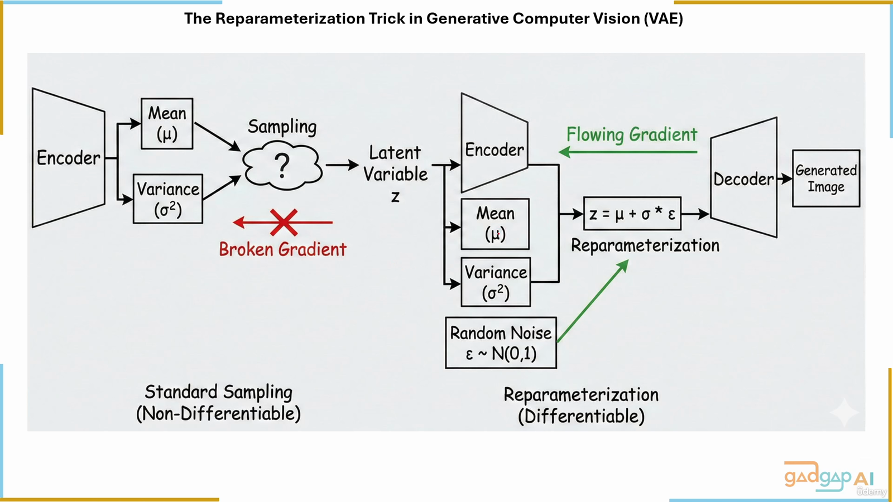

# 第 27 章 变分自编码器：概率建模、重参数化与损失

普通自编码器能够把图像压缩成一个确定编码，却不会自动保证编码之间的区域具有意义。变分自编码器（Variational Autoencoder，VAE）保留了编码器—解码器的基本外形，却将“记住一个点”改为“学习一个可采样的分布”，并用先验约束组织整个潜在空间。这个改变同时带来三项核心技术：以均值和方差描述潜在分布，以重参数化让随机采样参与可微训练，以及在重建损失之外加入 KL 散度。围绕这三项技术，可以进一步理解 $\beta$-VAE 的解耦控制、条件 VAE 的定向生成，以及重建保真度与生成灵活性之间的权衡。

## 从确定编码到概率潜在分布

VAE 的编码器不直接输出唯一的 $z$，而是为输入 $x$ 给出近似后验分布。常用的对角高斯形式为

$$
q_\phi(z\mid x)=\mathcal{N}\!\left(z;\mu_\phi(x),
\operatorname{diag}(\sigma_\phi^2(x))\right).
$$

其中，$\mu$ 决定分布中心，$\sigma^2$ 决定各维的变化范围。解码器再从采样的潜在变量恢复图像，可用 $p_\theta(x\mid z)$ 表示这一生成过程。训练还引入标准正态先验

$$
p(z)=\mathcal{N}(0,I),
$$

使不同输入对应的潜在分布受到共同坐标系的约束，而不是任意散落在互不相连的区域。

概率编码改变了样本与潜在空间的关系。AE 对输入给出固定“地址”，VAE 则给出一片有中心、有范围的可能性区域；同一输入可以通过采样得到略有差异的 $z$，解码后形成相应变化。先验与散度项进一步限制这些分布的位置和形状，使从未知区域盲目取点转变为从规定分布中有依据地采样。生成时可以直接取 $z\sim\mathcal N(0,I)$ 并解码，不要求先提供一张待重建图像。

需要区分两种随机性：$\epsilon$ 提供采样变化，$\mu$ 和 $\sigma$ 则由网络根据输入学习。模型不是学习随机噪声本身，而是学习如何放置和缩放潜在分布，使采样结果既能解释当前图像，又与全局先验保持相容。

## 重参数化：保留随机性并打通梯度

若直接执行 $z\sim q_\phi(z\mid x)$，采样操作会把随机节点插在编码器与解码器之间，无法按普通确定性运算直接对分布参数求梯度。重参数化技巧把随机性移到独立输入 $\epsilon$，将采样改写为等价变换：

$$
\epsilon\sim\mathcal N(0,I),\qquad
z=\mu+\sigma\odot\epsilon.
$$

这样，$z$ 对 $\mu$ 和 $\sigma$ 都是可微的，重建损失的梯度能够穿过这条计算路径返回编码器；$\epsilon$ 仍负责随机采样，却不需要作为网络参数学习。其贡献可直观写为

$$
\frac{\partial z}{\partial\mu}=1,\qquad
\frac{\partial z}{\partial\sigma}=\epsilon,
$$

逐维理解时以上导数按对应分量计算。

实现中，编码器通常输出 $\mu$ 和对数方差 $\operatorname{logvar}=\log\sigma^2$，而不是直接输出标准差。这样可以先恢复

$$
\sigma=\exp(0.5\operatorname{logvar}),
$$

再生成与 $\sigma$ 形状一致的标准正态噪声。对应的关键 PyTorch 运算可整理为：

```python
std = torch.exp(0.5 * logvar)
eps = torch.randn_like(std)
z = mu + eps * std
```

这里的 `logvar` 是 $\log\sigma^2$，所以乘 0.5 后再取指数得到的是 $\sigma$，不能误写成对标准差再平方。前向传播依次完成“编码得到 `mu, logvar`—重参数化得到 `z`—解码得到重建图”，训练时再对两个分布参数和其余网络权重统一求梯度。

{ .diagram }
<p class="figure-caption">图 27-1：直接采样切断梯度，而重参数化 z = μ + σ·ε 将随机噪声外置并保留可微路径。课程第 287 课时 00:39 抽帧。</p>

## 重建项与 KL 散度的联合目标

只让采样后的图像接近输入，编码器仍可能把不同样本的分布推到相距很远的位置，甚至让方差任意缩小。VAE 因此在重建误差上增加分布规则化项：

$$
\mathcal L
=\mathcal L_{\mathrm{rec}}
+\beta D_{\mathrm{KL}}\!\left(q_\phi(z\mid x)\,\|\,p(z)\right).
$$

$\mathcal L_{\mathrm{rec}}$ 可沿用逐像素 MSE，衡量解码输出与输入的差异；KL 散度衡量当前近似后验与标准正态先验的差别。标准 VAE 对应 $\beta=1$。对于上述对角高斯后验，逐维 KL 项可写为

$$
D_{\mathrm{KL}}
=-\frac12\sum_j\left(1+\log\sigma_j^2-\mu_j^2-\sigma_j^2\right),
$$

再按实现约定在潜在维度和批量上求和或求均值。公式同时约束中心和尺度：$\mu_j$ 过大、方差偏离 1，都会增加代价。它并非把每个输入都强行变成同一个点，而是推动各分布与统一的先验坐标相容，提高潜在空间的可采样性。

两个损失项承担相互牵制的任务。较强的重建压力有利于保留细节，却可能使后验更尖锐、样本之间更分离；较强的 KL 压力让空间更规则，却可能丢失个体细节，使重建更模糊。若 $\beta=0$，分布约束被移除，模型行为趋近只优化重建的 AE；若 $\beta$ 过大，则可能过度规则化。训练日志应分别记录重建项与 KL 项，而不能只看相加后的总损失，否则难以判断变化来自哪一端。课程演示中出现了重建损失下降、KL 项上升并趋于平台的过程，这是该次训练中两部分重新平衡的现象，不应机械视为所有数据集的固定曲线形状。

## AE、VAE 与 $\beta$-VAE 的权衡

| 模型 | 潜在表示 | 核心目标 | 主要优势 | 主要代价或限制 |
|---|---|---|---|---|
| AE | 单一确定编码 | 最小化重建误差 | 重建、压缩、修复和去噪较直接 | 空间可能不连续，随机采样不可靠 |
| VAE | 高斯分布及采样编码 | 重建误差加 KL 散度 | 新样本生成、平滑插值、数据扩充 | 重建可能更模糊，需平衡两个损失项 |
| $\beta$-VAE | 受加权 KL 约束的分布 | 以 $\beta$ 调节规则化强度 | 促进潜在因素解耦，增强属性控制 | 过大的权重会损害重建 |

解耦表示希望不同潜在维度分别对应较独立的变化因素，例如人脸中的头部旋转、微笑、发色或年龄。这样，沿一个维度移动时，可以尽量只改变目标属性，而不同时牵动其他特征。$\beta$-VAE 不改变基本编码—解码框架，而是通过调节 KL 项权重影响这种结构的形成。

课程的实验讨论把 $\beta=4$ 附近以及 4～6 作为兼顾解耦与重建的示例范围，并展示过大取值导致重建明显恶化的情况。这些数值应理解为特定实验中的观察，而不是跨数据集通用的最优设置。类似地，课程关于 CelebA 的维度比较中，64 维表现为容量不足，128 维取得较好折中，1024 维出现过拟合倾向；它们说明潜在容量过小会限制表达，过大则可能削弱压缩与泛化压力。实际选择仍需结合数据复杂度，并分别验证重建与生成表现，而不能把 128 当成固定答案。

## 条件 VAE 与可控生成

标准 VAE 能从先验采样，却不直接保证一次采样属于指定类别。条件 VAE（cVAE）把条件 $y$ 同时引入编码器和解码器：

$$
q_\phi(z\mid x,y),\qquad p_\theta(x\mid z,y).
$$

训练时，编码器接收图像 $x$ 及条件 $y$，学习该条件下的 $\mu$ 和 $\sigma$；解码器接收重参数化得到的 $z$ 以及同一个 $y$，重建相应图像。生成时不再输入待编码图像，而是抽取 $z$ 并指定目标条件，让解码器按条件合成结果。在代码接口上，关键是把标签张量作为额外参数分别传给编码与解码过程，而不是只在最后给输出补一个类别标记。

条件可以是 MNIST 的数字类别，也可以是人脸是否微笑、发色、是否佩戴眼镜等属性。同一潜在编码配合不同条件，能够形成受控变化；对样本稀少的类别，还可以定向生成扩充数据。条件机制因此把“生成一个合理样本”推进为“生成符合指定要求的样本”，但训练条件与生成条件必须保持一致，解码器不能只依赖 $z$ 而忽略 $y$。

## 训练、比较与潜在插值实践

课程的 PyTorch 示例沿用 MNIST 数据流程，定义继承 `nn.Module` 的 VAE，并将实现拆成 `encode`、`reparameterize`、`decode` 和 `forward`。一个完整训练步骤为：

1. 编码图像，得到 `mu` 与 `logvar`。
2. 采样 `eps` 并重参数化得到 `z`，随后解码。
3. 计算重建损失及相对 $\mathcal N(0,I)$ 的 KL 散度，再组合成总损失。
4. 反向传播并更新参数，分别保存各项损失用于观察。
5. 切换评估模式，在测试图像上比较 AE 与 VAE 的重建，并从先验采样检查 VAE 的生成结果。

演示中，AE 的重建通常更忠实，VAE 的个别重建会丢失细节，但 VAE 能生成具有数字形态的新样本。这正反映两者目标不同，不能只凭重建清晰度否定 VAE，也不能只凭能采样就忽略生成质量。

潜在插值用于检查编码之间的连续变化。对两个输入分别取得均值向量 $\mu_1$ 与 $\mu_2$，令

$$
\mu(t)=(1-t)\mu_1+t\mu_2,\qquad 0\le t\le1,
$$

在若干等间距 $t$ 上解码，即可观察从一个图像表示到另一个表示的过渡。课程以数字 1 和数字 5 为例展示这一过程。这里操作的是两个后验的均值路径，它提供直观检查，但不等于证明整个潜在空间处处连续有效。

应用选择应服从目标：去噪可使用带噪图像到干净图像的 AE 训练；仅用正常样本训练 AE 后，较高的重建偏差可辅助发现制造缺陷、医疗异常或其他偏离正常模式的情况；VAE 和 cVAE 则更适合新样本合成、稀有类别扩充与交互式可控生成。异常分数的具体阈值需要结合验证数据确定，不能把“重建误差较大”直接当作无条件成立的异常判据。

## 本章小结

- VAE 以 $q_\phi(z\mid x)$ 描述潜在分布，并用标准正态先验组织可采样的潜在空间。
- 重参数化 $z=\mu+\sigma\odot\epsilon$ 将随机噪声外置，使梯度能够流经 $\mu$ 和 $\sigma$。
- 总损失由重建项与 KL 散度组成；前者保留图像信息，后者约束分布结构，两者需要平衡。
- $\beta$-VAE 调节规则化强度以促进解耦，cVAE 在编码和解码两端加入条件以实现定向生成。
- AE 偏向忠实重建，VAE 偏向生成与插值；潜在维度、$\beta$ 和应用判据都应通过目标数据验证。

<!-- course-lectures: 285-294 -->

<!-- ebook-navigation -->

---

[← 上一章](ch26.md) · [返回完整目录](../index.md) · [下一章 →](ch28.md)
