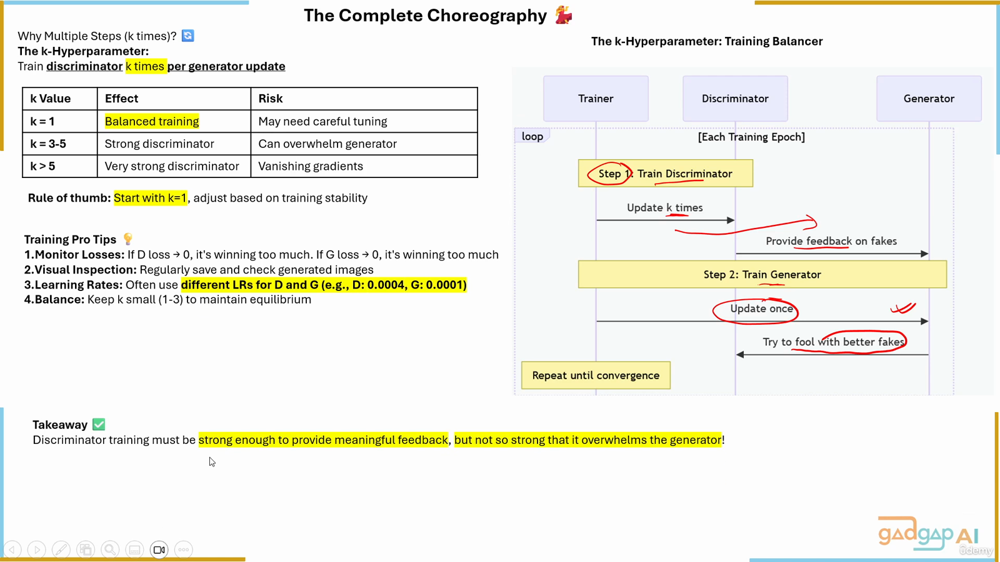

# 第 28 章 GAN 与 DCGAN：对抗训练和稳定实现

生成对抗网络（Generative Adversarial Network，GAN）把图像合成转化为两个网络的对抗过程：生成器尝试制造足以乱真的样本，判别器学习区分真实数据与生成数据。与自编码器逐像素回归输入不同，GAN 不要求每张生成图都有对应真值，而是通过判别反馈推动生成分布接近真实分布。这个框架在 2014 年提出后显著提升了图像合成的真实感，也引入了独特的优化难度。本章从极小极大目标出发，拆解判别器与生成器的交替更新，再说明 DCGAN 如何以卷积、转置卷积及合适的归一化和激活函数改善视觉生成。

## 生成器、判别器与对抗反馈

GAN 包含生成器 $G$ 和判别器 $D$。生成器接收随机噪声向量 $z\sim p_z$，课程示例通常采用高斯噪声，并输出

$$
\hat{x}=G(z).
$$

$z$ 是低维潜在变量，$G(z)$ 则是生成的假图像。判别器接收真实样本 $x\sim p_{\mathrm{data}}$ 或生成样本 $G(z)$，输出其“来自真实数据”的概率：真实目标为 1，生成目标为 0。

两个网络的学习信号不同。真实图像直接交给判别器，生成器并不逐张读取真实图像来重建；它从噪声出发，通过判别器传回的梯度学习什么样的输出更像真实数据。判别器则同时接触真实与生成样本，不断提高辨识能力。可以把二者理解为伪造者与鉴赏者，但技术本质不是两套独立分类任务，而是一条相互依赖的优化回路：$G$ 改变后，$D$ 面对的假样本分布随之改变；$D$ 改变后，$G$ 得到的反馈也随之改变。

理想训练终点是生成分布与真实分布难以区分。此时判别器对输入给出约 0.5 的真实概率，相当于无法可靠判断，形成博弈意义上的纳什均衡。它是优化目标的直观描述，并不意味着实际训练中每个损失都会平滑地收敛到固定值，也不意味着 0.5 可以单独证明图像质量已经合格。

这一框架不要求为每张训练图像提供类别标签，因而可用于无监督图像合成，也可扩展到数据扩充、风格转换和视觉域适应。这里的“无监督”是指没有逐图类别或目标输出标注，并不代表训练不需要真实数据；真实样本分布仍是判别器乃至生成器间接学习的基础。

## 极小极大目标及其更新含义

标准 GAN 的价值函数为

$$
\min_G\max_D V(D,G)=
\mathbb E_{x\sim p_{\mathrm{data}}}[\log D(x)]
+\mathbb E_{z\sim p_z}[\log(1-D(G(z)))].
$$

第一项只涉及真实样本。判别器希望 $D(x)\rightarrow1$，使 $\log D(x)$ 接近其区间内的较大值。第二项涉及生成样本：判别器希望 $D(G(z))\rightarrow0$，从而 $\log(1-D(G(z)))$ 接近 0。固定 $G$ 时，$D$ 最大化两项之和，就是在同时提高真实样本得分并压低生成样本得分。

生成器无法改变第一项，只能通过调整 $G(z)$ 影响第二项。它希望 $D(G(z))\rightarrow1$，让判别器把生成图误判为真实图，从原始极小极大形式看，就是最小化 $\log(1-D(G(z)))$。然而，当判别器已经很自信地把假样本判为假时，$D(G(z))$ 接近 0，原始生成目标的梯度可能很小。课程在生成器训练阶段采用等效欺骗方向下的非饱和形式

$$
\mathcal L_G=-\log D(G(z)),
$$

并通过最小化该损失鼓励 $D(G(z))$ 增大。这一写法与原始 $\log(1-D(G(z)))$ 不能在数值上混为同一个损失，但二者服务相同的对抗目标；实践中应明确自己使用的是哪一种。

若把判别器两部分写成最小化损失，可表示为

$$
\mathcal L_D=-\log D(x)-\log(1-D(G(z))).
$$

真实和生成批次也可分别计算再相加。判别器概率越符合真实标签与假样本标签，$\mathcal L_D$ 越小；生成器损失则需要结合其欺骗目标单独理解，不能把两个网络的损失直接当作同一排行榜比较。

## 从全连接 GAN 到 DCGAN

早期 GAN 可用全连接层搭建，在 MNIST 这类结构简单的数据上能够展示完整对抗流程，但稠密连接缺少卷积的局部空间归纳偏差，面对更复杂的自然图像时，训练稳定性、图像清晰度和结果复现都更困难。深度卷积生成对抗网络（DCGAN）将两个网络系统地卷积化，成为后续许多 GAN 实现的基础。

| 设计环节 | 生成器 $G$ | 判别器 $D$ |
|---|---|---|
| 输入与输出 | 从低维噪声生成图像 | 从图像输出真实概率 |
| 空间变换 | 转置卷积逐步上采样 | 步幅卷积逐步下采样 |
| 通道趋势 | 随空间扩大而减少，最终到图像通道数 | 随空间缩小而提取更丰富特征 |
| 中间激活 | ReLU | LeakyReLU |
| 输出激活 | $\tanh$，将像素映射到 $[-1,1]$ | Sigmoid，将分数映射到 $(0,1)$ |
| 归一化与下采样 | BatchNorm 稳定中间特征 | BatchNorm；以 stride 2 卷积替代池化 |

课程以生成 $64\times64\times3$ 图像为例：生成器从约 100 维噪声开始，经过多次转置卷积，空间尺度逐步扩大，通道最终收缩为 3。隐藏层的 ReLU 提供非线性，末层 $\tanh$ 与归一化到 $[-1,1]$ 的图像预处理相匹配。判别器执行相反方向的空间变换，stride 2 使特征图尺寸约减半，不另用最大池化；LeakyReLU 在负半轴保留斜率，避免普通 ReLU 的零梯度区域过早在深层对抗回路中阻断反馈。BatchNorm 用于稳定中间激活与训练过程，但不能把它理解成对模式崩溃的必然免疫。

为了隔离原理，课程代码仍实现了全连接版本：生成器从 100 维噪声出发，经线性层、BatchNorm 和 LeakyReLU 扩展表示，最后回到 784 个像素并重整为 $1\times28\times28$，末端采用 $\tanh$；判别器将图像展平为 784 维，经 512、256 等全连接表示压缩到单个 Sigmoid 输出。这个简化模型适合演示 MNIST，不应误当作 DCGAN 的卷积结构。

## 两阶段交替训练

GAN 的关键不是定义两个模型后同时无条件更新，而是清晰划分每一步更新的参数。

### 判别器阶段

先固定生成器参数，采样真实批次 $x$ 和噪声批次 $z$，生成 $G(z)$。判别器分别预测 $D(x)$ 与 $D(G(z))$，以真实标签 1 和生成标签 0 计算真实损失、假样本损失，将两者组合后只更新 $D$。这一阶段生成图仍由当前 $G$ 产生，但不根据本步判别损失修改 $G$。

### 生成器阶段

随后固定判别器参数，重新让当前生成器产生样本并送入 $D$。此时生成器希望这些样本被判为真实，因此以目标 1 计算 $-\log D(G(z))$ 等对抗损失。反向传播会穿过判别器的计算图以求得输入图像的梯度，再继续传回生成器，但优化器只更新 $G$ 的参数。“冻结 $D$”指不更新其权重，不是把 $D$ 从求导路径中删除。

可用以下伪代码表示一轮更新：

```text
重复 k 次：
    取真实批次 x，采样噪声 z
    fake = G(z)
    计算 D 对 x 与 fake 的真实/假样本损失
    只更新 D 的参数

采样噪声 z
fake = G(z)
计算生成器欺骗当前 D 的对抗损失
梯度穿过 D，但只更新 G 的参数
定期保存权重、损失和生成样本
```

$k$ 表示每次生成器更新之前的判别器更新次数。课程建议从 $k=1$ 的均衡配置开始；过大的 $k$ 可能使判别器迅速占优，让生成器难以获得有效梯度。两个网络可以使用各自优化器和不同学习率，调整依据应是训练稳定性，而不是机械追求某一侧损失尽快降到 0。判别器过弱会提供模糊反馈，过强又可能让生成器失去学习信号，因此两者需要维持动态平衡。

{ .diagram }
<p class="figure-caption">图 28-1：判别器先更新 k 次，生成器再利用判别反馈更新一次，随后重复这一交替过程。课程第 303 课时 02:41 抽帧。</p>

## 简化实现中的观察与诊断

课程的 MNIST 训练使用独立的生成器、判别器优化器，演示运行 10 个 epoch，并将权重保存为 PyTorch `.pth` 文件，避免后续评估时重复训练。每个批次依次执行判别器与生成器阶段，定期记录真实样本得分、生成样本得分和两项对抗损失，并把真实图与生成图并列检查。

初期生成结果只能呈现粗略数字轮廓，继续训练、调节两侧学习率或加深网络都可能改变结果；面向真实图像时，更应转向 DCGAN 而非单纯增加全连接层。评估判别器时，真实图的输出应偏向 1，生成图应偏向 0，但个别样本偏离并不自动意味着训练失败，需要结合整批统计与视觉变化观察。

训练监控至少应回答三个问题：判别器是否已能区分大部分真实与生成样本，生成器是否仍能持续改善，生成样本是否随训练呈现更合理的结构。损失曲线只反映当前对抗关系，单侧快速下降可能代表另一方失衡；定期保存固定或可比噪声下的输出，则有助于发现仅凭标量损失不易察觉的质量停滞。最终目标不是让某一个网络永久获胜，而是让反馈持续有效，并推动生成分布接近真实数据。

## 本章小结

- GAN 由 $G$ 与 $D$ 构成，生成器通过判别器反馈学习数据分布，真实图像直接用于训练判别器。
- 极小极大目标要求 $D$ 区分真假、$G$ 提高生成样本被判为真实的可能性；实践中常用 $-\log D(G(z))$ 改善生成器梯度。
- DCGAN 以转置卷积生成、以步幅卷积判别，并组合 ReLU、LeakyReLU、BatchNorm 和合适的输出激活。
- 训练按“更新 $D$ 若干次—只更新 $G$ 一次”交替进行；冻结一侧参数不等于切断另一侧所需的梯度路径。
- 对抗损失必须结合两侧得分与生成图像共同解读，简化全连接 MNIST 示例不能替代真实图像任务中的 DCGAN。

<!-- course-lectures: 295-304 -->

<!-- ebook-navigation -->

---

[← 上一章](ch27.md) · [返回完整目录](../index.md) · [下一章 →](ch29.md)
