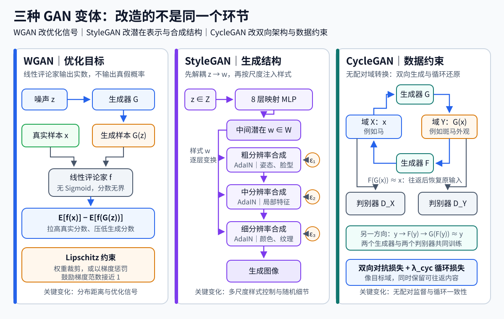

# 第 29 章 WGAN、StyleGAN 与 CycleGAN

标准 GAN 的对抗目标能生成逼真图像，却不保证训练过程稳定，也不自动提供属性控制或跨域转换能力。模式崩溃使生成结果失去多样性，判别器过强又可能让生成器梯度趋于消失。WGAN 从分布距离和评论家约束入手改善优化信号；StyleGAN 重构生成器的潜在表示与样式注入方式，使不同尺度的视觉属性更可控；CycleGAN 则用双向生成和循环一致性，在没有一一配对图像的情况下学习域间转换。理解这三条路线，需要分别抓住“改变优化目标”“改变生成器结构”和“改变数据约束”的核心，而不能把它们仅视为同一网络的层数变体。

## 模式崩溃与梯度消失

模式崩溃（mode collapse）是生成器只覆盖真实分布中的少数模式，甚至对不同噪声都反复输出近似结果。以包含 0～9 的 MNIST 为例，生成器可能发现某一类数字特别容易骗过当前判别器，于是不断强化这一局部策略，而不再学习其余数字。单次生成图看似清晰，也不能排除模式崩溃；判断时必须观察一批样本的多样性。

梯度消失则与判别器过强密切相关。当真实样本总被判为 1、生成样本总被判为 0 时，原始饱和形式 $\log(1-D(G(z)))$ 所在区域过于平坦，生成器难以得到有意义的改进方向。两个现象会相互纠缠：反馈不足使生成器固守少数有效模式，模式单一又进一步降低判别器学习新变化的难度。网络结构上曾尝试小批量判别、特征匹配和历史平均等缓解办法，WGAN 则进一步改变分布度量与评论家的输出方式。

课程代码用 16 张生成图进行简易检查：计算跨样本的像素标准差，再计算样本之间的平均成对距离。数值越高通常表示样本差异越明显，接近零则提示重复输出的风险。这只是快速启发式诊断，无法证明模型覆盖了全部语义模式；还需结合不同噪声下的样本检查和分布级指标。

## WGAN：以分布距离重塑对抗目标

### 从概率判别器到线性评论家

标准 GAN 的判别器通过 Sigmoid 输出真假概率，WGAN 将其改为输出无界实数分数的评论家（critic）$f$。分数不再解释为“真实概率为多少”，而用于拉开真实分布 $p_r$ 与生成分布 $p_g$ 的距离。评论家的基本方向为

$$
\max_f\;\mathbb E_{x\sim p_r}[f(x)]
-\mathbb E_{z\sim p(z)}[f(G(z))],
$$

生成器则提高生成样本的评论分数，可最小化

$$
\mathcal L_G=-\mathbb E_z[f(G(z))].
$$

Wasserstein 距离又称地球移动距离，可直观理解为把一个概率分布搬运成另一个分布所需的最小代价。与只看真假饱和程度的信号相比，它旨在分布尚有差距时仍提供较有方向性的优化信息。这里的“距离”来自受约束函数族上的评分差，不是直接对两张图计算欧氏距离。

### Lipschitz 约束与梯度惩罚

为使评分差对应有效的 Wasserstein 估计，评论家需要受到 Lipschitz 约束。1-Lipschitz 条件可写为

$$
|f(x_1)-f(x_2)|\le\|x_1-x_2\|,
$$

即输入变化有限时，评论分数不能任意剧烈跳变。原始 WGAN 可通过权重裁剪施加约束，WGAN-GP 则使用梯度惩罚，鼓励评论家在相关样本区域的梯度范数接近 1。其常用评论家损失写为

$$
\mathcal L_f=
\mathbb E_z[f(G(z))]-\mathbb E_x[f(x)]
+\lambda\,\mathbb E_{\hat{x}}
\left[\left(\|\nabla_{\hat{x}}f(\hat{x})\|_2-1\right)^2\right],
$$

其中 $\hat{x}$ 是构造惩罚项时使用的中间样本，$\lambda$ 控制惩罚强度。最小化前两项等价于让真实分数尽量高、生成分数尽量低，第三项则约束评论家的局部变化。谱归一化也是控制 Lipschitz 性质的路线之一，但课程实现重点放在权重裁剪与梯度惩罚的演进上。

| 对比项 | 标准 GAN | WGAN／WGAN-GP |
|---|---|---|
| 第二网络输出 | Sigmoid 真假概率 | 线性实数评论分数 |
| 基本信号 | 对数真假分类目标 | 真实与生成评论分数之差 |
| 关键约束 | 对抗平衡，易受过强判别器影响 | Lipschitz 约束；GP 进一步约束梯度范数 |
| 训练目标 | 提高真假判别准确率并驱动欺骗 | 估计分布距离并推动生成分布靠近真实分布 |
| 预期改善 | 高质量但训练可能敏感 | 损失信号更有意义，训练及模式覆盖倾向更稳定 |

WGAN 的价值在于缓解而非绝对消除模式崩溃和梯度问题。课程对比展示了更平稳的训练、更好的模式覆盖和更低的 FID，但任何量化增益都依赖数据集与实验配置。实现时应分别记录真实评论分数、生成评论分数和梯度惩罚，不能只把它们压成一个总数后观察。

## StyleGAN：解耦潜在编码与分层样式控制

StyleGAN 的重点不是改写判别目标，而是重建生成器。普通 GAN 常把随机 $z$ 直接送入合成网络，输入分布本身可能使不同属性纠缠在一起。StyleGAN 先用 8 层多层感知机（MLP）进行映射

$$
z\in\mathcal Z\;\longrightarrow\;w\in\mathcal W,
$$

得到中间潜在编码 $w$。$\mathcal W$ 不必服从输入 $z$ 的原始采样形状，更有利于学习相对解耦的属性表示。随后，各层通过可学习变换从 $w$ 得到样式参数，并注入不同分辨率的合成层。

样式注入采用自适应实例归一化（AdaIN）。对某个特征通道 $x_i$，可概括为

$$
\operatorname{AdaIN}(x_i,y)=y_{s,i}
\frac{x_i-\mu(x_i)}{\sigma(x_i)}+y_{b,i},
$$

其中缩放 $y_{s,i}$ 和偏移 $y_{b,i}$ 由 $w$ 派生。AdaIN 实际作用于合成网络的特征图，而不是简单把 $w$ 本身归一化。粗分辨率层更影响姿态、脸型等整体结构，中间层对应较显著的局部特征，细分辨率层则影响发色、边缘和皮肤纹理等细节。逐层注入高斯随机噪声，为毛孔、细发等随机变化提供额外来源，使所有细节不必都由 $w$ 单独决定。

样式混合利用这种分层结构：在部分层采用来自一张图像的 $w$，其余层采用另一来源的 $w$，可组合一个来源的整体姿态与另一个来源的细部属性。它提供的是可操作的层次控制，不代表任意两个属性都能完美独立。后续 StyleGAN2、StyleGAN3 继续围绕伪影和一致性改进，但本章所依据的核心仍是 $z\rightarrow w$ 映射、分层 AdaIN 与随机噪声注入。

## CycleGAN：无配对域间转换

CycleGAN 面向另一类任务：已有马图像集合 $X$ 和斑马图像集合 $Y$，却没有“同一匹马对应的斑马图”这种成对监督。模型学习两个方向的生成器

$$
G:X\rightarrow Y,\qquad F:Y\rightarrow X,
$$

并配置两个判别器：$D_Y$ 区分真实 $Y$ 与 $G(x)$，$D_X$ 区分真实 $X$ 与 $F(y)$。因此，完整结构包含两个生成器和两个判别器，而不是把一个普通 GAN 简单运行两遍。

双向训练包含两条循环：

$$
x\rightarrow G(x)\rightarrow F(G(x))\approx x,
$$

$$
y\rightarrow F(y)\rightarrow G(F(y))\approx y.
$$

第一组对抗损失让 $G(x)$ 符合目标域 $Y$ 的外观，第二组让 $F(y)$ 符合域 $X$；仅靠这两项，生成器仍可能任意改变内容，只要结果看起来像目标域即可。循环一致性损失进一步要求往返转换能够恢复原输入：

$$
\mathcal L_{\mathrm{cyc}}(G,F)=
\mathbb E_{x\sim p_{\mathrm{data}}(x)}
[\|F(G(x))-x\|_1]
+\mathbb E_{y\sim p_{\mathrm{data}}(y)}
[\|G(F(y))-y\|_1].
$$

整体训练可理解为两项对抗损失与加权循环损失协同：

$$
\mathcal L=\mathcal L_{\mathrm{GAN}}(G,D_Y)
+\mathcal L_{\mathrm{GAN}}(F,D_X)
+\lambda_{\mathrm{cyc}}\mathcal L_{\mathrm{cyc}}(G,F).
$$

对抗项负责“像目标域”，循环项负责“保留可往返的源内容”。实际更新仍需在两个生成器与两个判别器之间组织反向传播，并保持两个方向都参与训练。马与斑马、照片与莫奈画风、夏季与冬季景观都是这种无配对转换的典型示例；CycleGAN 的目标是域间映射，不是 StyleGAN 那种从噪声合成并控制高保真新图像。

| 模型 | 主要改造位置 | 核心机制 | 主要任务 |
|---|---|---|---|
| DCGAN | 生成器与判别器的卷积结构 | 转置卷积、步幅卷积及稳定化设计 | 从噪声生成图像 |
| WGAN | 对抗目标与评论家约束 | Wasserstein 评分差、Lipschitz 约束或梯度惩罚 | 改善训练信号与模式覆盖 |
| StyleGAN | 生成器的潜在映射和合成层 | 8 层 MLP、$\mathcal W$、AdaIN、逐层噪声 | 高保真生成与多尺度属性控制 |
| CycleGAN | 双向架构与损失组合 | 两个生成器、两个判别器、循环一致性 | 无配对图像域间转换 |

{ .diagram }

图 29-1：WGAN 改变评论家评分与优化约束，StyleGAN 通过 w 映射和分层 AdaIN 控制合成，CycleGAN 以双向生成和循环一致性约束无配对转换。根据课程内容整理。

## 生成质量评估与潜在空间检查

无监督生成没有每张新图的唯一标准答案，不能直接沿用分类准确率，也不能像重建任务那样对所有输出计算与固定真值的 MSE。评估需要同时考虑单样本质量、整体多样性，以及生成分布与真实分布的接近程度。

### Inception Score

Inception Score（IS）把生成图输入预训练 Inception 分类网络，记条件类别分布为 $p(y\mid x)$，全部生成样本的边际类别分布为 $p(y)$，则

$$
\operatorname{IS}(G)=
\exp\!\left(\mathbb E_x\left[D_{\mathrm{KL}}(p(y\mid x)\|p(y))\right]\right).
$$

单张图的类别分布较集中，有利于“清晰可辨”；整体边际类别分布较分散，有利于“类别多样”。IS 越高通常越好，但它依赖分类器与类别设定，可能对视觉缺陷或真实分布匹配程度不够敏感，不能单独作为质量结论。

### Fréchet Inception Distance

FID 分别提取真实与生成样本的 Inception 特征，用均值和协方差概括两组特征分布：

$$
\operatorname{FID}=
\|\mu_r-\mu_g\|_2^2+
\operatorname{Tr}\!\left(\Sigma_r+\Sigma_g
-2(\Sigma_r\Sigma_g)^{1/2}\right).
$$

均值项比较特征中心，协方差项比较离散结构。FID 越低越好，理论上的 0 对应建模后的两组特征统计完全一致，而不是逐像素相同。课程建议在大样本规模上估计分布，提到约 10000 张图像，以减少小样本统计的不稳定。与 IS 相比，FID 更直接比较真实和生成数据，但仍受特征提取器、样本量和实现方式影响。资源允许时，还可让评价者对真实性或偏好进行人工评分，其优点是贴近人的感知，代价则是成本、时间与主观差异。

| 指标或方法 | 主要观察对象 | 方向与局限 |
|---|---|---|
| 批量像素标准差、成对距离 | 生成样本之间的表观差异 | 可快速提示重复风险，不能证明完整模式覆盖 |
| IS | 条件类别清晰度与边际类别多样性 | 越高通常越好，但可能被分类器设定误导 |
| FID | 真实与生成 Inception 特征的分布距离 | 越低越好，需要可靠且足够的样本统计 |
| 人工评分 | 人感知到的质量与偏好 | 更接近主观体验，但成本较高且存在评价差异 |

最后，可通过潜在插值辅助观察生成器的连续响应。取 $z_1,z_2$，定义

$$
z(t)=(1-t)z_1+tz_2,
$$

课程在两点之间取 10 个步骤，逐点输入生成器并比较输出。若图像随 $t$ 呈现平滑变化，说明该路径附近的潜在表示具有一定连续性；若发生突变或产生无意义图像，则提示空间结构或生成覆盖仍存在问题。插值只是局部路径检查，应与批量多样性、FID 和人工观察共同使用。

## 本章小结

- 模式崩溃表现为生成多样性丧失，过强判别器还可能导致生成器梯度消失；批量差异指标只能作为初步诊断。
- WGAN 以线性评论家和 Wasserstein 目标替代真假概率判别，并用 Lipschitz 约束或梯度惩罚改善训练信号。
- StyleGAN 通过 8 层 MLP 得到 $\mathcal W$ 空间，再以分层 AdaIN 和随机噪声实现多尺度样式控制。
- CycleGAN 用两个生成器、两个判别器及循环一致性，在无配对数据上同时约束目标域真实性与源内容保持。
- IS、FID、人工评分和潜在插值关注不同侧面，生成评估应组合质量、多样性与分布匹配证据。

<!-- course-lectures: 305-314 -->

<!-- ebook-navigation -->

---

[← 上一章](ch28.md) · [返回完整目录](../index.md) · [下一章 →](ch30.md)
