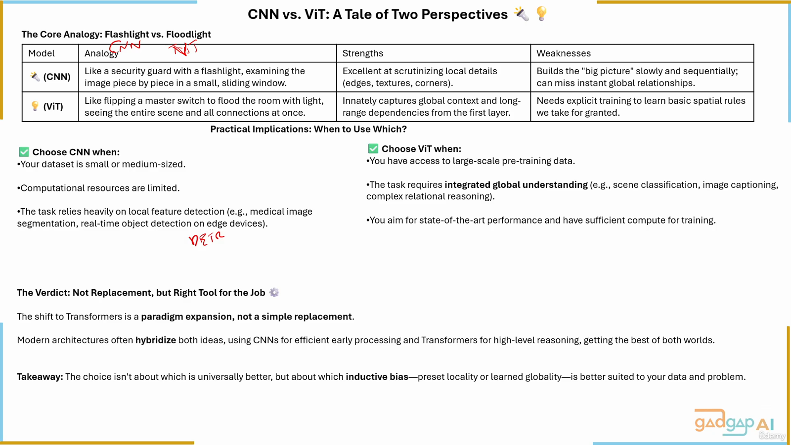

# 第 30 章 Vision Transformer：范式、架构与全局建模

Vision Transformer（ViT）把 Transformer 的序列建模能力引入计算机视觉，使图像理解不再完全依赖卷积核逐层扩大感受野。它先将图像切分为图像块，再把图像块表示为 token，通过自注意力直接建立不同区域之间的联系。由此，视觉模型可以在编码初期利用整幅图像的上下文，同时也面临序列长度带来的二次计算开销、较大的数据需求以及空间结构需要显式编码等新约束。理解 ViT，既要掌握其数据流，也要理解它与卷积神经网络在建模假设上的差异。

## 从卷积归纳偏置到全局序列建模

卷积神经网络以局部连接和权值共享为基本机制。小尺寸卷积核在特征图上滑动，优先提取边缘、纹理等局部模式；随着网络加深和下采样进行，特征逐步组合为部件与整体语义。局部性与平移等变性是很有价值的归纳偏置，使 CNN 在中小规模数据和局部判别任务上通常易于训练，但远距离区域的关系需要经过多层传播才能建立。

Transformer 在 2017 年随“Attention Is All You Need”提出后，首先改变了自然语言处理。2020 年出现的 ViT 则展示了纯 Transformer 编码器处理图像分类的可行路径。NLP 中的输入是词元嵌入序列，而图像是具有高度、宽度和通道维度的像素阵列，因此迁移的关键不是简单替换骨干网络，而是先构造适合 Transformer 的“视觉词汇”。

ViT 将图像块（patch）作为基本空间单元，将每个图像块转换为向量形式的 token 嵌入。所有 token 组成序列后，自注意力可以根据内容计算任意两个位置之间的关联，而不受它们在图像中相距多远的直接限制。随后出现的 Swin Transformer、卷积与 Transformer 的混合架构，则进一步说明局部归纳偏置和全局关系建模并非互相排斥，而是可以按任务需要组合。

统一的 token 表示还为跨模态建模提供了便利。语言与视觉可以采用相近的 Transformer 编码机制，再通过适当的训练目标对齐两类表示，CLIP 所代表的对比语言—图像预训练就是这种方向的典型应用。ViT 的可扩展性因此不仅表现为扩大视觉模型本身，也表现为把图像接入更广泛的多模态系统。不过，架构形式相近并不会自动带来语义对齐，跨模态能力仍取决于配对数据、训练目标和具体连接方式。

## ViT 的整体架构与数据流

设输入图像为 \(X\in\mathbb{R}^{H\times W\times C}\)，图像块边长为 \(P\)。在高度和宽度均可整除时，图像块数量为

\[
N=\frac{H}{P}\frac{W}{P}=\frac{HW}{P^2}
\]

每个图像块包含 \(P^2C\) 个像素值，先展平，再通过可学习的线性投影得到 \(D\) 维嵌入。图像由此从二维空间阵列转换为长度为 \(N\) 的向量序列。用于分类时，序列前还会加入一个可学习的分类 token，即 CLS token；它与图像块 token 一同经过编码器，最终其表示可送入分类头。

完整数据流可以概括为以下环节：

1. **图像块化与嵌入**：切分、展平并线性投影，得到 patch embeddings。
2. **注入位置信息**：将位置嵌入加入 token 嵌入，使模型不仅知道区域“是什么”，还能够区分它“在哪里”。
3. **堆叠编码器**：编码器包含 \(L\) 个结构相同的层，核心组件为 LayerNorm、多头自注意力（MSA）、多层感知机（MLP）和残差连接。
4. **形成上下文表示**：自注意力负责 token 之间的信息交换，MLP 对每个 token 的表示分别进行非线性变换，残差与归一化共同支持深层训练。
5. **连接任务头**：分类任务通常读取最终的 CLS 表示并输出类别；其他视觉任务也可以利用全部 token 的空间表示。

编码器中的注意力并不把图像重新变成卷积特征图，而是持续更新序列中每个 token 的上下文表示。经过多层编码后，一个区域的表示可以融合来自其他相关区域的信息，这也是 ViT 全局建模能力的架构基础。

## 全局视野为何重要

CNN 的早期层主要观察局部邻域，较大范围的语义关系依赖后续层逐层聚合。ViT 的全连接自注意力则允许序列中的每个 token 在同一层内与所有其他 token 交互：左上角区域可以直接关联右下角区域，眼睛可以关联耳、鼻和胡须，车轮可以关联车身，篮球也可以关联篮筐。全局连接并不意味着所有区域都具有相同重要性；注意力权重正是用于学习哪些关系更值得保留。

这种机制尤其适合需要整合分散线索的任务。医学影像中的异常模式可能分布在较大范围，自动驾驶需要同时理解远处障碍物与周围道路结构，遥感解译和场景分类也经常依赖多个区域共同表达的含义。全局注意力使这些关系能够较早参与表示学习，而不是等到网络末端才进行汇总。

不过，“CNN 只能看局部、ViT 已经理解整体”并不是严格结论。深层 CNN 同样可以形成很大的理论感受野，ViT 也仍需通过训练学习有效的全局关系。两者真正的差别在于信息交互路径及内置偏置：CNN 默认局部结构优先，ViT 则提供较直接的全局两两交互，并把更多空间规律交给数据和位置编码学习。

这种灵活性有明确代价。对长度为 \(N\) 的序列，标准自注意力需要构造 \(N\times N\) 的关系矩阵，核心交互开销随 \(O(N^2)\) 增长。减小图像块会保留更细的空间粒度，却迅速增加 token 数量和计算量。ViT 还缺少卷积天然具备的局部连接与权值共享，因而通常更依赖大规模预训练、合适的数据策略或后续架构改进。

## CNN 与 ViT 的取舍

| 维度 | CNN | ViT |
|---|---|---|
| 核心操作 | 卷积核滑动与局部加权求和 | 基于内容的全局自注意力 |
| 空间交互 | 从局部开始，随层深逐步扩大 | 单层即可建立任意 token 间的直接联系 |
| 归纳偏置 | 局部性、权值共享和平移等变性较强 | 空间偏置较弱，更依赖数据与位置编码 |
| 数据与训练 | 中小数据场景通常更稳妥，计算选择较灵活 | 从头训练通常更需要大规模数据与算力 |
| 长距离关系 | 需要多层传播与聚合 | 可直接建模，但关系矩阵带来二次开销 |
| 典型优势 | 局部纹理、细粒度空间结构、资源受限场景 | 全局场景理解、可扩展预训练、多模态统一建模 |

模型选择应服从数据规模、计算预算和任务结构。数据较少、资源有限或判别依据高度局部时，CNN 往往是直接而高效的选择；具备充足预训练数据或合适预训练权重，并且任务强调整体场景关系时，ViT 更具吸引力。实际系统还可以采用卷积干层、层级式 Transformer 或 CNN—Transformer 混合骨干，兼顾局部特征提取与全局推理。DETR 等视觉流水线也表明，两种范式可以分别承担特征提取和关系建模，而不是简单替代彼此。

{ .diagram }
<p class="figure-caption">图 30-1：CNN 像滑动窗口逐块审视局部，ViT 从首层建立全局关系；二者应按数据、任务与归纳偏置选择。课程第 319 课时 03:00 抽帧。</p>

## 预训练 ViT 的图像块观察

课程示例使用 Hugging Face `transformers` 加载 `google/vit-base-patch16-224`。名称中的 `patch16` 表示图像块大小为 \(16\times16\)，`224` 表示输入图像为 \(224\times224\)。对三通道图像，沿高度和宽度各得到 \(224/16=14\) 个图像块，共 \(14\times14=196\) 个；每块原始形状为 \(16\times16\times3\)，展平后含 768 个值。示例还抽取其中 8 个图像块进行可视化，用来核对切分边界与形状，而不是把每个图像块误当成一个类别或完整物体。

模型与预处理组件可按同一标识加载：

```python
from transformers import AutoImageProcessor, AutoModelForImageClassification

model_id = "google/vit-base-patch16-224"
processor = AutoImageProcessor.from_pretrained(model_id)
model = AutoModelForImageClassification.from_pretrained(model_id)
inputs = processor(images=image, return_tensors="pt")
outputs = model(**inputs)
```

该基础模型约有 8600 万参数，包含 12 个 Transformer 层和 12 个注意力头，并采用 ImageNet 的 1000 类分类配置。这个示例同时揭示了两个实践要点：预处理必须与预训练模型匹配；`196` 是图像块 token 数，加入 CLS 后编码器实际处理的是 197 个 token。理解这些形状，再继续分析注意力权重和层级嵌入，才能避免把可视化结果与网络真实输入混淆。

还应区分可视化中的原始 patch 与网络内部的 patch embedding。前者仍是可还原为 \(16\times16\times3\) 图像块的像素数据，后者则经过模型预处理、展平和可学习投影，已经处于隐藏特征空间。两者在该示例中都可能涉及数字 768，却分别表示原始标量数量与嵌入维度，含义并不相同。代码检查时可依次记录输入形状、切分后的网格、单块形状以及编码器序列形状，以验证每一步转换。

## 本章小结

- ViT 通过“图像块—token—编码器”的路径，将二维图像转换为 Transformer 可处理的向量序列。
- 自注意力可在编码早期直接连接远距离区域，但全局关系仍需训练学习，并不等价于自动获得完整语义。
- 标准注意力的 \(O(N^2)\) 开销、较弱的空间归纳偏置和数据需求，是 ViT 设计与选型时必须考虑的约束。
- CNN 与 ViT 各有适用条件；局部建模、全局注意力和层级设计可以在现代视觉架构中协同使用。

<!-- course-lectures: 315-320 -->

<!-- ebook-navigation -->

---

[← 上一章](ch29.md) · [返回完整目录](../index.md) · [下一章 →](ch31.md)
