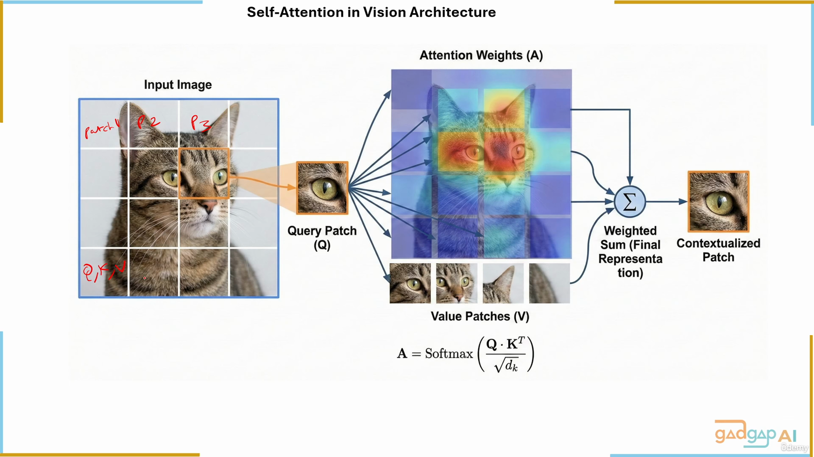
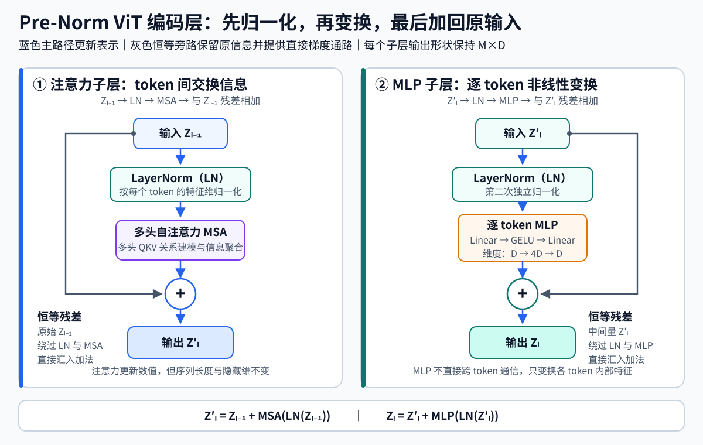

# 第 31 章 从图像块到 Token：自注意力与 ViT 编码器

ViT 的表示学习可以拆解为一条形状清晰、职责分明的链路：先把图像切分并展平为向量，再投影为可学习的 token 嵌入，加入位置编码与分类 token，最后由多层 Transformer 编码器反复进行全局信息交换和逐 token 非线性变换。自注意力决定不同区域如何相互提供上下文，多头机制让模型在多个表示子空间中并行计算关系，LayerNorm、MLP 与残差连接则保证这些信息能够被稳定地逐层整合。掌握各阶段的张量形状和数学作用，比记住架构名词更为重要。

## 图像块、线性投影与分类 Token

设输入尺寸为 \(H\times W\times C\)，图像块大小为 \(P\times P\)。图像被划分为 \(N=HW/P^2\) 个不重叠图像块，第 \(i\) 块展平后记为 \(x_i\in\mathbb{R}^{P^2C}\)。展平只改变数据排列，尚未进行特征学习；真正的嵌入由可学习投影完成：

\[
e_i=x_iE+b,\qquad E\in\mathbb{R}^{P^2C\times D},\quad e_i\in\mathbb{R}^{D}
\]

这里 \(E\) 将原始像素排列映射到模型统一的隐藏维度 \(D\)。原始向量长度 \(P^2C\) 与嵌入维度 \(D\) 在概念上相互独立，只是在常见的 ViT-Base/16 示例中恰好都为 768，不能据此认为线性投影没有作用。投影层既学习跨像素、跨通道的组合，也使不同图像块配置能够接入相同的编码器宽度。

以 \(224\times224\times3\) 输入和 \(P=16\) 为例，可得到 \(14\times14=196\) 个图像块，每块展平长度为 \(16\times16\times3=768\)。加入 CLS token 后，序列长度为 197。CLS 是额外的可学习向量，不对应某个固定图像区域；它在各层自注意力中与其他 token 交换信息，最终可作为整图分类表示。

图像块大小决定空间粒度与序列长度之间的折中。同一输入若改用 \(P=32\)，只会产生 \(7\times7=49\) 个图像块，计算更省，但单个 token 覆盖的区域更大，细节更容易在初始划分中混合；减小 \(P\) 则提高空间分辨率，同时使 token 数量及注意力矩阵迅速增大。因此，`16` 不是普遍最优值，而是该模型在粒度与成本之间的一种设计选择。

## QKV 与缩放点积自注意力

自注意力的输入是同一序列的 token 表示。对矩阵 \(X\)，通过三组可学习线性变换得到查询、键和值：

\[
Q=XW_Q,\qquad K=XW_K,\qquad V=XW_V
\]

查询表示当前 token 希望寻找的信息，键用于被其他查询匹配，值则承载最终被聚合的内容。三者来自同一序列，所以称为“自”注意力；它们并非人工给图像块填写的语义标签，而是训练过程中学习得到的投影。

若序列长度为 \(M\)，且 \(Q,K\in\mathbb{R}^{M\times d_k}\)、\(V\in\mathbb{R}^{M\times d_v}\)，标准计算为

\[
\operatorname{Attention}(Q,K,V)
=\operatorname{softmax}\!\left(\frac{QK^T}{\sqrt{d_k}}\right)V
\]

首先，\(QK^T\) 得到 \(M\times M\) 的分数矩阵，第 \(i\) 行描述第 \(i\) 个 token 对所有 token 的匹配程度。除以 \(\sqrt{d_k}\) 可控制点积随维度增大而过度放大，避免 softmax 过早进入极端区域。随后对每行执行 softmax，使权重非负且总和为 1；最后与 \(V\) 相乘，形成对所有值向量的加权和。这里使用的是**缩放点积相似度**，未经归一化的点积不能直接等同于余弦相似度。

输出中的每一行仍是 \(d_v\) 维向量，但它已不再只包含当前图像块的原始信息，而是融合了全序列上下文的表示。例如，眼部 token 可以从耳、鼻等关联区域获得信息。注意力矩阵提供的是内容相关的信息分配机制，而不是预先规定好的物体结构；所有 token 都参与计算，也不意味着所有关系都会获得相同权重。构造完整两两关系需要 \(M^2\) 个分数，这正是标准 ViT 计算成本的重要来源。

## 多头注意力：并行关系子空间

单头注意力只能在一组 \(W_Q,W_K,W_V\) 定义的表示空间中计算关系。多头注意力设置 \(h\) 组投影，并行得到

\[
\operatorname{head}_j=\operatorname{Attention}
(XW_Q^{(j)},XW_K^{(j)},XW_V^{(j)})
\]

再将各头输出拼接并通过输出投影整合：

\[
\operatorname{MSA}(X)=
\operatorname{Concat}(\operatorname{head}_1,\ldots,\operatorname{head}_h)W_O
\]

不同头可以在不同子空间中学习边缘与纹理、区域组合、颜色或更长距离的语义关系。不过，“某个头固定负责某种语义”只是帮助理解的解释，并不是架构强制保证；头的实际分工来自训练，且可能重叠或随层变化。多头的核心价值是并行提供多种关系表示，再通过拼接和线性投影融合，而不是简单重复多次相同计算。

课程使用的 ViT-Base 示例包含 12 个注意力头。分析其注意力时，可以先对 12 个头求平均以观察总体分布，但这种汇总也会掩盖头间差异；若目的是研究具体头的行为，就应保留头维度分别检查。

{ .diagram }
<p class="figure-caption">图 31-1：查询图像块经 Q/K 匹配形成注意力权重，再对值图像块加权求和，得到上下文化表示；底部给出缩放点积权重公式。课程第 321 课时 01:23 抽帧。</p>

## 位置编码：恢复被展平的空间关系

仅看内容投影和自注意力，token 的排列顺序本身并不提供可靠的二维位置信息。将图像块打乱后，如果没有位置机制，模型仍会对同一组向量进行集合式交互，难以区分眼睛位于鼻子上方还是下方。ViT 因此在进入编码器前加入位置嵌入：

\[
Z_0=[e_{\mathrm{CLS}};e_1;\ldots;e_N]+E_{\mathrm{pos}}
\]

内容嵌入回答“这里有什么”，位置嵌入补充“它位于何处”。二者相加后，位置和外观共同进入后续 QKV 投影。加入 CLS 后，位置表也必须覆盖完整的 \(N+1\) 个位置。

| 位置表示方式 | 基本思路 | 需要注意的性质 |
|---|---|---|
| 可学习绝对位置 | 为每个序列位置学习一个向量 | 标准 ViT 常用，直接适配固定序列布局 |
| 正弦位置编码 | 用位置相关的正弦函数生成编码 | 原始 Transformer 的经典方案，无需逐位置学习参数 |
| 二维分解编码 | 分别表示行、列，再组合到 token | 显式保留图像的二维网格结构 |
| 相对位置或相对偏置 | 编码 token 间的位移或距离关系 | 关注相对布局，可用于层级或密集预测架构 |

绝对位置强调序列中的固定位置，相对位置强调 token 之间的距离与方向。二维相对表示进一步区分横向和纵向关系。它们不能仅凭名称判断优劣，实际选择应与输入分辨率、序列长度变化以及分类、检测或分割任务共同考虑。

## Pre-Norm 编码器：归一化、MLP 与残差

ViT 编码层采用归一化在前的主干形式。对第 \(l\) 层，可写为

\[
Z'_l=Z_{l-1}+\operatorname{MSA}(\operatorname{LN}(Z_{l-1}))
\]
\[
Z_l=Z'_l+\operatorname{MLP}(\operatorname{LN}(Z'_l))
\]

LayerNorm 在每个 token 的特征维度上归一化，主要用于稳定激活与训练；它不同于依赖批量统计的 BatchNorm。MSA 在 token 之间交换信息，承担全局或关系建模。随后的 MLP 则对每个 token 独立施加同一组非线性变换，不直接进行跨 token 通信，两者职责互补。

典型 MLP 包含两个线性层，中间使用 GELU 激活：先将隐藏维度扩展到约 \(4D\)，再压缩回 \(D\)。GELU 提供平滑的非线性门控，扩展与恢复维度则增加每个 token 内部的特征变换能力。两条残差路径分别绕过多头注意力和 MLP，将输入直接加回变换结果，使原始信息可以保留，并为深层网络提供更顺畅的梯度传播路径。多层堆叠后，编码器输出的是经过反复关系聚合和逐点细化的上下文嵌入。

分类时通常读取最后一个编码层的 CLS 表示并接分类头；用于特征提取或迁移学习时，也可以保留该向量或全部 token，供后续任务使用。应区分“特征维度保持不变”与“特征没有变化”：虽然每层输出仍可保持 768 维，但向量数值已经历不同层的注意力和 MLP 更新。

{ .diagram }
<p class="figure-caption">图 31-2：Pre-Norm 编码层先执行 LN 再进入 MSA 或 MLP，两个子层均把各自输入通过恒等路径加回输出。根据课程内容整理。</p>

## 推理、注意力与层级嵌入的检查流程

课程代码示例把上述概念组织为可验证的观察流程。首先对猫、狗、人物和汽车图像执行模型要求的预处理，逐张前向推理，对分类 logits 计算概率并取前 3 个类别及分数。个别图像出现低置信的异常首选类别，说明 top-1 输出不能脱离分数和备选结果机械接受，也不能把 ImageNet 类别外的开放世界语义强加给分类器。

随后开启注意力输出，选择第 0、5、11 层，分别代表 12 层编码器的开始、中间和末尾；读取 CLS token 的注意力，并在 12 个头上求平均，再将图像块部分按 \(14\times14\) 网格组织用于观察。示例中可以看到 CLS 对主体区域的响应随层深化而变化，但注意力热图只是权重诊断，不应直接当作预测因果证明。相应的核心操作可概括为：

```python
outputs = model(**inputs, output_attentions=True, output_hidden_states=True)
layer_attention = outputs.attentions[layer]
cls_attention = layer_attention.mean(dim=1)[:, 0]
cls_embedding = outputs.hidden_states[layer][:, 0, :]
```

最后读取各层索引 0 的 CLS 向量，比较其 768 维表示的变化，可把分类预测、注意力分布和中间特征放在同一条分析链路中。形状检查应始终明确批次、token 和隐藏维度三个轴，尤其不要把 196 个图像块位置与额外的 CLS 位置混为一谈。

## 本章小结

- 图像块展平得到原始向量，可学习线性投影才形成统一的 token 嵌入；CLS token 则为整图分类提供专用位置。
- QKV 自注意力通过缩放点积、softmax 和值加权实现全局信息交换，多头机制在多个子空间并行建模关系。
- 位置编码为内容向量注入空间布局；绝对、相对和二维表示各有不同的结构假设。
- Pre-Norm、残差、逐 token MLP 与 MSA 共同构成编码层，分别承担训练稳定、信息保留、非线性变换和关系建模。
- 对分类分数、跨层注意力和 CLS 嵌入进行联合检查，比单独观察最终标签更能揭示模型的表示过程。

<!-- course-lectures: 321-331 -->

<!-- ebook-navigation -->

---

[← 上一章](ch30.md) · [返回完整目录](../index.md) · [下一章 →](ch32.md)
