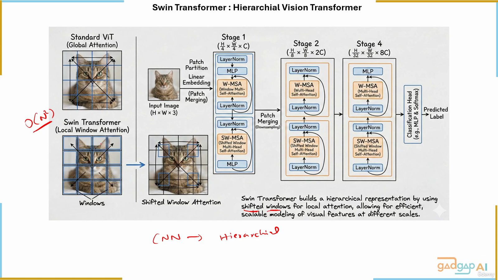

# 第 32 章 ViT 变体：ELA-ViT、HgVT、DeiT 与 Swin

标准 ViT 建立了统一的全局 token 建模框架，但“所有层始终更新、所有 token 两两交互、完全依赖海量数据从头训练”并不是唯一选择。ELA-ViT 从训练动态出发减少稳定层继续更新的成本，HgVT 用超图表达多个图像块之间的高阶关系，DeiT 借助知识蒸馏改善数据效率，Swin 则以局部窗口、移位连接和层级特征图提高可扩展性。四者优化的对象并不相同，不能只用一张精度表判断优劣，而应先辨认它们分别改变了训练、关系结构、监督信号还是注意力范围。

## 四类方法的定位与核心差异

| 方法 | 主要针对的约束 | 核心机制 | 与其他方法的本质区别 |
|---|---|---|---|
| ELA-ViT（Energy Landscape-Aware ViT） | 各层稳定时间不同造成的训练冗余 | 依据层不稳定指数 LII 判断稳定性，冻结或跳过稳定层的后续训练更新 | 重点是训练调度，而不是重新设计 token 注意力 |
| HgVT（Hypergraph Vision Transformer） | 普通两两注意力难以显式表达群组与高阶关系 | 将相关图像块组织为超边，以超图建模集合式语义联系 | 改变关系表示结构，突出复杂场景语义 |
| DeiT（Data-efficient Image Transformer） | ViT 从头训练依赖大规模数据 | 引入蒸馏 token，以 CNN 教师指导学生，并联合分类与蒸馏损失 | 主要改变监督与训练方式，而非限制注意力范围 |
| Swin Transformer | 全局注意力的二次开销及缺少层级特征 | 窗口注意力与移位窗口交替，并构建多尺度层级表示 | 改变注意力作用域和骨干特征组织方式 |

ELA-ViT 与 HgVT 是课程介绍的 2025 年新方法，适合从研究动机理解其潜力，不应把初步展示直接写成已经普遍取代标准 ViT 的结论。DeiT 和 Swin 则分别代表了较成熟的两条改进路线：一条解决“如何更有效地教模型”，另一条解决“如何让视觉骨干随输入规模更高效地工作”。

## ELA-ViT：依据层稳定性安排训练

ELA-ViT 将 Transformer 层视为动态系统，并借助与 Hopfield 网络能量景观相似的观点分析训练过程。其观察重点不是所有编码层同步收敛，而是不同层达到稳定状态的时间可能不同：较早层的权重可能先趋于稳定，较深层仍在继续调整。如果训练流程无视这种差异，对已经稳定的层持续执行完整更新，就会产生可避免的计算。

为描述这种层间差异，方法引入层不稳定指数（Layer Instability Index，LII）。训练时根据 LII 判断某层是否达到稳定条件，再按方法策略冻结该层，或跳过其后续训练更新，把更新资源集中于仍不稳定的部分。其逻辑链条是：

1. 在训练过程中评估各层稳定性，而非预设所有层在同一阶段停止学习；
2. 将满足稳定判据的层从后续更新中排除；
3. 减少相应参数更新与训练计算，继续优化其余层。

这里节省的是**训练过程中的冗余更新**，不能不加区分地等同于减少模型参数、删除网络层或降低每次推理的延迟。LII 的意义在于提供层级训练调度依据；具体稳定性测量与判据应遵循原方法，而不能用任意一次损失下降替代。该思路的价值还在于把优化动态纳入 ViT 设计：效率不只来自更小的网络，也可以来自避免不必要的训练操作。

## HgVT：用超边表达高阶语义关系

标准自注意力以 token 对为基本计算单位。虽然多层注意力能够组合复杂关系，但它并不显式声明“若干图像块共同构成一个语义组”。HgVT 引入超图，就是希望把这类集合式、高阶联系纳入表示结构。普通图的一条边通常连接两个节点，而超边可以同时关联一组节点，因此适合表达多个区域共同形成的语义单元。

在课程给出的直观示例中，可以通过类似聚类的组织方式，把相似或相关的图像块归为组：车辆的不同车轮区域可以形成超边，大片天空区域也可以形成另一超边。关系不再只是“每个图像块与所有图像块等距离地交互”，而是根据图像内容建立有层次的群组联系。对于同时包含多个对象和复杂区域关系的场景，这种结构旨在补充普通两两注意力，增强对群体关系与高阶语义的表达。

HgVT 的目标主要是语义理解，而不是像 ELA-ViT 那样直接压缩训练更新。课程将其潜力联系到复杂场景理解、图像分类与检索，但该方法仍较新，实际采用时需要继续验证其关系构建方式、计算代价和跨任务泛化。还应避免把“超边”误解为简单的图像块拼接：超图强调的是一个关系可以连接集合中的多个节点，其关键在于高阶关联表达。

## DeiT：以蒸馏监督提高数据效率

ViT 的弱归纳偏置使其在大规模预训练后具有良好的扩展性，却也提高了从头训练的门槛。DeiT 的思路不是先发明一种全新的全局注意力，而是改进学生 ViT 获得监督的方式：利用已经训练良好的 CNN 教师，将教师的知识迁移给学生，从而在较常规的数据与训练条件下获得有竞争力的视觉 Transformer。

课程示例中的教师是 **RegNet**，不是 ResNet。RegNet 属于 CNN 架构，与学生的 Transformer 架构不同，这正体现了蒸馏可以跨越模型家族。训练过程包括以下要素：

- 学生除 CLS token 外增加一个**蒸馏 token**，用于承接教师提供的监督；
- 教师对输入图像产生预测，学生也产生自己的类别预测；
- 分类损失约束学生学习真实类别，蒸馏损失约束学生与教师输出之间的关系；
- 总体优化把两类监督结合起来，可概括为 \(\mathcal{L}=\mathcal{L}_{cls}+\mathcal{L}_{distill}\)，具体形式随软蒸馏或硬蒸馏策略而定。

软蒸馏利用教师输出的类别分布，使学生学习不仅是“正确类别是什么”，还包括教师对类别相对可能性的判断；硬蒸馏则使用更离散的教师目标。两者的损失定义不同，但共同目的都是让教师成为额外监督来源，而不是把教师权重直接复制给学生。蒸馏 token 与 CLS token 的职责也应区分：前者面向教师知识迁移，后者面向通常的整图分类表示。

课程对比中，直接在大规模 JFT-300M 上训练与仅在 ImageNet-1K 上训练的 ViT 表现存在明显差距，DeiT 所展示的意义正在于缩小这种数据条件造成的鸿沟。这里“数据高效”指更好地利用训练数据与教师监督，并不自动意味着学生模型在所有任务上都优于 CNN，也不意味着可以省略训练方法和评估条件的说明。

## Swin：移位窗口与层级视觉骨干

Swin 是 **Shifted Windows Transformer** 的缩写。它首先将 token 网格划分为规则、不重叠的局部窗口，例如包含 \(7\times7\) 个 token 的窗口，只在每个窗口内部执行多头自注意力。这样，token 不再在每个 block 中与全图所有 token 直接计算关系，注意力的主要成本由全局两两交互转为各窗口内部交互。

若全图共有 \(N\) 个 token，每个窗口含 \(w\times w\) 个 token，则窗口数为 \(N/w^2\)。一个窗口的注意力开销与其 token 数平方 \(w^4\) 成正比，因此全部窗口合计为 \(O(Nw^2)\)；当窗口大小 \(w\) 固定时，对 \(N\) 呈线性增长。相比标准全局注意力的 \(O(N^2)\)，这为高分辨率输入提供了更可控的扩展方式。这里的线性结论以固定窗口为前提，不能脱离条件泛化为所有 Swin 计算都只有 \(O(N)\)。

单纯窗口隔离会阻断跨区域信息，因此 Swin 交替使用两类 block：常规窗口多头自注意力（W-MSA）之后，使用移位窗口多头自注意力（SW-MSA）。下一层将窗口划分平移约半个窗口，使原先分属不同窗口的相邻 token 进入同一窗口，从而建立跨窗口连接。全局关系通过多层局部与移位交互逐步传播，而不是要求每一层都保留完整的全图注意力矩阵。

与此同时，Swin 按阶段组织层级特征图，空间分辨率逐步降低、表示逐步聚合，例如由 \(H/4\times W/4\) 过渡到 \(H/8\times W/8\) 等尺度。这样的金字塔结构更接近视觉骨干对多尺度特征的需求，使其不仅可用于分类，也便于接入检测和分割等密集预测任务。Swin 因而同时完成了两项调整：窗口控制注意力成本，层级结构提供多尺度表示，移位机制弥补窗口之间的信息隔离。

{ .diagram }

图 32-1：Swin 以局部窗口和移位窗口替代逐层全局注意力，并用 Patch Merging 构建层级特征。课程第 336 课时 00:54 抽帧。

## 将视觉预测接入语言解释流程

课程最后的代码示例把猫图像的 ViT 前 3 项预测及其分数整理为提示文本，再通过已配置的 API 密钥调用 DeepSeek 大语言模型，请其解释为何可能出现这些预测，以及自注意力在图像处理中可能发挥什么作用。其工作流是“视觉模型产生结构化预测—构造包含预测结果的提示—语言模型生成说明”，而不是把语言模型当成新的分类器重新训练。

这种衔接适合生成面向用户的类别说明、整理视觉结果或构建视觉与语言协同的应用原型。但若提示中只包含类别与分数，语言模型获得的就不是原图中的完整证据，其回答只能视为基于输入文本和通用知识的解释，不能当作 ViT 内部决策的因果验证。模型置信度也不等于事实保证；可靠的解释仍应与注意力、特征及输入证据检查结合，并避免在示例代码中暴露真实 API 密钥。

## 本章小结

- ELA-ViT 以 LII 驱动稳定层的冻结或跳过更新，针对的是训练效率，而非直接改变推理结构。
- HgVT 通过超边组织多个图像块的高阶关系，重点是复杂场景语义；其新方法性质要求谨慎评估。
- DeiT 通过 RegNet 等 CNN 教师、蒸馏 token 和复合监督提高数据效率，与注意力结构优化属于不同路线。
- Swin 通过 W-MSA/SW-MSA 和层级特征图兼顾计算扩展性、跨窗口交互与多尺度视觉任务。
- 视觉预测可以接入 DeepSeek 等语言模型生成解释，但文本说明不能替代对视觉模型证据与可靠性的检查。

<!-- course-lectures: 332-337 -->

<!-- ebook-navigation -->

---

[← 上一章](ch31.md) · [返回完整目录](../index.md) · [下一章 →](ch33.md)
