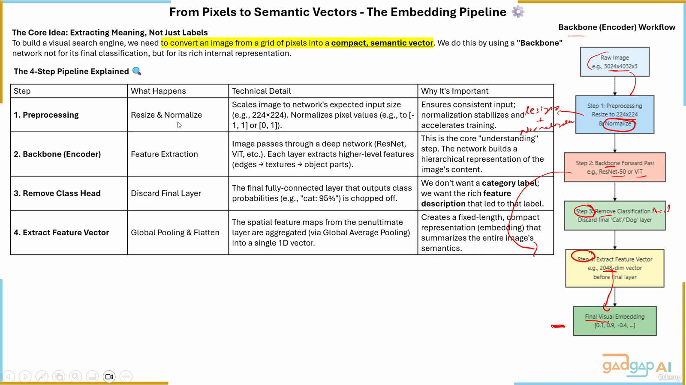

# 第 33 章 视觉嵌入与相似度学习

图像检索的关键，不是让计算机逐像素寻找“看起来一样”的图，而是把图像转换为能够表达语义的向量，并规定何种向量应当靠近、何种向量应当分开。这样的向量称为**视觉嵌入**（visual embedding），其所在空间称为嵌入空间。本章从完整嵌入流水线出发，说明预处理、骨干编码、投影和 L2 归一化各自承担的作用，再以 SimCLR 与三元组损失解释两种塑造嵌入空间的训练方式。前者借助数据增强进行自监督对比学习，后者利用身份关系直接优化样本间距，二者共同构成相似度学习的重要基础。

## 嵌入空间与图像检索闭环

一幅 8 位图像在计算机中只是取值通常为 0～255 的像素矩阵。同一物体改变姿态、光照、观察角度或视觉风格后，像素可能发生大幅变化，语义却没有改变。因此，逐像素比较既脆弱又昂贵。嵌入模型将图像编码为紧凑的一维向量 $\mathbf z\in\mathbb R^d$，希望同一只狗的不同照片彼此接近，而狗与跑车等语义不同的图像彼此远离。这里的“远近”不再由像素差决定，而由向量距离或相似度决定，相当于为主观视觉内容建立一张可计算的语义地图。

围绕嵌入空间，图像搜索形成三个相互衔接的环节：

1. **建立图库索引**：将图库图像逐一送入同一嵌入模型，保存向量及其对应的图像标识。
2. **编码用户查询**：查询可以是一张图像，也可以是一段文本；无论形式如何，都要进入与图库兼容的表示空间。图文查询尤其需要 CLIP 一类的共享嵌入模型。
3. **搜索并返回近邻**：计算查询向量与候选向量的余弦相似度，按得分返回前 $k$ 个结果。图库规模扩大后，再以索引结构减少候选数量。

嵌入解决的是“比较什么”，索引解决的是“怎样快速比较”。检索质量首先取决于表示是否真正反映语义，不能仅靠更换搜索算法弥补嵌入本身的缺陷。

## 从像素到向量的完整流水线

视觉嵌入并不是简单地取走网络最后一层，而是一条有明确输入输出约束的流水线：**尺寸调整与像素归一化 → 骨干编码并去除分类头 → 投影到目标维度 → 嵌入 L2 归一化**。

### 预处理：让输入符合骨干网络要求

原始图像尺寸可以各不相同，而骨干网络要求固定的输入规格。例如，课程示例把原图缩放为 $224\times224$，以适配 ResNet。随后将较宽的像素取值范围映射到较窄区间，如 $[0,1]$ 或 $[-1,1]$。这一预处理有助于控制数值和梯度尺度，使训练更稳定、收敛更顺利。尺寸调整改变的是空间采样，像素归一化改变的是数值尺度；两者都不能替代之后的嵌入归一化。

### 骨干编码：保留特征，移除分类职责

CNN 可采用 ResNet、VGG、EfficientNet，也可采用 Vision Transformer（ViT）。检索需要的是分类头之前的通用特征，因此应移除最终分类层，并将骨干输出整理成一维特征向量。ResNet-50 在示例中输出 2048 维特征，ViT-Base 则输出 768 维特征。

| 骨干选择 | 表示特点 | 适用侧重 |
|---|---|---|
| CNN | 擅长提取局部纹理与模式，计算需求相对较低 | 局部外观重要、算力受限的特征提取 |
| ViT | 通过全局关系建模理解整体场景 | 需要场景级上下文的检索任务 |

更高维度通常意味着更大的表示容量，也会增加存储和后续计算成本，并不自动保证检索效果更好。维度与骨干都应结合任务语义、数据规模和资源预算选择。

### 投影头：形成适合检索的嵌入维度

骨干特征往往仍需降维。一个小型多层感知机（MLP）可将 2048 维特征投影为 512 维嵌入。课程示例采用两层全连接结构：先由 2048 维映射到 1024 维，经 ReLU 激活，再映射到 512 维。中间激活也可以使用 GELU；课程示例选择 ReLU，并不表示所有投影头都必须采用同一种配置。与单层直接映射相比，多层结构引入更多非线性变换，但具体层数仍属于模型设计选择，而非固定规则。投影不仅压缩向量，也为相似度学习提供可训练的表示变换。

## L2 归一化与余弦相似度

投影后的向量还需进行 **L2 归一化**。对非零向量 $\mathbf z$，有

$$
\hat{\mathbf z}=\frac{\mathbf z}{\|\mathbf z\|_2},
\qquad
\|\mathbf z\|_2=\sqrt{\sum_{r=1}^{d}z_r^2},
\qquad
\|\hat{\mathbf z}\|_2=1.
$$

例如，向量 $(3,4)$ 的模长为 5，归一化后成为 $(3/5,4/5)$。方向保持不变，长度变为 1；同样规则适用于数百维嵌入。这里的对象是整个特征向量，与预处理阶段逐像素缩放取值范围是两种不同操作。

两个向量的余弦相似度定义为

$$
\cos\theta=\frac{\mathbf a\cdot\mathbf b}{\|\mathbf a\|_2\|\mathbf b\|_2}.
$$

当二者已经 L2 归一化时，分母为 1，因此

$$
\operatorname{sim}(\hat{\mathbf a},\hat{\mathbf b})
=\hat{\mathbf a}^{\mathsf T}\hat{\mathbf b}.
$$

这便把相似度计算化为点积或矩阵乘法：同向时为 1，正交时为 0，反向时为 $-1$。归一化消除了向量模长对分数的影响，使比较专注于方向。对单位向量还有 $\|\hat{\mathbf a}-\hat{\mathbf b}\|_2^2=2-2\operatorname{sim}(\hat{\mathbf a},\hat{\mathbf b})$，所以余弦相似度排序与对应欧氏距离排序一致。

课程的 CIFAR-10 示例取 1100 张图像，其中前 1000 张构成图库，后 100 张作为查询集；ResNet-50 去掉分类头后输出 2048 维特征，再经“1024 维—ReLU—512 维”的投影头和 L2 归一化生成嵌入。其核心流程可压缩为以下伪代码：

```text
f = backbone_without_classifier(x)  # ResNet-50：2048 维
h = relu(fc_1024(f))
z = fc_512(h)                       # 目标嵌入：512 维
z = z / l2_norm(z)
scores = z_query @ z_gallery.T      # 单位向量点积即余弦相似度
```

`z_gallery` 的每一行对应一张图库图像，得分排序后即可取得近邻。实际实现必须保证图库与查询经过完全一致的预处理和嵌入变换。

{ .diagram }
<p class="figure-caption">图 33-1：从尺寸调整、像素归一化到骨干编码、移除分类头与视觉向量提取；投影及 L2 归一化接在同一流水线之后。课程第 341 课时 03:12 抽帧。</p>

## SimCLR：用增强视图构造监督信号

骨干网络给出的通用特征并不天然就是理想的检索嵌入。SimCLR 通过同一图像的不同增强视图定义语义不变性：从锚图像出发，分别施加两组增强，例如裁剪、颜色扰动，或翻转、灰度化；两个视图经编码器和投影头得到 $\mathbf z_i$ 与 $\mathbf z_j$，构成正样本对，批内其他样本则充当负样本。模型要学会在表观变化下保持身份与语义一致，同时区分不同图像。

这一过程不需要人工类别标签，监督信号来自“两个视图源自同一图像”这一事实，因而属于自监督学习。其 NT-Xent（归一化温度缩放交叉熵）损失可写为

$$
\ell_{i,j}=-\log
\frac{\exp(\operatorname{sim}(\mathbf z_i,\mathbf z_j)/\tau)}
{\sum_{k=1}^{2N}\mathbf 1_{[k\ne i]}
\exp(\operatorname{sim}(\mathbf z_i,\mathbf z_k)/\tau)},
$$

其中 $\tau$ 是温度参数，控制相似度分布的锐化程度。最小化该损失会提高正样本对在全部候选中的相对得分，而不是无差别地让所有向量靠近。增强必须保留任务所需语义：若检索依赖颜色，过强的灰度化或颜色扰动反而可能破坏有效监督。课程指出，SimCLR 训练的 ResNet-50 在 ImageNet 上的 Top-1 准确率可达到约 70%，用来说明自监督表示的竞争力；该数值对应特定训练设置，不是任意数据与实现的性能保证。SimCLR 与 CLIP 都使用对比思想，但前者的正样本对来自图像增强，后者的正样本对来自相互匹配的图像与文本，不能把两者视为同一种数据组织方式。

## 三元组损失：以身份关系约束样本间距

三元组损失直接比较三个嵌入：锚样本 $a$、与锚同身份的正样本 $p$，以及不同身份的负样本 $n$。以 $d$ 表示嵌入距离，其目标是

$$
d(a,p)+\alpha\le d(a,n),
$$

对应损失为

$$
L=\max\bigl(d(a,p)-d(a,n)+\alpha,0\bigr).
$$

边界 $\alpha$ 要求正负距离之间不仅大小正确，还要留有安全间隔。条件满足时损失为 0；否则损失推动锚与正样本靠近、锚与负样本分开。人脸识别中，正样本可以是同一人的另一张照片，负样本来自另一人，因此需要同身份或异身份关系标注，这与 SimCLR 的无人工标签训练不同。

| 三元组类型 | 距离关系 | 训练价值 |
|---|---|---|
| 简单三元组 | $d(a,n)\ge d(a,p)+\alpha$ | 损失已为 0，几乎不提供新梯度 |
| 半难三元组 | $d(a,p)<d(a,n)<d(a,p)+\alpha$ | 顺序正确但未满足边界，仍有学习信号 |
| 困难三元组 | $d(a,n)\le d(a,p)$ | 负样本过近，能纠正错误邻域，也更难优化 |

因此，三元组**挖掘**是训练核心。随机挑选过于容易的负样本会浪费计算，始终挑选最困难样本又可能使训练不稳。有效方法通常要在信息量和稳定性之间取舍。三元组损失适用于人脸验证、照片整理、签名核验、商品相似度与细粒度检索；它优化的是相对距离结构，最终仍需配合统一的向量比较与阈值策略。

## 本章小结

- 视觉嵌入把像素转换为语义向量，使相似内容在嵌入空间中靠近，并为图库索引、查询编码和近邻返回提供统一表示。
- 完整流水线包含输入缩放与像素归一化、去除分类头的骨干编码、MLP 投影以及嵌入 L2 归一化，各步骤不可相互替代。
- 单位向量的余弦相似度可简化为点积，从而用高效矩阵运算完成批量相似度计算。
- SimCLR 利用增强正样本对和批内负样本进行自监督学习；三元组损失利用身份关系与边界约束优化距离，并依赖有效的三元组挖掘。

<!-- course-lectures: 338-348 -->

<!-- ebook-navigation -->

---

[← 上一章](ch32.md) · [返回完整目录](../index.md) · [下一章 →](ch34.md)
