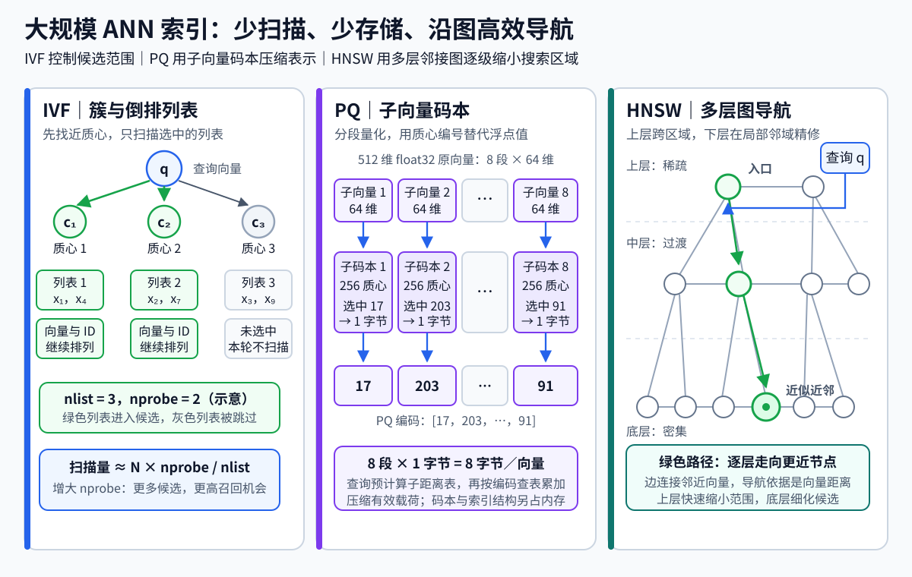

# 第 34 章 大规模图像检索：FAISS、IVF、PQ 与 HNSW

当图库从数百张扩展到数十亿张时，即使每次向量比较都很廉价，逐一扫描全部嵌入也会成为系统瓶颈。大规模检索需要在结果完整性、响应延迟、内存占用和索引维护之间作出选择。本章以 FAISS 所提供的索引能力为线索，比较精确检索与近似最近邻检索，并剖析三种核心机制：IVF 用倒排列表缩小候选范围，PQ 用分段量化压缩向量，HNSW 用多层图引导搜索。它们可以独立使用，也可以组合，从而分别解决“少扫描”“少存储”和“高效导航”的问题。

## 从全量精确检索到近似最近邻

**精确最近邻检索**会把查询向量与图库中的每个向量比较，再按距离或相似度排序。若图库含 $N$ 个 $d$ 维向量，一次查询需要 $O(Nd)$ 量级的相似度计算，并通常需要让所有原始向量可访问。只要距离计算和排序正确，它就能返回所选度量下的真实最近邻，因此常作为评估近似算法的基准。

**近似最近邻检索**（ANN，approximate nearest neighbor）不再检查所有候选项，允许少量真正的近邻被漏掉，以换取更低延迟和更少内存开销。所谓“近似”不是随意返回相似图片，而是通过可调的搜索范围、量化精度或图遍历预算，主动控制召回率与成本。其合理性来自生产场景的不对称性：全量扫描可能耗时数秒甚至更久，而交互式搜索往往要求毫秒级响应；少量召回损失若能换来数量级的效率提升，就具有工程价值。

| 维度 | 精确检索 | 近似检索 |
|---|---|---|
| 候选范围 | 全部图库向量 | 由索引筛出的部分候选或近似距离 |
| 最近邻保证 | 可得到度量意义下的真实前 $k$ 项 | 可能漏掉部分真实近邻 |
| 主要成本 | 比较次数随图库规模线性增长 | 建索引与训练成本较高，在线扫描减少 |
| 适合场景 | 数据量较小、资源充足，或必须建立精确基准 | 大规模、低延迟、内存受限的在线检索 |

在小规模示例中，可先对查询和图库嵌入计算余弦相似度，再取前 $k$ 项。课程的 CIFAR-10 示例使用 scikit-learn 的 `cosine_similarity`，定义 `search_similar_images` 一类的函数接收查询嵌入和图库嵌入，示例返回前 5 项，并将结果与相似度分数一起显示。狗、飞机和汽车查询展示了图像到图像搜索的基本闭环，但这种全量比较方式不能直接外推到十亿级图库。

**FAISS**（Facebook AI Similarity Search）是开源的相似度搜索库，为精确索引和多种 ANN 索引提供统一实现。它并不改善嵌入语义，而是把已学好的向量组织成适合搜索的数据结构，是表示模型与实时应用之间的工程桥梁。

## IVF：用倒排列表限制搜索范围

**倒排文件索引**（IVF，inverted file index）首先用 K-means 对训练向量聚类，得到 `nlist` 个质心。每个质心对应一个倒排列表，列表保存分配到该簇的向量及其标识。建库时，每个向量进入最近质心对应的列表；查询时，先寻找离查询最近的若干质心，只扫描被选中的列表，而不遍历整个图库。

查询检查的簇数由 **`nprobe`** 控制：

- `nprobe = 1` 时只检查最近的一个簇，速度快，但容易漏掉簇边界另一侧的近邻。
- 增大 `nprobe` 会覆盖更多相邻簇，提高召回机会，同时增加候选数量与延迟。
- `nprobe = nlist` 时所有倒排列表都进入候选扫描，就候选范围而言退化为全量检索。

假设各簇大小近似均衡，仅估计簇内向量扫描量，则每次查询约需比较

$$
O\!\left(N\frac{\texttt{nprobe}}{\texttt{nlist}}\right)
$$

个数据库向量，此外还需支付粗粒度质心搜索的成本。这个式子揭示的是近似量级，而不是对任意数据分布都成立的固定加速比；簇严重不均衡时，实际开销会偏离该估计。

FAISS 中，`IndexIVFFlat` 体现了“粗量化器 + 维度 + `nlist`”的建索引思路，之后需要训练、添加向量，再设置 `nprobe` 并对查询向量执行前 $k$ 搜索。这里的 `Flat` 表示倒排列表中仍保存原始向量，因此不能把 IVF 误解为只存质心编号便无需保存数据库向量。IVF 的主要代价是 K-means 训练与索引构建，以及数据分布变化后的维护：新数据不断加入或语义分布漂移时，旧质心和旧分区可能不再合适，需要更新索引。它特别适合分区可复用、图库相对稳定的场景。

## PQ：把浮点向量变成紧凑编码

**乘积量化**（PQ，product quantization）主要解决内存和距离计算成本，而不是像 IVF 那样先按簇排除候选。它将一个 $d$ 维向量切成 $m$ 个子向量，在每个子空间分别训练码本，再用最近质心的编号替代原子向量。

课程的示例将 512 维向量分为 8 段，每段 64 维；每个子空间的码本含 256 个质心。由于 $256=2^8$，每段编号只需 1 字节，整个向量最终由 8 个质心编号表示：

| 表示 | 单个向量的理论有效载荷 |
|---|---:|
| 512 维 float32 原向量 | $512\times4=2048$ 字节 |
| 8 段、每段 256 质心的 PQ 编码 | $8\times1=8$ 字节 |

仅比较这两部分，压缩比为 $2048/8=256$ 倍。实际系统还要保存码本、向量标识及其他索引结构，因此总内存收益不能直接等同于这一理想数字。PQ 也不是把 512 维转换成普通的 8 维实向量；8 个编码分别索引不同子空间的 64 维质心，只有结合码本才能近似重建原向量。

查询时可采用非对称距离计算：数据库侧保存压缩编码，查询向量保持未量化。将查询 $\mathbf q$ 同样切成 $m$ 段，对第 $j$ 段预先计算它到该子码本所有质心的距离，形成查找表 $D_j$。若数据库向量第 $j$ 段的编码为 $c_j(\mathbf x)$，近似距离可写为

$$
\widetilde d(\mathbf q,\mathbf x)
=\sum_{j=1}^{m}D_j[c_j(\mathbf x)].
$$

这样，对每个数据库向量的高维距离计算被若干次查表与累加代替。码本训练需要额外成本，质心逼近还会产生量化误差；分段过少或压缩过于激进，通常会进一步损害检索精度。IVF 与 PQ 因而具有很强的互补性：**IVF-PQ** 先以倒排分区减少候选，再以 PQ 编码压缩候选向量，适合大规模且内存受限的图库。

## HNSW：在多层邻接图中逐级导航

**分层可导航小世界图**（HNSW，hierarchical navigable small world）把向量组织为图，而不是聚类分区。节点对应数据库向量，边连接邻近节点；底层保留密集节点，上层逐渐稀疏，用于快速跨越较大范围。查询从顶层入口开始，移动到当前更近的节点，再逐层下降，在更密集的邻接关系中细化搜索，最后返回近邻。

这种导航方式避免了从任意位置对全库进行扫描。课程用猫、黑狗与金毛犬的逐层路径说明其思想：上层先缩小到较相关的区域，下层再在局部邻域找到目标。这里的示例只用于解释遍历，并不意味着 HNSW 按“动物”类别建图；真正引导移动的是向量距离及图连接。HNSW 通常以高召回和低查询延迟见长，但需要保存图结构，并为建图与搜索投入相应资源。高召回是设计目标，不是脱离参数和数据集也始终成立的固定百分比。

{ .diagram }

图 34-1：IVF 只探测部分簇列表，PQ 用各子空间的质心编号压缩向量，HNSW 从稀疏上层沿图导航到密集底层，分别减少候选、降低存储并加速搜索。根据课程内容整理。

## 索引选择与检索质量评估

索引选择不能只看算法名称，应同时考察图库规模、更新频率、内存预算、延迟目标与可接受的召回损失。

| 方案 | 核心机制 | 主要优势 | 主要代价与适用侧重 |
|---|---|---|---|
| 精确全量索引 | 扫描全部原向量 | 结果可作为最近邻基准，无需训练聚类或码本 | 大图库下延迟和内存访问压力大；适合小规模或基准评估 |
| IVF | 质心分区，只探测部分倒排列表 | 候选范围可控，扩展性好 | 需要训练与维护，边界近邻可能漏检；适合较稳定图库 |
| PQ / IVF-PQ | 子向量量化，查表估算距离 | 显著压缩向量，适合内存内大规模搜索 | 有码本训练与量化误差；适合内存紧张场景，常与 IVF 组合 |
| HNSW | 多层图从上到下导航 | 通常兼顾低延迟与较高召回 | 图结构与构建有额外成本；适合重视召回和响应速度的场景 |

评估时应固定同一组查询与相关性标注，比较各索引的延迟、内存和 **Precision@k、Recall@k**：

$$
\operatorname{Precision@k}=\frac{\text{前 }k\text{ 个结果中的相关项数}}{k},
\qquad
\operatorname{Recall@k}=\frac{\text{前 }k\text{ 个结果中的相关项数}}{\text{该查询的全部相关项数}}.
$$

精确率关注返回结果有多少正确，召回率关注应找结果有多少被找回。增大 $k$ 时，召回率通常提高，而精确率往往下降，但精确率并非数学上必然单调变化，仍应以实测曲线为准。ANN 的召回评估还应以精确最近邻结果为参照，区分“嵌入没有找到语义相关图”和“索引漏掉了真实近邻”这两类误差。

课程另用 t-SNE 将 500 个样本的 512 维嵌入投影到二维，并按类别着色观察聚类结构。PCA 也能降维，而 t-SNE 更侧重展示局部邻域。该可视化有助于检查语义分布，却不能代替原空间中的检索评估，更不能把二维投影当作十亿级索引本身。

## 本章小结

- 精确检索通过全量比较获得真实最近邻；ANN 以可控召回损失换取速度和内存效率，选择依据是业务约束而非单纯追求近似程度。
- IVF 通过 `nlist` 个分区和 `nprobe` 个探测簇控制候选范围，在召回与延迟之间提供直接调节手段。
- PQ 将子向量替换为码本质心编号，并用查表累加估算距离；IVF-PQ 同时利用候选剪枝和向量压缩。
- HNSW 以多层邻接图从稀疏上层导航到密集底层，适合重视低延迟与高召回的检索任务。
- 索引评估应联合考察 Precision@k、Recall@k、延迟、内存和维护成本，二维可视化只能辅助理解嵌入结构。

<!-- course-lectures: 349-355 -->

<!-- ebook-navigation -->

---

[← 上一章](ch33.md) · [返回完整目录](../index.md) · [下一章 →](ch35.md)
