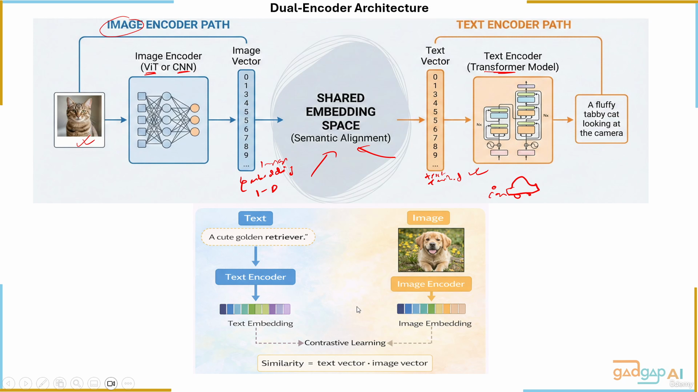

# 第 35 章 CLIP、多模态搜索与视觉嵌入应用

视觉嵌入把图像、身份与语义转化为可计算的向量关系，使检索不再局限于文件名或人工标签。本章将前述嵌入学习和索引技术放入三类应用中：反向图像搜索以图找图，人脸识别与 ArcFace 强调身份边界，CLIP 则通过图像编码器和文本编码器建立共享空间，使文字与视觉内容能够直接比较。三类应用共享“编码—比较—返回”的基本结构，但监督信号、输出含义和结果解释并不相同。

## 反向图像搜索：从查询照片到相似图库内容

**反向图像搜索**以图像而不是关键词作为查询。用户上传照片后，系统用与建库阶段一致的嵌入模型生成查询向量，在已建立的 FAISS 等索引中寻找近邻，再按相似度返回前 $k$ 个图库结果。完整数据流可以概括为：

1. **离线图库准备**：完成图像预处理、嵌入提取和向量索引，并保留向量到原图及元数据的映射。
2. **在线查询编码**：对用户图片执行同样的预处理与嵌入变换，避免训练或建库与查询分布不一致。
3. **近邻检索与展示**：采用精确或近似索引获得候选，按相似度排序，返回图像及必要说明。

在电商中，用户可以用商品照片寻找相似款式，减少为商品外观寻找准确文字描述的负担。Pinterest Lens、Amazon StyleSnap 和 Google Lens 都体现了这种交互方式。更准确的匹配有助于改善转化、用户参与和商品发现，也能让文字描述缺失或不完整的商品获得曝光；当用户更容易找到真正需要的商品时，退货也有望减少。这些属于应用价值，而不是仅凭一次相似度分数就能保证的业务结果。

同一技术还可用于内容验证与版权检查，通过匹配已知图像发现相关副本；在医学影像中检索具有相似特征的历史扫描，为专业人员提供对照；在旅游场景中，根据游客照片检索地标。不同任务对“相似”的定义不同：商品款式接近、同一身份、同一作品的不同副本并非同一概念，嵌入模型和结果阈值必须与目标匹配。反向搜索返回的是**相似候选**，不能天然证明两张图片完全同源，也不能把视觉近邻直接当作医学诊断或版权结论。

## 人脸识别与 ArcFace 的角度边界

人脸应用至少包含两种相关但不同的任务。**人脸验证**判断查询人脸与指定身份是否为同一人，常用于手机解锁、门禁和数字身份核验；**人脸检索或照片标记**则在已知人脸库中寻找身份候选，或把跨时间的同人照片组织起来。两者都依赖高质量人脸嵌入：同一人受姿态、年龄和光照影响后仍应聚集，不同人即使外观接近也应保持间隔。

普通 softmax 分类主要学习把训练身份分开，其分类得分不必然形成适合开放集合检索的人脸空间。三元组损失通过锚、正样本和负样本之间的相对距离及边界 $\alpha$ 改善这一问题。ArcFace 则把边界思想引入角度分类目标，在归一化特征与类别方向构成的角度上加入**加性角度边界** $m$。对正确类别的角度 $\theta_y$，其关键变换可表示为

$$
\cos\theta_y\quad\longrightarrow\quad\cos(\theta_y+m).
$$

在相同角度范围内，加入 $m$ 会压低正确类别对应的目标 logit，使训练必须让样本更靠近本类方向，才能保持原有的分类置信度。由此形成更紧凑的类内分布和更清晰的类间角度间隔，增强对细微人脸差异的辨别能力。

| 方法 | 主要约束 | 对嵌入空间的作用 |
|---|---|---|
| Softmax 分类 | 正确类别得分超过其他类别 | 侧重训练集身份分类，不显式控制检索边界 |
| Triplet Loss | $d(a,p)+\alpha\le d(a,n)$ | 直接拉开正负样本距离，效果依赖三元组挖掘 |
| ArcFace | 正确类别角度加入边界 $m$ | 强化类内紧凑与类间角度分离，适合人脸表示学习 |

训练完成后，人脸识别仍可使用余弦相似度：同一人的向量通常更相近，不同人的相似度应低于相应判定阈值。训练时的角度边界与部署时的判定阈值不是同一参数，不应混用。手机安全解锁、金融机构数字身份等场景还需要在独立数据上评估误接受与误拒绝，而不能只报告图库检索命中率。

## CLIP 双编码器与共享语义空间

**CLIP**（Contrastive Language-Image Pre-training，对比语言—图像预训练）扩展了视觉检索的查询方式。它使用两个编码器：图像侧可采用 ViT 或 CNN，将图片转换为一维图像嵌入；文本侧采用 Transformer，将描述转换为一维文本嵌入。两种表示被映射到同一嵌入空间，使“汽车”这段文字与汽车图片能够靠近，而不再依赖人工把每个查询词映射到固定图像类别。

训练数据以相互匹配的图像—文本对为单位。对批内正确配对，模型提高图像嵌入与文本嵌入的相似度；对不匹配的组合，则降低相似度。例如，红色跑车图片应靠近“红色跑车”的描述、远离“雨夜”的描述；雨夜街景则应呈现相反关系。若两侧向量均归一化，跨模态匹配同样可由余弦相似度或点积完成：

$$
s(I,T)=\hat{\mathbf z}_{I}^{\mathsf T}\hat{\mathbf z}_{T}.
$$

这与 SimCLR 的对比目标有共同的“正样本靠近、负样本远离”思想，但两者不能混为一谈：

| 对比方式 | 正样本对来源 | 编码器与空间 | 直接获得的能力 |
|---|---|---|---|
| SimCLR | 同一图像的两种增强视图 | 图像编码器与视觉嵌入空间 | 对表观变化更稳健的视觉表示 |
| CLIP | 相互匹配的图像与文本 | 图像、文本双编码器与共享空间 | 跨模态比较、检索和零样本分类 |

共享空间是 CLIP 的核心，而不是把文字简单附加到图像文件名上。图库图像可提前编码并建立索引，在线阶段只需编码文本查询；反向的图像到文本检索则预先准备文本候选，再比较图像查询与文本向量。

{ .diagram }

图 35-1：图像编码器与文本编码器分别产生向量，并映射到共享语义嵌入空间，使图文表示可以直接比较。课程第 358 课时 01:13 抽帧。

## 多模态搜索的三类应用与实现边界

CLIP 的共享空间支持文本到图像、图像到文本和零样本分类三类典型应用。它们使用相同的相似度机制，但候选集合和输出解释不同。

| 应用 | 查询与候选 | 输出含义 |
|---|---|---|
| 文本到图像检索 | 文本查询，对图库图像向量排序 | 与描述最相符的已有图片，例如“日出时宁静的湖，数字艺术风格” |
| 图像到文本检索 | 图像查询，对标题或描述候选排序 | 最匹配的已有文本，可辅助图片标注与描述检索 |
| 零样本分类 | 图像查询，对各类别的文本提示排序 | 不针对新任务重新训练分类头，直接选择最匹配类别 |

这里的“文本到图像”首先指**检索**，不是扩散模型式图像生成；“图像到文本”也可以由候选描述匹配实现，不应自动理解为任意开放式 caption 生成。零样本分类则把类别名称或提示文本当作候选，在共享空间中比较图像与文本，不要求为该分类任务额外训练一个固定类别的输出层，也不意味着模型从未接触任何相关视觉或语言知识。

课程代码示例的最后部分将精确率、召回率等指标作为参数放入提示，交给 DeepSeek 解读检索表现；同时把能取回图像的函数作为工具提供给大语言模型，并引入记忆，展示检索工具与智能体结合的基本形态。语言模型可以组织查询、调用工具和解释结果，但指标本身仍来自检索评估，不能用自然语言解读替代实测。

示例还编写了一个**模拟**文本到图像搜索的函数：输入“显示飞机”“寻找鸟类图片”等文本，从 CIFAR-10 图库取回相应类别图像。这一演示用于说明输入为文本、输出为图像的跨模态交互，并不是完整训练或部署 CLIP 的证据。真正的 CLIP 检索应以文本编码器生成查询向量，再与图库图像向量计算共享空间相似度，而非仅靠预定义类别名做关键词分派。明确这一边界，才能从类别过滤示例正确过渡到可泛化的多模态系统。

## 本章小结

- 反向图像搜索通过一致的查询嵌入、图库索引和前 $k$ 近邻返回相似内容，可用于商品发现、内容核验、医学对照与地标识别，但相似结果不等于事实结论。
- ArcFace 在角度分类目标中加入加性边界，强化人脸类内紧凑和类间分离；部署时仍以人脸嵌入及相似度阈值完成验证或检索。
- CLIP 用图像与文本双编码器建立共享空间，通过匹配对和非匹配对的对比学习实现跨模态相似度计算。
- 文本到图像、图像到文本和零样本分类共享同一比较机制，但分别对应图像候选、文本候选和类别提示候选；模拟检索流程不能替代真实双编码器推理。

<!-- course-lectures: 356-360 -->

<!-- ebook-navigation -->

---

[← 上一章](ch34.md) · [返回完整目录](../index.md)
